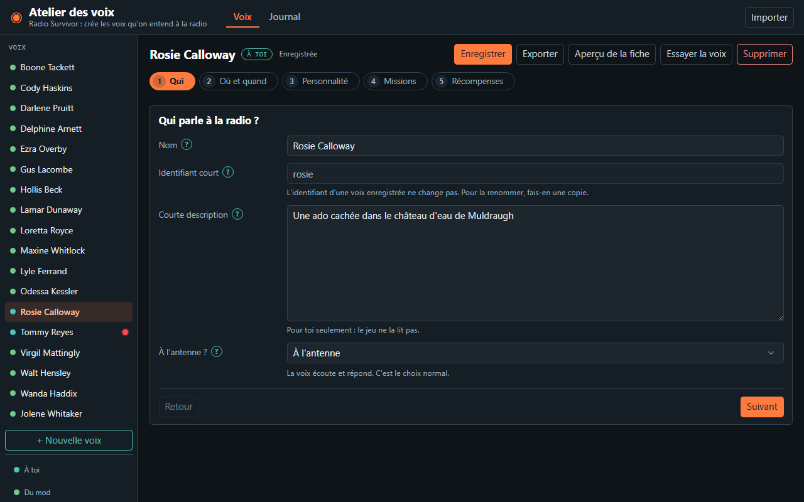

# Radio Survivor

[English](README.md)

**Des voix à la radio et des survivants bien vivants dans le comté de Knox.**
Mods pour Project Zomboid **Build 42.21**, solo et multijoueur (serveur dédié compris).
Un objet Workshop, **trois mods** : Radio Survivor (`batman_RadioSurvivor`, 0.3.0), Living Knox (`batman_LivingKnox`,
0.1.0) et leur socle commun (`batman_CoreAI`, 0.1.0). Version de test.

Knox County, juillet 1993. La zone est bouclée, les survivants sont seuls. Ces mods leur donnent ce que le jeu de
base n'a pas : **des voix de l'autre côté de la radio**, jouées par une intelligence artificielle, et **d'autres
survivants en chair et en os**, des groupes de PNJ qui vivent leur vie dans le comté. Un carnet de terrain sert à les
rencontrer, à gagner leur confiance et à accepter leurs missions.

> **Le pont d'IA.** Les dialogues sont écrits par un modèle de langage (LLM). Le jeu ne peut pas l'appeler lui-même :
> un petit programme Python, **le pont**, fait l'intermédiaire et doit tourner sur la machine qui exécute la partie
> (votre PC en solo, la machine du serveur en multijoueur). Sans pont, le jeu reste jouable mais les voix et les PNJ se
> taisent. Tout est expliqué dans [Le pont d'IA](#le-pont-dia).

## Sommaire

- [Les trois mods](#les-trois-mods)
- [Fonctionnalités](#fonctionnalités)
- [Prérequis](#prérequis)
- [Installation des mods](#installation-des-mods)
- [Le pont d'IA](#le-pont-dia)
- [Configuration](#configuration)
- [Jouer](#jouer)
- [Dépannage](#dépannage)
- [État du projet](#état-du-projet)
- [Développement](#développement)

## Les trois mods

Abonnez-vous une fois, puis cochez dans la liste **Mods** ce que vous voulez jouer : Radio Survivor, Living Knox, ou
les deux. Chacun fonctionne sans l'autre.

| Mod | Mod ID | Ce qu'il apporte | Demande |
|---|---|---|---|
| Radio Survivor | `batman_RadioSurvivor` | La radio : des voix d'IA sur de vraies fréquences (six personnages et un marchand par ville), l'onglet Radio du carnet, les factions | Core AI, Belt Walkie-Talkie, Signal Smoke |
| Living Knox | `batman_LivingKnox` | Des groupes de survivants PNJ : foyers, besoins, routines, combats, fortifications ; leurs relations et accords, l'onglet Équipe du carnet | Core AI. Incompatible avec Bandits! et Project A-Life |
| Core AI | `batman_CoreAI` | Ce que les deux partagent : lien avec le pont d'IA, carnet entier (fenêtre, onglets Contacts, Missions et Réputation, vues des missions, zones sur la carte), moteur des missions, identité des personnages, historique des échanges, réputation, contacts, équipes, petits outils | Signal Smoke |

- **Le Core** est exigé par les deux autres : le jeu l'active pour vous. Activé seul, il n'apporte rien de jouable.
- **Radio Survivor seul** : voix, radio, le carnet avec son onglet Radio ; pas de groupes de PNJ.
- **Living Knox seul** : groupes de PNJ avec le carnet complet (contacts, missions, réputation, équipe). Vous parlez à
  un PNJ avec **Ctrl+G** et le carnet, dans le chat local (`/say`) quand vous êtes près de lui (une phrase dite sans PNJ
  sélectionné va au plus proche à 8 cases), ou par le menu du clic droit **Parler** ; il répond dans une bulle. Ses
  missions se livrent et se réclament depuis le carnet ; les relations et les accords avec les groupes viennent avec
  Living Knox.
- **Les deux** : tout ce qui précède, dans le même carnet.
- **Le pont d'IA** est un seul programme, sans réglage qui dépende du choix des mods.

## Fonctionnalités

### La radio (Radio Survivor)

- **Seize voix**, chacune sur sa propre fréquence, tirée au hasard à chaque partie : Walt, le confident sorti de la
  zone ; Darlene, infirmière cachée à West Point ; Cody, déserteur de la Garde nationale ; les Whitaker, famille
  assiégée ; le Night Owl, station pirate ; et un marchand dans chaque ville vanilla, dont Gus, passeur de l'Ohio à
  Riverside. Chacune a son caractère, ses horaires et la radio qu'il faut pour la joindre.
- **On les trouve en fouillant** : des notes du butin (page de journal, fiche de patient, avis de recherche, prospectus…)
  donnent les fréquences de la partie. Aucune liste n'est envoyée aux joueurs.
- **On leur parle avec n'importe quelle radio émettrice** : talkie en main ou sur le dos, radio de radioamateur posée,
  autoradio d'un véhicule. Une section **Émettre** s'ajoute à la fenêtre radio du jeu.
- **Elles agissent**, mais seul le serveur décide : repère sur votre carte, quartier révélé, mission de
  reconnaissance (Darlene, Cody), troc avec le passeur. L'IA propose dans une liste fermée, le serveur vérifie.
- **Parler fait du bien** : chaque réponse d'un survivant à votre personnage par radio apaise un peu l'ennui et la
  tristesse ; entendre deux survivants discuter apaise un peu l'ennui (quelques fois par heure de jeu au plus).
- **Appels spontanés**, **bulletin du soir** de la station pirate (faits du serveur, mémorial des morts du jour) et
  **dernières pages** : à la mort d'un personnage, son journal manuscrit est écrit et laissé sur le corps.
- **Survivants à secourir** : une famille appelle à l'aide depuis un vrai bâtiment, avec des indices ; secourue à temps
  elle laisse une cache, sinon on trouve la scène.
- **Un marchand par ville** : troc négocié à la radio, échange sans contact une fois tous les joueurs hors de vue.
  Riverside, West Point, Brandenburg et Louisville ont un passeur qui vient en bateau la nuit ; Muldraugh, March Ridge,
  Irvington et Echo Creek un marchand qui arrive en voiture au bord de la route ; à Rosewood, Ekron et Fallas Lake on
  laisse le paiement dans un conteneur et la marchandise y apparaît plus tard.
- **Des planques crédibles** : une voix ne récupère ce que vous avez déposé qu'une fois l'endroit hors de vue de tous et
  quelques heures de jeu plus tard ; une mission peut proposer plusieurs planques, et la récompense est tirée au hasard
  parmi ce que la voix peut donner.
- **Des missions qui racontent** : reconnaissance, livraison par catégorie d'objets, nettoyage, barricadage, relais
  radio, itinéraire, guet, objet personnel ; certaines missions s'enchaînent, et Darlene peut retourner à sa clinique.
- **Les voix se souviennent de vous, pour toujours** : chaque voix garde ce qu'elle a appris de chaque appelant
  (jusqu'à 2 000 caractères par personnage) et sait encore qui est mort, si quelqu'un lui en parle.

### L'atelier des voix (Radio Survivor)

Créez vos propres voix radio sans écrire de fichier : double-cliquez sur `bridge/atelier.bat` (`atelier.sh` sous
Linux, `atelier.command` sous macOS) et une page s'ouvre dans votre navigateur. Cinq étapes (qui, où et quand,
personnalité, missions, récompenses), des lieux relevés en jeu d'un clic droit, le stock d'un marchand choisi par nom
d'objet, une note manuscrite et un appel spontané écrits dans la voix elle-même. L'IA du pont peut écrire la
personnalité et fait essayer la voix avant d'enregistrer ; le jeu l'entend en moins de 30 secondes, signale une ligne
refusée, et un journal en direct montre ce que les joueurs disent aux voix. Exporter et Importer partagent une voix.
Guide : [Atelier des voix](docs/wiki/fr/13-atelier-des-voix.md).



### Le carnet et les PNJ

Le carnet vient avec l'un ou l'autre mod ; l'onglet Radio demande Radio Survivor, les PNJ demandent Living Knox. Voir [Les trois mods](#les-trois-mods).

- **Carnet de terrain** (bouton **Carnet** de la barre latérale) : contacts, onglet Radio (historique par fréquence, avec qui y parle et ses heures d'écoute dès le premier contact ou la note lue),
  missions, réputation, notes.
- **Parler à un PNJ** : s'en approcher, **Ctrl+G** (touche « Choisir le PNJ le plus proche ») pour le sélectionner,
  puis parler sur la ligne **Dire** du carnet ou dans le chat local (`/say`) ; une phrase du chat sans PNJ sélectionné
  va au plus proche à 8 cases, ou à personne. Le menu du clic droit **Parler** marche aussi. Il répond en bulles et se
  souvient de vous.
- **Missions** : livrer, reconnaître, retrouver les papiers d'un disparu, nettoyer un lieu, récupérer une cache, faire un
  signal (fumigène ou fusée, mod Signal Smoke). L'objectif rempli, il faut **revenir le dire** au demandeur (ou à la
  radio pour une mission donnée par une voix), puis **Récupérer le lot commun** (la récompense).
- **Relations** : chaque PNJ a son avis sur vous, qui change sur des faits réels (aide, vol, mission réussie ou ratée),
  jamais sur de simples paroles. Trêves et alliances se négocient avec le chef d'un groupe.
- **Réputation** (mauvaise, neutre, bonne), tenue par le serveur : elle monte avec les missions réussies, baisse avec les
  échecs, les abandons, la tricherie envers le passeur, et chute si vous tuez celui qui vous a confié une mission. Une
  mauvaise réputation ne laisse que les missions simples, le passeur fait payer plus cher, les PNJ en parlent.

### Living Knox, le moteur de PNJ (Living Knox)

- **Trois à cinq groupes de survivants** (colons, neutres, pillards), chacun avec un chef, des membres, une histoire et un
  foyer aménagé dans un vrai bâtiment, dont le stock est fait d'objets réels.
- **Une vie** : sommeil, gardes et rondes, corvées, repas pris dans le stock, entretien du générateur, expéditions de
  fouille, cueillette, arrosage et récolte du potager.
- **Une défense** : alerte, défense du foyer depuis des postes, campement qui se défend sur place, fortification
  progressive (barricades, murs, palissades) et réparation après une attaque.
- **Face aux joueurs** : sommations avant tout tir, demandes d'aide, troc, vengeance après un meurtre, raids annoncés des
  pillards sur les bases des joueurs.
- **Hors écran** : les groupes continuent de vivre loin des joueurs ; un groupe décimé laisse ses traces et un autre
  s'installe ailleurs.
- Les PNJ sont des corps humains (vêtements, armes, gestes de joueur) pilotés par le serveur, conçus pour le
  multijoueur.

## Prérequis

| Élément | Où | Remarque |
|---|---|---|
| Project Zomboid **42.21** | — | Build 41 non prise en charge. |
| **Belt Walkie-Talkie** (`batman_BeltRadio`) | Workshop 3817018338 | Requis par Radio Survivor (talkie à la ceinture, règle d'émission commune). |
| **TooltipLib** (`TooltipLib`) | Workshop 3694097672 | Requis par Belt Walkie-Talkie. |
| **Signal Smoke** (`batman_SignalSmoke`) | Workshop 3811010882 | Requis par les trois mods (fumigènes et fusées des missions, du passeur et des secours). |
| **Python 3.10 ou plus récent** | sur la machine de la partie | Pour le pont d'IA. Aucun paquet à installer. |
| **Une clé d'API d'IA** | chez un fournisseur | Compatible avec l'API OpenAI (voir [Fournisseur d'IA](#3-la-clé-et-le-fournisseur-dia)). |

**Incompatible** (Living Knox) avec Bandits! et Project A-Life : un seul moteur de PNJ par partie (le sélecteur de mods le signale).

## Installation des mods

### En solo

1. Abonnez-vous aux mods requis et à l'objet Radio Survivor (il contient les trois mods) sur le Workshop, **ou** copiez les dossiers de mods dans
   `%USERPROFILE%\Zomboid\mods\` (installation sans Workshop, par exemple à partir du zip de test : voir son
   `LISEZMOI.md`).
2. Dans **Mods**, activez les mods choisis, dans cet ordre : TooltipLib, Belt Walkie-Talkie, Signal Smoke, Core
   AI, Radio Survivor, Living Knox (Living Knox seul n'a besoin ni de TooltipLib ni de Belt Walkie-Talkie).
3. Redémarrez complètement le jeu après une installation ou une mise à jour.
4. **Créez une nouvelle partie** : les groupes de survivants s'installent au démarrage du monde.
5. Installez et lancez le [pont d'IA](#le-pont-dia).

### Sur un serveur dédié

Dans `<Zomboid>/Server/<nom du serveur>.ini`, ajoutez les objets Workshop et les identifiants des mods choisis (en
gardant vos autres entrées, séparées par `;`). L'objet Radio Survivor contient les trois mods : il n'est listé qu'une
fois ; retirez celui que vous ne voulez pas parmi `batman_RadioSurvivor` et `batman_LivingKnox` :

```ini
WorkshopItems=<ID Workshop de Radio Survivor>;3817018338;3694097672;3811010882
Mods=TooltipLib;batman_BeltRadio;batman_SignalSmoke;batman_CoreAI;batman_RadioSurvivor;batman_LivingKnox
```

Les joueurs n'ont rien d'autre à installer que les mods. Le pont tourne **sur la machine du serveur** : voir
[Pont sur un serveur dédié](#pont-sur-un-serveur-dédié).

## Le pont d'IA

### Comment ça marche

Le Lua de Project Zomboid n'a aucun accès réseau. Le jeu (le serveur en multijoueur, votre jeu en solo) échange donc
avec le pont par deux fichiers texte, dans un **dossier d'échange** ; le pont appelle l'API de l'IA :

```text
jeu ──requests.txt──▶ pont ──HTTPS──▶ API de l'IA
jeu ◀─responses.txt── pont ◀─────────
```

- Dossier d'échange : `<dossier Zomboid>/Lua/batman_CoreAI/` (en solo sous Windows :
  `%USERPROFILE%\Zomboid\Lua\batman_CoreAI`).
- Le pont signale qu'il est vivant en réécrivant `bridge-alive.txt` toutes les 5 s. Tant qu'il est vivant, le jeu attend
  une réponse lente jusqu'à 150 s ; sans pont, il passe au secours après 90 s.
- Le serveur ne transmet jamais de secret à l'IA (position exacte des bases, fréquences cachées…) et vérifie chaque
  action qu'elle propose.
- **Un mod Workshop ne peut ni fournir ni lancer un programme** : le pont s'installe et se lance à la main.

| Partie | Où tourne le pont |
|---|---|
| Solo | Sur votre PC |
| Partie hébergée depuis le menu (« Héberger ») | Sur le PC de l'hôte |
| Serveur dédié | Sur la machine du serveur (ou un conteneur voisin) |
| Joueurs qui se connectent | **Rien à installer** |

### 1. Les fichiers

Le pont est un dossier entier, à télécharger **en entier** depuis le dépôt GitHub, à garder **ensemble** et à mettre à jour avec les mods. Son programme principal est `radio_bridge.py` ; il a besoin des autres fichiers Python, du dossier `atelier/` et des lanceurs (`atelier.bat`, `atelier.sh`, `atelier.command`) placés à côté.

S'y ajoute `.env.example`, le modèle du fichier de réglages. Dans ce dépôt : dossier [`bridge/`](bridge/).

### 2. Python

Python 3.10 ou plus récent (`python --version`, ou `python3 --version` sous Linux). Le pont n'utilise que la
bibliothèque standard : rien à installer avec `pip`.

### 3. La clé et le fournisseur d'IA

Le pont parle à tout fournisseur compatible avec l'**API Chat Completions d'OpenAI** (`POST <adresse>/chat/completions`) :
OpenAI, DeepSeek, OpenRouter, Mistral, ou un serveur local comme Ollama ou LM Studio. Copiez `.env.example` en `.env`
dans le dossier du pont et remplissez les trois réglages :

```ini
OPENAI_KEY=<votre clé>
OPENAI_BASE_URL=https://api.openai.com/v1
OPENAI_MODEL=<nom du modèle chez ce fournisseur>
```

- `OPENAI_BASE_URL` s'écrit **sans** `/chat/completions`. Prenez l'adresse et le nom de modèle exacts dans la
  documentation de votre fournisseur. Un serveur local n'exige en général pas de clé : mettez une valeur quelconque.
- Une **variable d'environnement** du même nom l'emporte sur le fichier ; un autre fichier se désigne par
  `--env CHEMIN`.
- **Ne partagez jamais `.env`** ni un journal `--debug` (il contient les prompts). Le bandeau du pont n'affiche que
  `API key: configured (hidden)`. En cas de fuite, révoquez la clé chez le fournisseur.

### 4. Vérifier sans le jeu

Dans un terminal ouvert dans le dossier du pont :

```powershell
python radio_bridge.py --test "Allô ?"
```

Quelques lignes de Walt s'affichent : la clé, l'adresse et le modèle sont bons. `--voice darlene` essaie une autre voix ;
`--offline` vérifie l'installation sans clé ni coût (la voix répète votre phrase).

### Pont en solo

```powershell
python radio_bridge.py
```

Le bandeau affiche la configuration effective, puis `Bridge ready, model …, directory …`. **Laissez la fenêtre ouverte**
pendant la partie ; l'ordre (jeu ou pont d'abord) est indifférent. Arrêt par **Ctrl+C**.

- Dossier d'échange par défaut : `%USERPROFILE%\Zomboid\Lua\batman_CoreAI` (créé au besoin).
- Jeu lancé avec `-cachedir=X` : ajoutez `--exchange "X\Lua\batman_CoreAI"`.
- Pour garder le journal dans un fichier : `python radio_bridge.py > bridge.log 2>&1`.

### Pont en partie hébergée

Comme en solo, sur le PC de l'hôte : le serveur lancé par le jeu utilise le même dossier `Zomboid` que le jeu de l'hôte.

### Pont sur un serveur dédié

1. **Le bon dossier d'échange.** Le pont doit surveiller exactement le dossier où écrit le serveur :

   | Cas | Dossier d'échange |
   |---|---|
   | Windows, sans `-cachedir` | `%USERPROFILE%\Zomboid\Lua\batman_CoreAI` |
   | Linux, sans `-cachedir` | `/home/<compte du serveur>/Zomboid/Lua/batman_CoreAI` |
   | Serveur lancé avec `-cachedir=X` | `X/Lua/batman_CoreAI` |

   Sans `--exchange`, le pont prend le dossier `Zomboid` de **son propre** compte : passez `--exchange` dès que le
   serveur tourne sous un autre compte ou avec `-cachedir`. Le pont crée le dossier s'il manque, donc une faute de
   frappe ne donne aucune erreur : tant que le pont tourne, le bon dossier contient `bridge-alive.txt`.
2. **Installer** le dossier `bridge` en entier dans un dossier (par exemple `C:\RadioSurvivorBridge` ou
   `/opt/radiosurvivor-bridge`) et le fichier de clé **hors** de ce dossier et des dossiers du jeu, lisible par le seul
   compte du pont (`chmod 600` sous Linux).
3. **Tester à la main** :

   ```sh
   python3 /opt/radiosurvivor-bridge/radio_bridge.py --env /etc/radiosurvivor/bridge.env \
     --exchange /srv/pz/cache/Lua/batman_CoreAI
   ```

   et attendre `Bridge ready`.
4. **Le lancer avec le serveur.** Sous Linux, un service systemd :

   ```ini
   # /etc/systemd/system/radiosurvivor-bridge.service
   [Unit]
   Description=Radio Survivor bridge (Project Zomboid)
   After=network-online.target
   Wants=network-online.target

   [Service]
   User=<compte du serveur PZ>
   ExecStart=/usr/bin/python3 /opt/radiosurvivor-bridge/radio_bridge.py --env /etc/radiosurvivor/bridge.env --exchange /srv/pz/cache/Lua/batman_CoreAI
   Restart=on-failure
   RestartSec=10
   KillSignal=SIGINT

   [Install]
   WantedBy=multi-user.target
   ```

   puis `sudo systemctl daemon-reload && sudo systemctl enable --now radiosurvivor-bridge` (journal :
   `journalctl -u radiosurvivor-bridge -f`). Sous Windows : une tâche planifiée « Au démarrage » qui lance
   `python radio_bridge.py --env … --exchange …`. Avec Docker : un second conteneur `python:3.12-slim` qui monte **le
   même volume** que les données du serveur, sous le même utilisateur. Détails, Windows et Docker :
   [docs/wiki/fr/07-installation-du-pont.md](docs/wiki/fr/07-installation-du-pont.md) ([English](docs/wiki/en/07-bridge-server-setup.md)).
5. **Règles** :
   - **un seul pont par dossier d'échange** : un second refuse de démarrer (`bridge.lock`) ; deux serveurs sur la même
     machine ont chacun leur `-cachedir` et leur pont ;
   - le pont tourne sur **la même machine** (ou le même hôte de conteneurs) que le serveur : l'âge des demandes (75 s)
     et le battement de vie se comparent à l'horloge locale ;
   - le compte du pont lit et écrit le dossier d'échange, le compte du serveur lit ce que le pont écrit.

### Options du pont

| Option | Rôle |
|---|---|
| `--offline` | Sans IA, sans clé, sans coût : les voix répètent votre phrase (pour tester l'installation). |
| `--test "TEXTE"` | Un échange en console, sans le jeu ; `--voice ID` pour une autre voix que `walt`. |
| `--env CHEMIN` | Autre fichier de réglages que `.env` à côté du pont. |
| `--exchange CHEMIN` | Autre dossier d'échange. |
| `--personas CHEMIN` | Dossier des fiches de voix pour `--test` (défaut : les fiches livrées avec Radio Survivor). |
| `--usage-log CHEMIN` | Journal de consommation (défaut `<échange>/token_usage.jsonl`). |
| `--debug` | Journal complet dans le terminal, prompts et dialogues compris. |
| `--poll SECONDES` | Intervalle de lecture de `requests.txt` (défaut 0,3). |
| `--atelier` | Ouvre aussi l'[atelier des voix](docs/wiki/fr/13-atelier-des-voix.md) dans le navigateur (même sans IA configurée). |
| `--atelier-port PORT` | Port local de l'atelier (défaut 8765, les suivants s'il est pris). |
| `--atelier-host ADRESSE` | Adresse d'écoute de l'atelier (défaut `127.0.0.1`, ce PC seul, sans mot de passe). Toute autre adresse, comme `0.0.0.0` pour le réseau de la maison, demande `ATELIER_PASSWORD` (10 caractères ou plus) dans `bridge/.env` : [depuis une tablette](docs/wiki/fr/13-atelier-des-voix.md#louvrir-depuis-une-tablette-ou-un-autre-ordinateur). |
| `--game-log CHEMIN` | Console du jeu lue par l'atelier pour ses verdicts et son journal (défaut `<Zomboid>/console.txt` ; fichier de console d'un serveur dédié). |
| `--help` | Aide complète. |

### Coût

- Chaque message radio, chaque réplique de PNJ, chaque appel spontané, bulletin ou dernière page est **un appel à
  l'IA** (jusqu'à deux ou trois si le fournisseur refuse un paramètre ou rend une réponse vide).
- Garde-fous en jeu : option **`MaxPerHour`** (60 messages radio par heure réelle pour tout le serveur, `0` = illimité,
  à éviter sur un serveur public), `PlayerCooldown`, `InitiativeFrequency` pour les paroles spontanées des PNJ, plafonds
  fixes de 60 dialogues de PNJ et 12 biographies par heure.
- La consommation (tokens par appel, cumuls) est écrite dans `token_usage.jsonl` ; le pont n'estime aucun prix.
- **Fixez une limite de dépense mensuelle chez votre fournisseur** : c'est la seule limite qui tient même si une option
  est mal réglée.

### Sans le pont

Le jeu reste jouable : la radio répond « Rien que des parasites… », le bulletin du soir et les dernières pages prennent
de courts textes fixes, et les PNJ se taisent. Tout le reste (groupes, combats, foyers, missions par le carnet, troc)
continue.

## Configuration

### Options sandbox

Une page par mod dans les réglages sandbox (sur un serveur dédié : `<Zomboid>/Server/<nom>_SandboxVars.lua`).

**Radio Survivor** : `Enabled` (voix radio), `PlayerCooldown` (10 s entre deux messages d'un joueur), `MaxPerHour`
(60), `SpontaneousCalls`, `CallLanguage` (langue des appels spontanés), `NoteRarity` (notes de fréquences dans le
butin), `ChronicleHour` (heure du bulletin, 20 h), `LastPages`, `InitiativeFrequency` (paroles spontanées des PNJ),
`RescueDays` (temps pour secourir une famille), `ComfortBoredom` / `ComfortSadness` (3 / 1 retirés par une réponse radio),
`ComfortListen` (1 d'ennui retiré par une conversation entendue), `ComfortPerHour` (5 réconforts par heure de jeu ; 0
désactive une valeur).

**Living Knox** : `Enabled` (groupes de survivants), `Debug`, `GroupCount` (3 à 5, **à régler avant de créer le monde**),
proportions colons / pillards / neutres, taille des groupes, délai de relève d'un groupe décimé, `RaidsEnabled` et
`RaidDays` (raids des pillards), `RevengeDelayHours`, et les distances d'alerte, de fuite, de défense et de sommation.

Liste complète avec les valeurs par défaut : [docs/wiki/fr/09-options-sandbox.md](docs/wiki/fr/09-options-sandbox.md).

### Caractère des voix

Chaque voix a une fiche texte dans `<dossier Zomboid>/Lua/batman_RadioSurvivor/personas/<voix>.txt` (Radio Survivor seulement) (fréquences, horaires, radio exigée,
actions permises, et son prompt après `[prompt]` : personnalité, passé et ce qu'elle tait). Le serveur l'installe au premier
chargement du monde et la relit toutes les 30 s : la modifier change la voix sans redémarrer. Une fiche modifiée par
l'admin n'est jamais écrasée par une mise à jour du mod. Guide : [docs/wiki/fr/10-creer-une-voix-radio.md](docs/wiki/fr/10-creer-une-voix-radio.md).

## Jouer

1. **Trouver une fréquence** : fouillez, lisez les notes (« Inspecter »).
2. **Parler à une voix** : talkie allumé **en main ou sur le dos** (jamais depuis la ceinture), micro ouvert, réglé sur
   la fréquence ; dans la fenêtre de la radio, section **Émettre** : tapez votre phrase, Entrée. La radio de
   radioamateur posée (à moins de 5 cases) et l'autoradio émettrice d'un véhicule marchent aussi.
3. **Rencontrer un groupe** : approchez sans arme pointée, **Ctrl+G** pour sélectionner le PNJ, puis parlez sur
   la ligne **Dire** du carnet ou dans le chat local (ou clic droit → **Parler**). Faites connaissance avant de demander du travail.
4. **Mission** : acceptez-la dans le carnet (**Missions**), remplissez l'objectif (cercle sur la carte), revenez le
   dire au demandeur, puis **Récupérer le lot commun**.
5. **Carnet** : onglet Radio pour relire les conversations, Contacts pour ce que chaque PNJ pense de vous, Réputation
   pour votre niveau et vos derniers actes.

Admins et mode debug : fenêtre d'administration des groupes, fiche d'un PNJ par clic droit et panneau de debug des PNJ
(panneau debug du jeu en solo, panneau d'admin en multijoueur).

## Dépannage

| Symptôme | Cause probable |
|---|---|
| Toujours « Rien que des parasites… » | Pont arrêté, mauvais dossier d'échange (`--exchange`), clé ou modèle invalide (`--test`), fournisseur trop lent (plus de 60 s par appel). |
| Le pont refuse de démarrer | Un autre pont surveille déjà ce dossier (`bridge.lock`). |
| Aucune voix sur une fréquence | Personne ne la tient cette partie, hors de ses horaires, ou radio pas assez puissante (ondes courtes). |
| `Expired request ignored` | Demande de plus de 75 s : pont lancé en retard ou horloges différentes (pont sur une autre machine). |
| Radio Survivor ou Living Knox absent du jeu | Un mod requis manque (Core AI, Signal Smoke ; pour Radio Survivor aussi Belt Walkie-Talkie et TooltipLib) ou n'est pas dans `WorkshopItems=` / `Mods=`. |

Journaux : sortie du pont (`bridge.log` si redirigée), `token_usage.jsonl`, `%USERPROFILE%\Zomboid\console.txt` (solo),
`server-console.txt` du serveur. Plus de cas : [docs/wiki/fr/11-depannage.md](docs/wiki/fr/11-depannage.md).

## État du projet

Version de test, non publiée sur le Workshop. Les trois mods sont testés ensemble, comme un seul projet.

- Toutes les fonctions de la radio, du carnet et de Living Knox sont vérifiées **en jeu solo** par des campagnes de
  tests automatiques (vrai jeu 42.21 piloté par script), et une grande partie l'est aussi **en multijoueur** (serveur
  dédié et deux clients pilotés). État détaillé et journal de développement :
  [docs/annexes/maquettes/fonctionnalites.html](docs/annexes/maquettes/fonctionnalites.html) ; plan : [docs/annexes/plans/SUIVI.md](docs/annexes/plans/SUIVI.md).
- Les tests tournent dans une partie de test calme ; une longue partie avec la densité de zombies normale reste à
  éprouver.
- Limites connues : offensive des PNJ par une fenêtre encore irrégulière en multijoueur ; pêche des PNJ non vérifiée ;
  les voix ne donnent que des missions de reconnaissance ; texte au-delà du Latin-1 (« ’ », « € ») mal transmis.

## Développement

```text
Contents/mods/batman_CoreAI/42.21/          socle commun (lien avec le pont, carnet, missions, identité, réputation)
Contents/mods/batman_RadioSurvivor/42.21/   radio, voix, factions (Lua ; personas ; traductions EN/FR)
Contents/mods/batman_LivingKnox/42.21/      moteur de PNJ (Lua ; traductions EN/FR)
bridge/                                     le pont Python
dev/batman_CoreAITests/                     moteur de tests en jeu (RST) et suites du commun, jamais publié
dev/batman_LivingKnoxTests/                 suites en jeu de Living Knox, jamais publié
dev/batman_RadioSurvivorTests/              suites en jeu de Radio Survivor, jamais publié
tests/                                      bancs hors jeu (lupa, VM Kahlua)
tools/                                      plan, campagnes en jeu (autoclient), zip de test
docs/                                       index de la documentation : docs/README.md (architecture, spécifications, wiki, annexes)
workshop/                                   descriptions Workshop (EN, FR)
```

- Index de la documentation : [docs/README.md](docs/README.md).
- Tous les tests hors jeu : `python tests/run_all.py` (nécessite `lupa` ; aucun appel d'IA payant).
- Campagnes en jeu automatiques : `tools/autoclient/autoclient.py` (solo, serveur dédié avec deux clients, tranches
  parallèles, faux modèle d'IA) ; méthode : [docs/annexes/tests/tests-en-jeu.md](docs/annexes/tests/tests-en-jeu.md).
- Contrat Lua ↔ Python : [docs/specifications-techniques/protocole-carnet-v2.md](docs/specifications-techniques/protocole-carnet-v2.md) ; API de Living Knox :
  [docs/specifications-techniques/api-living-knox.md](docs/specifications-techniques/api-living-knox.md) ; conception : [docs/annexes/conception/README.md](docs/annexes/conception/README.md).
- Zip de test local sans le Workshop : `python tools/make_test_zip.py` (écrit `dist/`).
- Pages wiki prêtes à publier : [docs/wiki/fr/](docs/wiki/fr/Home.md) ([anglais](docs/wiki/en/Home.md)).
- Living Knox est écrit indépendamment : aucun code de Bandits! ni de Project A-Life n'est repris.
- Code source : dépôt GitHub public, licence MIT (voir ci-dessous).

## Licence

MIT — voir [LICENSE](LICENSE).
