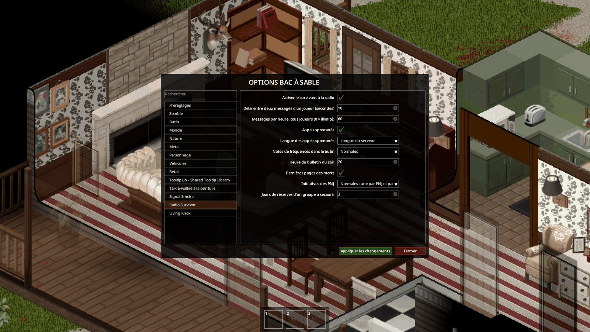
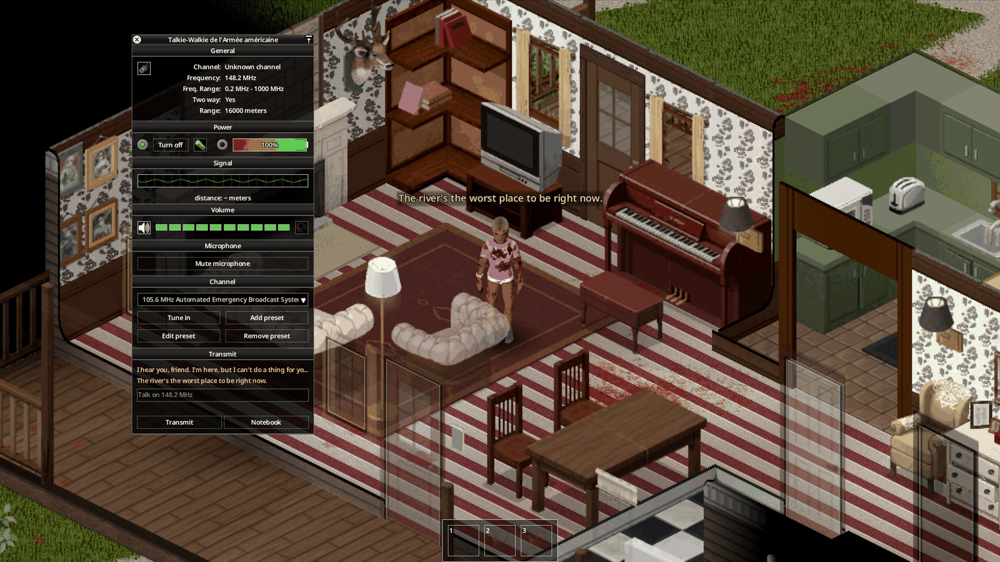

*Français : [[Installation et configuration|Installation-and-Configuration-FR]]*

# Installation and configuration

Four steps take you from the Workshop to a game where the voices and the survivors speak. Each step has its own page.

## 1. Install the mods

Subscribe to Radio Survivor and its three required mods (Belt Walkie-Talkie, TooltipLib, Signal Smoke), enable them in
the right order and restart the game: [[Installation]].

## 2. Start the bridge

The bridge is a small Python program that carries the requests of the game to the AI and brings the answers back. It
runs on the machine of the server: your PC in singleplayer or in a game hosted from the menu, the server machine for a
dedicated server.

- Singleplayer and hosted game: [[The bridge in singleplayer|Bridge-in-Singleplayer]].
- Dedicated server (Windows, Linux, Docker): [[The bridge on a dedicated server|Bridge-on-a-Dedicated-Server]].

Without the bridge the game stays playable: the voices answer with static and the NPCs stay silent.

## 3. Choose the AI provider

Any service with an OpenAI-compatible API works (three settings: address, model, key). Choice, cost and quotas:
[[AI provider configuration|AI-Provider-Configuration]].

## 4. Set the sandbox options

The sandbox settings of a new game have two pages, **Radio Survivor** and **Living Knox**: voices, message limits,
frequency notes, number and kind of survivor groups, their behaviour. Every option is described in
[[Sandbox options|Sandbox-Options]].

*Screenshots taken in a French game: the option names are those of the [[Sandbox options|Sandbox-Options]] page.*

## Check in game

Once in the world:

1. take a walkie-talkie in hand, tune it to the frequency of Walt (note found in the loot) and type a sentence in the
   **Transmit** section: Walt answers within a few seconds;
2. the **Notebook** button of the left bar opens the notebook.

Nothing answers? See [[Troubleshooting]]. Next: the player guide, [[Usage]].

## Going further: your own voices

Every voice is a text sheet on the server machine that you can edit, or copy to create a new voice, without a
restart: [[Creating radio voices|Creating-Radio-Voices]].
