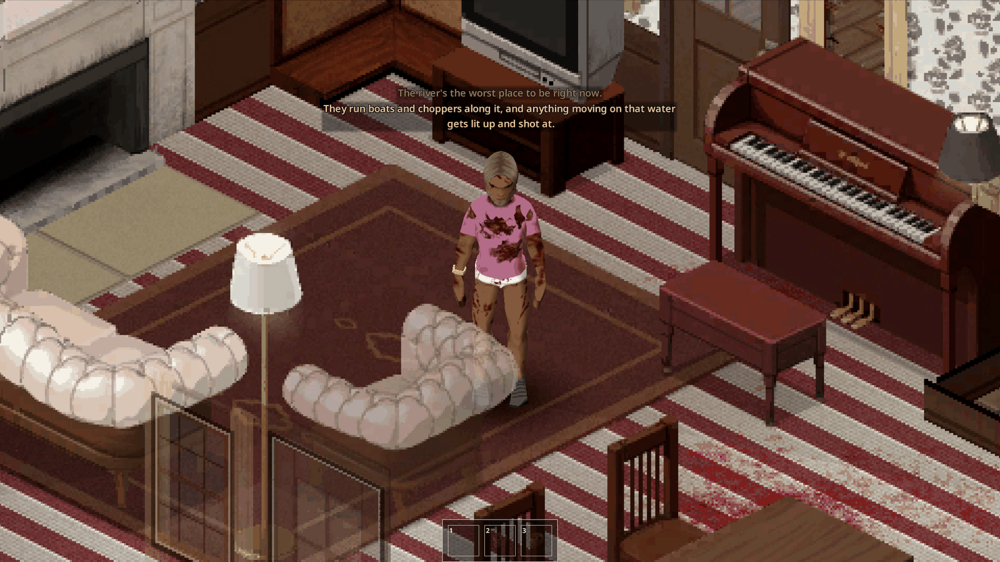
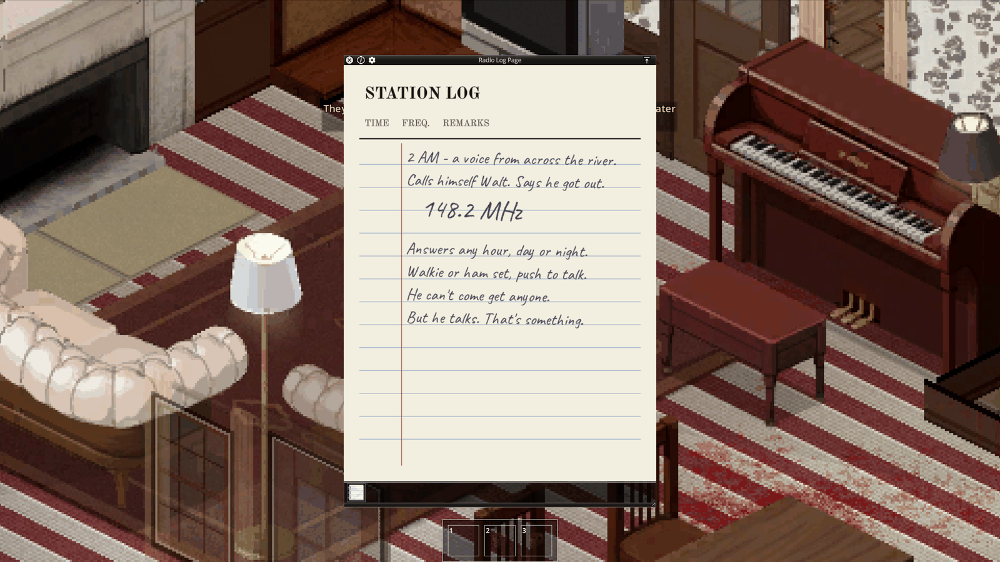
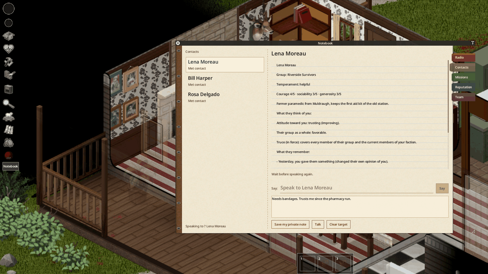
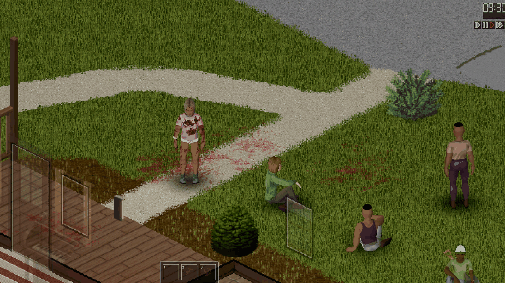
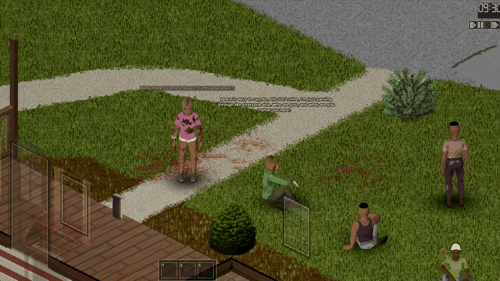
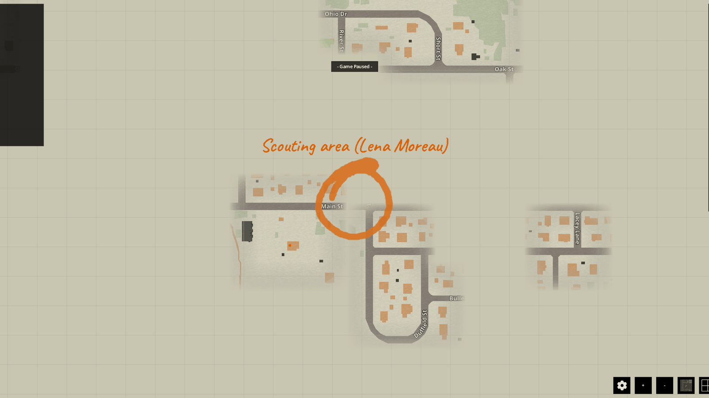

*Français : [[Présentation|Presentation-FR]]*

# Presentation

Radio Survivor (`batman_RadioSurvivor`) brings other survivors into Knox County, July 1993: **voices on the radio**,
a **field notebook** that keeps track of everyone you meet, and **Living Knox**, groups of human survivors who live,
fight and fortify their homes. Singleplayer and multiplayer, Project Zomboid **Build 42.21**.

The voices and the NPCs speak through an AI model, reached by a small program, **the bridge**
([[Installation and configuration|Installation-and-Configuration]]). The game server decides everything that happens:
the AI only writes the words and picks from closed lists.

## Voices on the radio

Six voices answer on real frequencies drawn for each game: Walt the old radio amateur, a nurse, a deserter, a
besieged family, a pirate station and a smuggler. Each one has its own story, its listening hours and its memory of
you.

Take a transmitting radio **in hand** (walkie-talkie, HAM radio) or a manpack radio on your back, switch it on, tune
it, open the microphone, and type your sentence in the **Transmit** section of the radio window. The answer comes
back on the radio, like any other broadcast.

The frequencies are never given for free: they are written on notes found in the loot (radio log page, patient card,
National Guard notice, scribbled note, flyer). Read the note to learn where to listen.

## The notebook

The **Notebook** button of the left bar opens the field notebook of your character. It keeps:

- **Contacts**: everyone you spoke to, their group, their temperament, the conversations your character heard, your
  private note, and **what they think of you**;
- **Missions**: offers and missions in progress, their objective, deadline and reward;
- **Radio**: the history of each frequency you listened to;
- **Reputation**: your reputation among the survivors and what people remember of your acts.

## Living Knox

Living Knox fills the county with 3 to 5 groups of human survivors: settlers, neutrals and raiders. Each group has a
home, a leader, real supplies, needs and routines. Its members defend and fortify their home, fight zombies, go on
expeditions and keep living while you are far away.

Walk up to a survivor, select them with **Ctrl+G** and talk: they answer in a speech bubble, in their own voice, and
remember the conversation.

## Missions and reputation

Survivors and voices ask for help: deliver supplies, scout a place, find a missing person, clear an area, recover a
stash, light a signal. The server checks each objective. Some missions circle an approximate area on your world map.

What you do is remembered: missions kept or failed, people rescued or killed. It changes your reputation and the
attitude of each survivor toward you.

## See also

- [[Installation and configuration|Installation-and-Configuration]]
- [[Usage]]: step-by-step player guide
- [[FAQ]]
