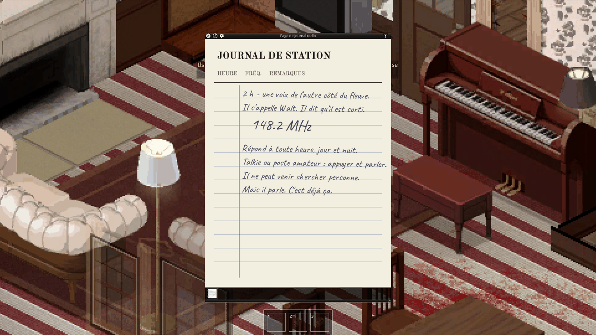
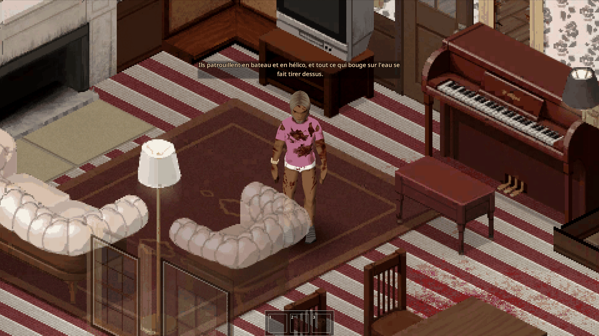
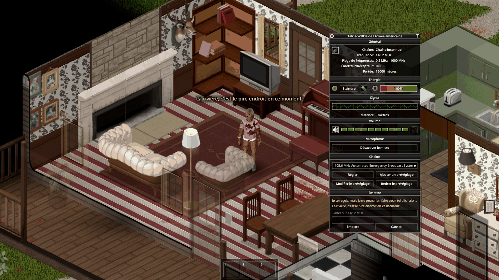
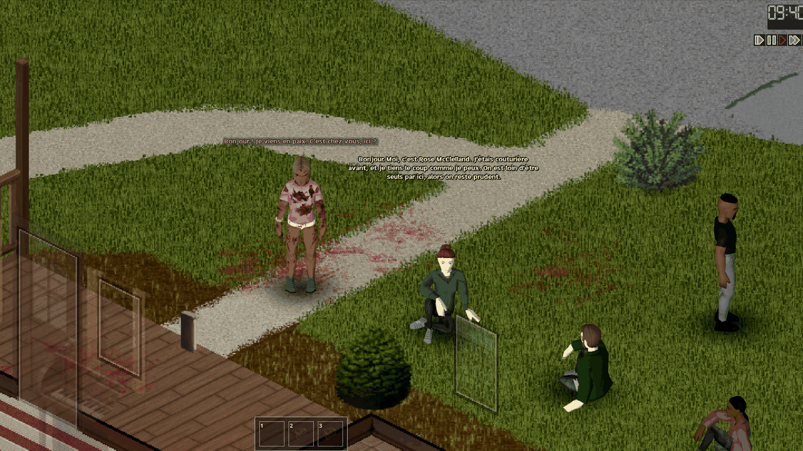
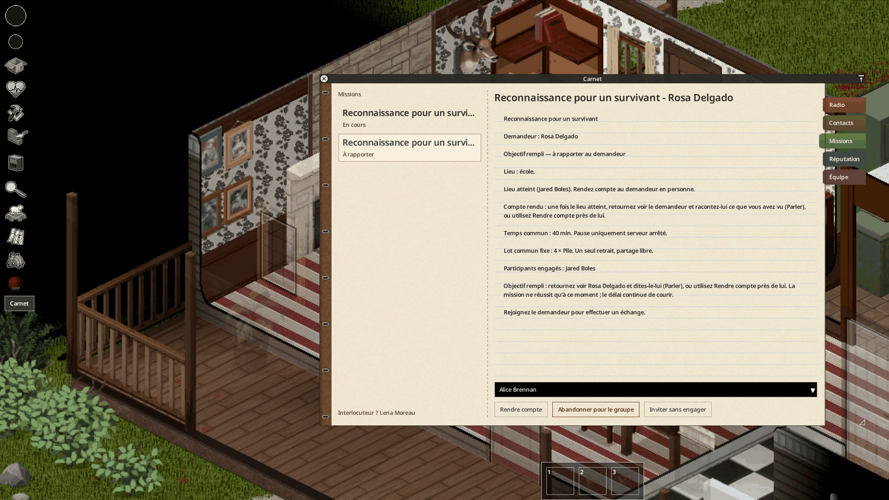
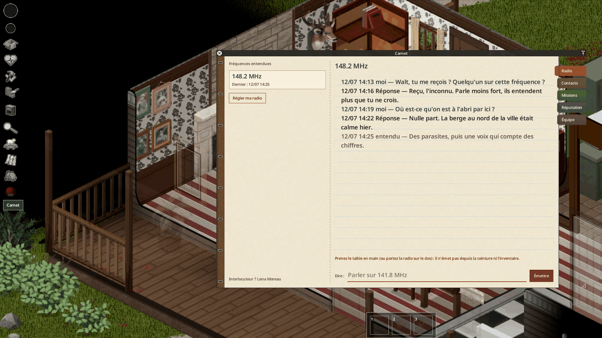
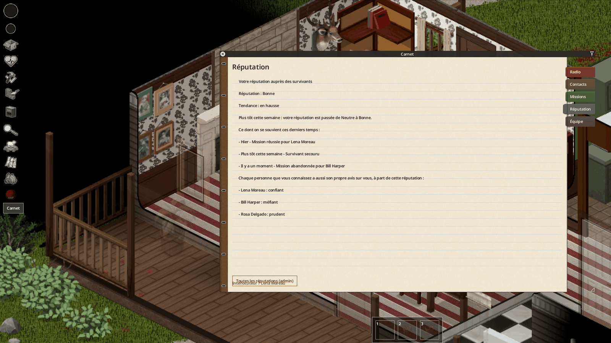
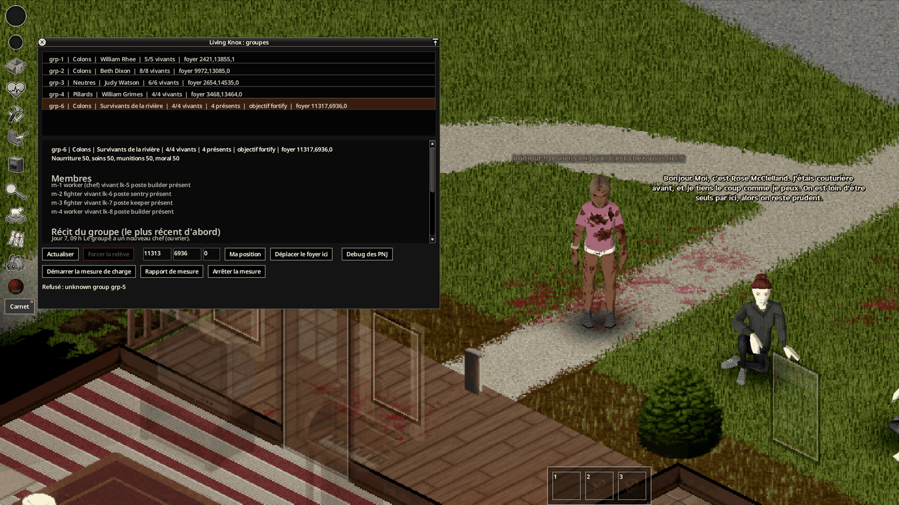
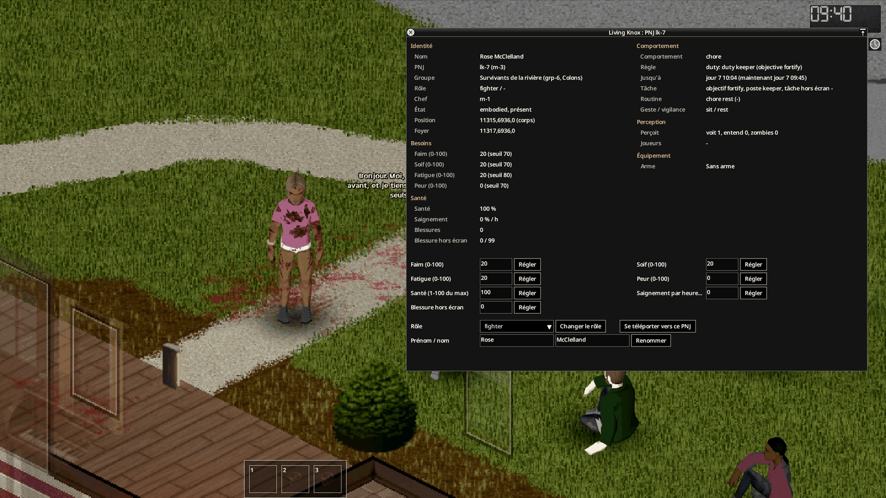

*English: [[Usage]]*

# Utilisation

Un guide pas à pas pour le joueur. Le pont doit tourner pour que les voix et les survivants parlent
([[Installation et configuration|Installation-and-Configuration-FR]]).

## 1. Trouver une fréquence

Les voix émettent sur des fréquences tirées pour chaque partie. Elles sont écrites sur des **notes** trouvées dans le
butin : page de journal radio, fiche de patient, avis de la Garde nationale, note griffonnée, prospectus de Night Owl.
Chaque note se trouve là où sa voix l'aurait laissée (fréquence : option sandbox **Notes de fréquences dans le butin**).

Clic droit sur la note → **Inspecter** (ou **Lire**) pour l'ouvrir. Walt est la première voix à chercher : il répond à
toute heure.

## 2. Parler à une voix à la radio

1. Prenez une radio émettrice **en main** : talkie-walkie, radio HAM (ou une radio militaire portée sur le dos).
2. Allumez-la et réglez-la sur la fréquence de la note.
3. Ouvrez le micro (section **Microphone** de la fenêtre radio).
4. Écrivez votre phrase dans la section **Émettre** en bas de la fenêtre radio, puis Entrée ou **Émettre**.

Le champ est grisé pendant que la voix répond ; la réponse passe sur la radio et s'affiche dans les dernières lignes
de la section. Restez bref : une voix à qui l'on parle sans pause vous demande de reprendre votre souffle. Un
talkie-walkie à la ceinture reçoit, mais n'émet pas : prenez-le en main pour parler.

Chaque voix a ses heures d'écoute et se souvient de vous. L'onglet **Radio** du carnet garde ce qui s'est dit sur
chaque fréquence.

## 3. Rencontrer un groupe Living Knox

Des groupes de survivants vivent dans des maisons ou des camps du comté : colons, neutres et pillards. Un groupe a un
chef, des combattants et des ouvriers, un foyer qu'il barricade, des réserves et des besoins. Approchez doucement et
ne pointez pas d'arme : un groupe défend son foyer, et les pillards attaquent.

## 4. Parler à un survivant (Ctrl+G)

1. Près d'un survivant que vous voyez, appuyez sur **Ctrl+G** : le PNJ visible le plus proche est sélectionné (touche
   **Sélectionner un PNJ RadioSurvivor** dans les options du jeu). Le bouton **Parler** d'un contact du carnet fait
   de même.
2. Écrivez sur la ligne **Dire** du carnet (onglet **Contacts**). En multijoueur, le chat local (`/say`) marche aussi.
3. Le survivant répond dans une bulle au-dessus de sa tête. Une longue réponse arrive en plusieurs bulles.

Un inconnu ne dit pas tout : noms, histoire et demandes viennent après quelques échanges. **Quitter le dialogue** met
fin à la conversation.

## 5. Missions et compte rendu

Quand un survivant ou une voix demande de l'aide, l'offre apparaît dans l'onglet **Missions** du carnet (« Nouvelle
offre dans le carnet »).

- **Accepter personnellement** vous engage ; **Inviter sans engager** y associe un autre joueur ; **Abandonner pour
  le groupe** y renonce (cela coûte de la réputation).
- **Livrer** ouvre la fenêtre de livraison : choisissez les objets que le demandeur accepte.
- Les missions de reconnaissance, de recherche, de nettoyage, de récupération et de signal entourent une **zone
  approximative** sur la carte du monde : le lieu est quelque part dedans, pas au centre.
- Une fois l'objectif rempli, la mission indique **À rapporter** : retournez voir le demandeur et dites-le-lui
  (**Parler**), ou utilisez **Rendre compte** près de lui. Pour une voix radio, rappelez-la sur sa fréquence. La
  mission ne réussit qu'à ce moment, et le délai continue de courir.

### Ce que vous gagnez

Après réussite et compte rendu, les missions de voix améliorent la réputation et peuvent donner **une** cache de matériel, une fréquence d'une autre voix, une carte-cachette vanilla ou une leçon. Darlene propose du matériel médical et enseigne les soins ; Cody propose des munitions et enseigne le tir. Le serveur fait tourner les récompenses autorisées ; vous ne choisissez pas leur contenu. Les fréquences rejoignent votre seul carnet ; les caches de voix ont un repère sur votre seule carte. Le matériel posé reste un objet réel du monde.

Les voix peuvent demander reconnaissance, dépôt, papiers à retrouver, nettoyage ou signal Signal Smoke selon leur fiche. Les PNJ peuvent aussi proposer récupération et ravitaillement du groupe. Rapportez toujours une mission de PNJ **en personne** au demandeur.

### Livraisons radio : collecte discrète

Le serveur alterne boîte de dépôt convenue et sac caché au sol, à un lieu `place=` de la voix. Une boîte existante adaptée est désignée précisément sur votre carte ; sans boîte adaptée, le serveur demande un sac. Déposez le lot complet puis éloignez-vous : **tous les joueurs doivent rester à au moins 40 cases horizontalement pendant 10 secondes réelles continues**, même à un autre étage. Un retour ou un redémarrage relance le délai ; la case exacte doit être chargée avant le retrait.

Dans une boîte, seuls les objets demandés disparaissent : boîte et autres objets restent. Pour un sac, sac et contenu disparaissent ; un sac contenant des objets étrangers au lot demandé est refusé pour éviter leur perte. Avant la collecte, vous pouvez reprendre le dépôt et rien n'est validé. **Après la collecte seulement, rendez compte à la radio**. Validation en jeu solo et MP de cette collecte : **en attente**.

Pour Living Knox, le matériel provient d'abord du surplus réel du foyer, sans toucher aux réserves nécessaires ni au stock rationné ; à défaut, une cache près du foyer utilise une table fermée selon le groupe. Une relation favorable ou confiante, sans mauvaise réputation, ouvre cartes et leçons adaptées au rôle. Un demandeur mort ne remet plus de récompense. Une mission de groupe a **un seul retrait partagé**, effectué par un participant, comme l'ancien lot commun. Un contact de confiance peut partager la radio de son groupe si elle existe, sinon une voix active. Les contrats de ravitaillement déjà dotés d’un lot payé sur les réserves conservent ce lot, pour éviter un second prélèvement.

L'option sandbox du multiplicateur de leçon désactive l'expérience à 0. Les nouvelles récompenses sont écrites ; leur validation solo et MP est **en attente**.

## 6. Le carnet

Le bouton **Carnet** de la barre de gauche l'ouvre.

| Onglet | Contenu |
|---|---|
| **Radio** | Historique de chaque fréquence écoutée. |
| **Contacts** | Les personnes rencontrées : groupe, tempérament, conversations entendues, votre note privée (**Enregistrer ma note privée**), et **Ce qu'on pense de vous** (attitude, tendance, accords avec votre camp). |
| **Missions** | Offres et missions : objectif, délai, récompense, participants. |
| **Réputation** | Votre réputation parmi les survivants et ce qu'on retient de vos actes. |
| **Équipe** | Votre faction et ses négociateurs (multijoueur). |

## 7. Réputation

Missions tenues, personnes secourues, un marchand floué, un demandeur tué : ce que vous faites est retenu. L'onglet
**Réputation** montre votre niveau (mauvaise, neutre, bonne), sa tendance et les derniers actes dont on se souvient.
L'attitude de chaque survivant envers vous est une autre chose, montrée sur sa page de contact.

## 8. Outils d'administration

Pour l'administrateur (solo en mode debug, ou rôle `admin` / `moderator` sur un serveur) :

- menu debug → **Living Knox - Admin** : fenêtre **Living Knox : groupes** avec chaque groupe, son foyer, ses
  membres, son histoire et son journal ; déplacer un foyer, forcer un groupe de relève ;
- clic droit sur un survivant → **Détails (Living Knox)** : la fiche de ce PNJ (besoins, santé, décision, arme), avec
  des réglages bornés, le rôle, le nom et la téléportation ;
- onglet **Réputation** → **Toutes les réputations (admin)**.

