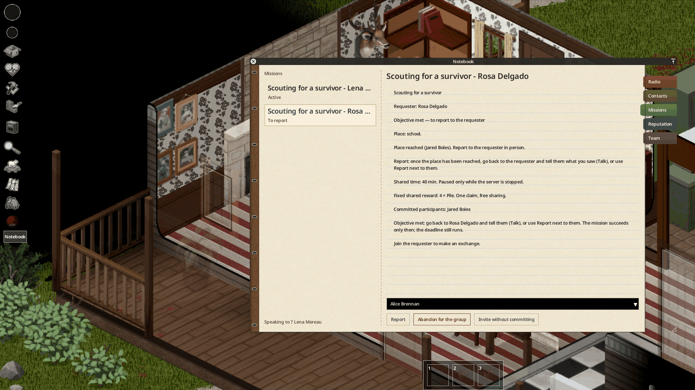
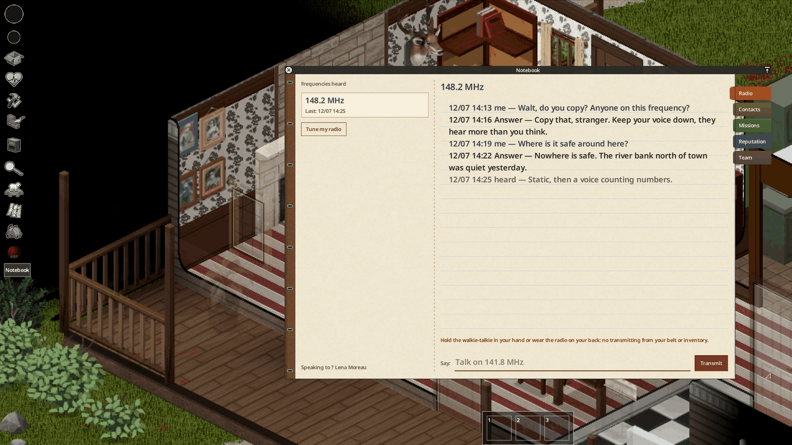
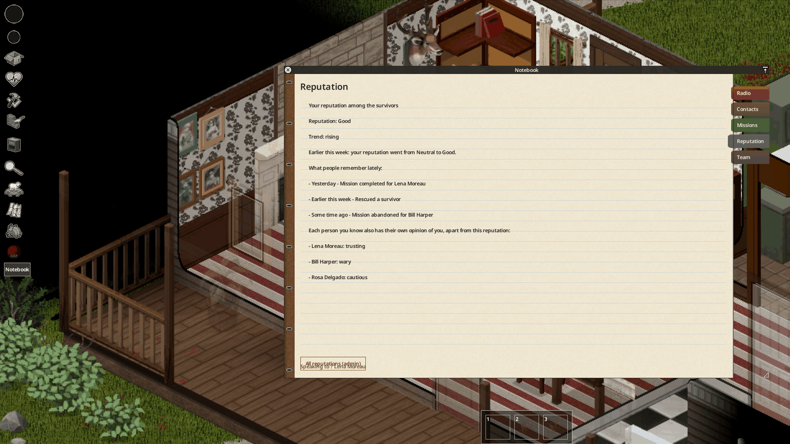
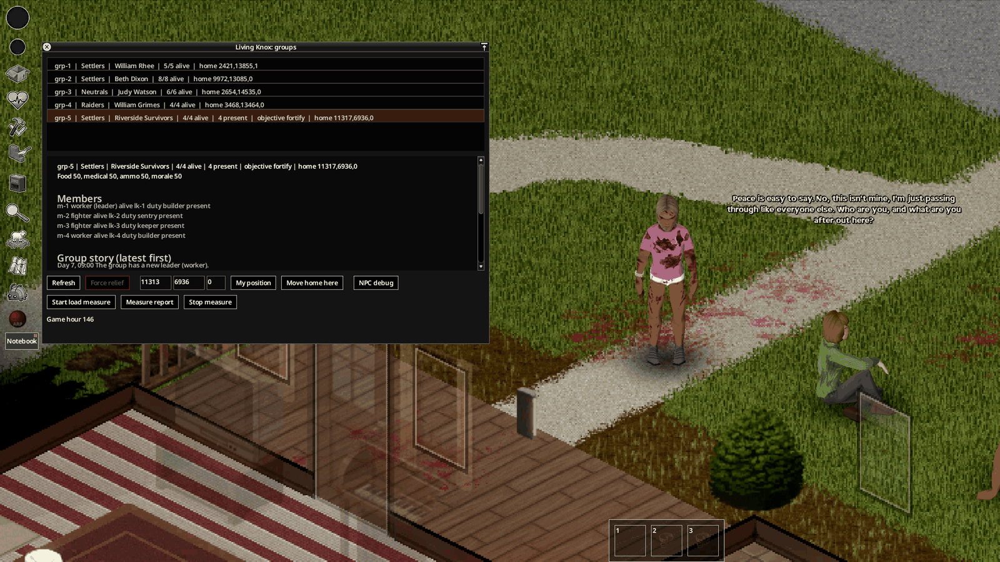
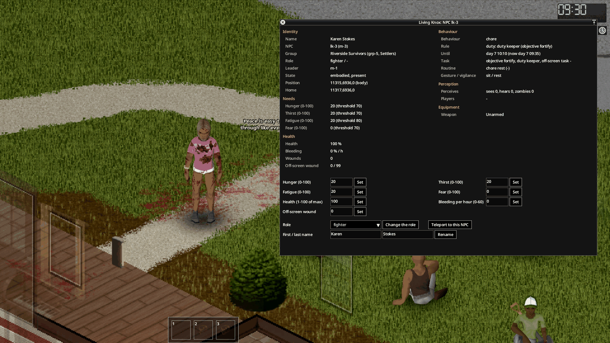

*Français : [[Utilisation|Usage-FR]]*

# Usage

A step-by-step guide for the player. The bridge must be running for the voices and the survivors to speak
([[Installation and configuration|Installation-and-Configuration]]).

## 1. Find a frequency

The voices are on frequencies drawn for each game. They are written on **notes** found in the loot: radio log page,
patient card, National Guard notice, scribbled note, Night Owl flyer. Each note sits where its voice would leave it
(how often: sandbox option **Frequency notes in the loot**).

Right click the note → **Inspect** (or **Read**) to open it. Walt is the first voice to look for: he answers at any
hour.

## 2. Talk to a voice on the radio

1. Take a transmitting radio **in hand**: walkie-talkie, HAM radio (or a manpack radio worn on the back).
2. Switch it on and tune it to the frequency of the note.
3. Open the microphone (section **Microphone** of the radio window).
4. Type your sentence in the **Transmit** section at the bottom of the radio window, then press Enter or
   **Transmit**.

The field is greyed while the voice answers; the answer is played on the radio and shown in the last lines of the
section. Keep it short: a voice that is spoken to without a pause asks you to catch your breath. A walkie-talkie on the
belt receives, but it does not transmit: hold it in hand to speak.

Every voice has its listening hours and remembers you. The **Radio** tab of the notebook keeps what was said on each
frequency.

## 3. Meet a Living Knox group

Groups of survivors live in houses or camps across the county: settlers, neutrals and raiders. A group has a leader,
fighters and workers, a home it barricades, supplies and needs. Approach slowly and do not point a weapon: a group
defends its home, and raiders attack.

## 4. Speak to a survivor (Ctrl+G)

1. Near a survivor you can see, press **Ctrl+G**: the nearest visible NPC is selected (key **Select a RadioSurvivor
   NPC** in the game options). The **Talk** button of a contact in the notebook does the same.
2. Write on the **Say** line of the notebook (**Contacts** tab). In multiplayer, the local chat (`/say`) works too.
3. The survivor answers in a speech bubble above their head. A long answer comes in several bubbles.

A stranger does not tell you everything: names, story and requests come once you have spoken a few times. **Clear
target** ends the conversation.

## 5. Missions and report

When a survivor or a voice asks for help, the offer appears in the **Missions** tab of the notebook ("New offer in the
notebook").

- **Accept personally** commits you; **Invite without committing** brings another player of your team in;
  **Abandon for the group** gives it up (it costs reputation).
- **Deliver** opens the delivery window: pick the items the requester accepts.
- Scouting, search, clearing, recovery and signal missions circle an **approximate area** on the world map: the place
  is somewhere inside, not at its centre.
- When the objective is met, the mission shows **To report**: go back to the requester and tell them (**Talk**), or
  use **Report** next to them. For a radio voice, call it back on its frequency. The mission succeeds only then, and
  the deadline still runs.

## 6. The notebook

The **Notebook** button of the left bar opens it.

| Tab | Content |
|---|---|
| **Radio** | History of each frequency you listened to. |
| **Contacts** | People you met: group, temperament, conversations heard, your private note (**Save my private note**), and **What they think of you** (attitude, trend, agreements with your side). |
| **Missions** | Offers and missions: objective, deadline, reward, participants. |
| **Reputation** | Your reputation among the survivors and what people remember of your acts. |
| **Team** | Your faction and its negotiators (multiplayer). |

## 7. Reputation

Missions kept, people rescued, a trader short-changed, a requester killed: what you do is remembered. The
**Reputation** tab shows your level (bad, neutral, good), its trend and the last acts people remember. The attitude of
each survivor toward you is a separate thing, shown on their contact page.

## 8. Administration tools

For the administrator (singleplayer in debug mode, or the `admin` / `moderator` role on a server):

- debug menu → **Living Knox - Admin**: window **Living Knox: groups** with every group, its home, members, story and
  log; move a home, force a relief group;
- right click on a survivor → **Details (Living Knox)**: the sheet of that NPC (needs, health, decision, weapon),
  with bounded settings, role, name and teleport;
- **Reputation** tab → **All reputations (admin)**.

