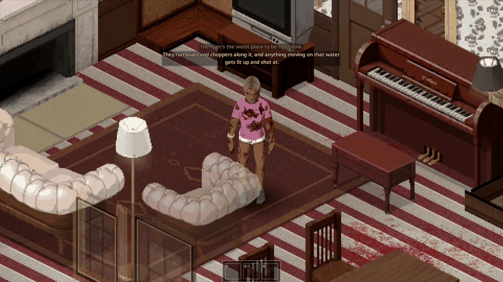
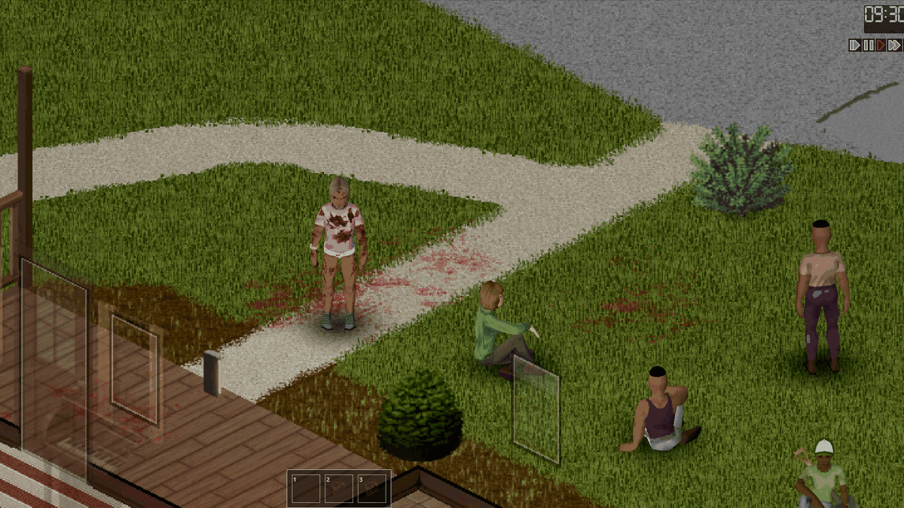
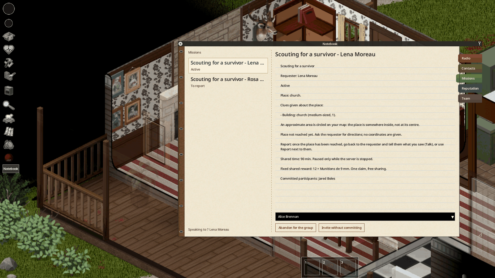
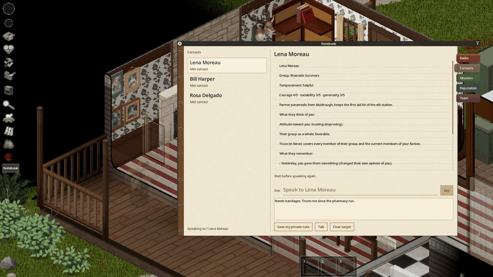
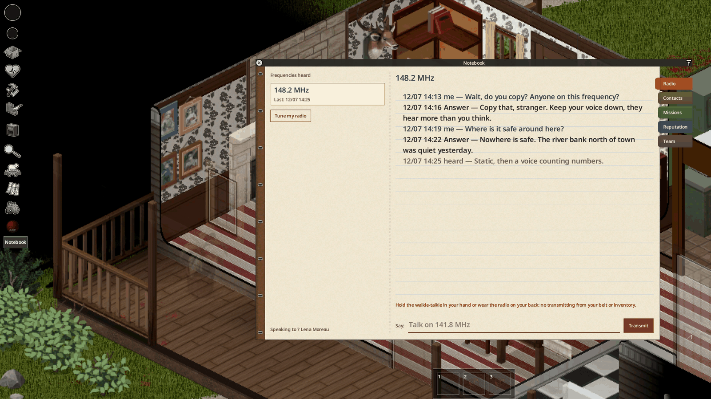
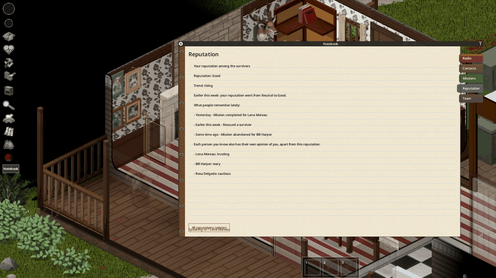
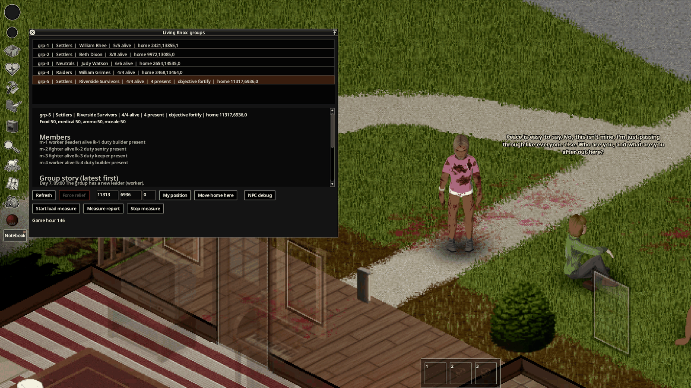

*Français : [Utilisation](../fr/03-utilisation.md)*

# Usage

A step-by-step guide for the player. The bridge must be running for the voices and the survivors to speak
([Installation and configuration](02-installation-and-configuration.md)).

## 1. Find a frequency

The voices are on frequencies drawn for each game. They are written on **notes**: radio log page, patient card,
National Guard notice, scribbled note, Night Owl flyer. Every note can be found wherever papers lie around (office
and home desks, filing cabinets, bedside tables, kitchen drawers, post offices, police and school desks), in car
glove boxes and on zombies (rarely on any zombie, much more often on one carrying a walkie-talkie), and also where its
voice would leave it (how often: sandbox option **Frequency notes in the loot**).

Right click the note → **Inspect** (or **Read**) to open it. Walt is the first voice to look for: he answers at any
hour.

## 2. Talk to a voice on the radio

1. Take a transmitting radio **in hand**: walkie-talkie, HAM radio (or a manpack radio worn on the back).
2. Switch it on and tune it to the frequency of the note.
3. Open the microphone (section **Microphone** of the radio window).
4. Type your sentence in the **Transmit** section at the bottom of the radio window, then press Enter or
   **Transmit**.

The field is greyed while the voice answers; the answer is played on the radio and shown in the last lines of the
section. Keep it short: a voice that is spoken to without a pause asks you to catch your breath. A walkie-talkie on the
belt receives, but it does not transmit: hold it in hand to speak.

Every voice has its listening hours and remembers you, for good. It does not forget the dead either: talk to it about
a lost friend and it may recall them. The **Radio** tab of the notebook keeps what was said on each frequency.

## 3. Meet a Living Knox group

Groups of survivors live in houses or camps across the county: settlers, neutrals and raiders. A group has a leader,
fighters and workers, a home it barricades, supplies and needs. Approach slowly and do not point a weapon: a group
defends its home, and raiders attack.

## 4. Speak to a survivor (Ctrl+G)

*Living Knox is needed for the survivors; it works the same with or without Radio Survivor.*

1. Near a survivor you can see, press **Ctrl+G**: the nearest visible NPC (8 squares at most) is selected (key
   **Select the nearest NPC** in the game options). The **Talk** button of a contact in the notebook does the same.
2. Write on the **Say** line of the notebook (**Contacts** tab). In multiplayer, the local chat (`/say`) works too: a
   sentence said with no survivor selected goes to the nearest one within 8 squares, and to nobody if none is that
   close. You can also right click a survivor and choose **Talk** (the way to speak without the chat in
   singleplayer).
3. The survivor answers in a speech bubble above their head. A long answer comes in several bubbles.

The missions a survivor offers appear in the Missions tab of the notebook. Next to the survivor who gave the mission,
the **Deliver** button of that tab hands over the items asked for, and **Claim the reward** collects the reward once
the mission has succeeded: an item the group has to spare, else the reward announced with the mission, else a lot that
depends on the group (tools from settlers, food from neutrals, ammunition from raiders), shown in the notebook.

A stranger does not tell you everything: names, story and requests come once you have spoken a few times. **Clear
target** ends the conversation.

## 5. Missions and report

When a survivor or a voice asks for help, the offer appears in the **Missions** tab of the notebook ("New offer in the
notebook").

- **Accept personally** commits you; **Invite without committing** brings another player of your team in;
  **Abandon for the group** gives it up (it costs reputation).
- **Deliver** opens the delivery window: pick the items the requester accepts.
- Scouting, search, clearing, recovery and signal missions circle an **approximate area** on the world map: the place
  is somewhere inside, not at its centre.
- A voice's **barricade** mission circles the building on the map and shows how many openings to barricade:
  outside windows and doors, with planks or metal sheets, from inside or outside (each opening counts once). The
  server counts by itself; barricades already in place when the mission started do not count, and a barricade
  removed again stops counting.
- A voice's **radio relay** mission circles the place on the map: put a radio that can transmit there, high up (on
  an upper floor or the roof, at least at the level shown), a walkie-talkie or a ham radio, turned on and powered
  by its battery, the grid or a generator. The server checks by itself; while the radio is off, without power or
  taken away, the mission is no longer to report and the report is refused.
- A voice's **watch** mission circles the watch post on the map: stay there (within 6 tiles; an upper floor
  or the roof counts too) for the game hours shown. Time counts in game hours; leaving for more than 10
  game minutes starts the watch again from zero. Once it is done, call the voice back: it talks about what
  happened during the watch (a helicopter heard, a group of the dead close by).
- A voice's **route** mission has you cross several places in order, on foot or by vehicle: only the
  next point is circled on the map, the notebook shows "2 of 4". A point reached before the previous
  one does not count; the server reads your position itself.
- A voice's **personal item** mission circles a place on the map: the item the voice names (a locket, a
  photo...) lies on the floor there. Find it and leave it at one of the mission's drop points; only that
  item counts, another one of the same kind is never taken. It is collected out of sight, after the delay.
- When the objective is met, the mission shows **To report**: go back to the requester and tell them (**Talk**), or
  use **Report** next to them. For a radio voice, call it back on its frequency. The mission succeeds only then, and
  the deadline still runs.

### What you earn

After success and reporting, voice missions improve reputation and may grant **one** material cache, another voice's frequency, a vanilla stash map or a skill lesson. Darlene offers medical rewards and first-aid lessons; Cody offers ammunition and aiming lessons. The server draws the reward at random among those the voice offers, and the contents of a cache at random within its category; you choose neither. Frequencies enter only your notebook; voice caches get a marker only on your map. Physical supplies remain real world items.

Depending on their sheet, voices can request scouting, a delivery drop, missing papers, clearing, a Signal Smoke signal, barricading a building, a route, a radio relay, keeping watch or finding a personal item. Some missions of a voice only come after the success of another one: a failure puts them on hold until the next success, and a successful chain can change the voice's situation. NPCs can also offer recovery and group supplies. Always report an NPC mission **in person** to its requester.

### Radio deliveries: discreet collection

A delivery mission of a voice offers **all its dead drops at once** (key `drops=` of its section; without it, every `use=drop` place of the sheet), each circled on your map with its name. The voice asks for items of one family (medical, food, ammunition...) and a number set when the mission starts; the notebook shows the accepted items and the requested number. Leave the goods wherever you want: items left at several drops add up toward the requested quantity. At each drop, the server designates a suitable existing box (every other mission) or, without one, requests a bag on the ground. The voice collects a drop only **out of everyone's sight** (no player within 100 tiles on x and on y, whatever the floor, or the square unloaded) **and after about 6 game hours** (set by the voice's sheet). The wait follows the game clock: it stops while paused, runs faster at higher speed or while sleeping, and does not count while the server is stopped. A player back in sight before the end resets it. A drop whose wait ran out while its square was unloaded is emptied as soon as the square loads again.

From a box, only requested items disappear, never more than the remaining quantity: the box, other items and the surplus remain. For a bag, the bag and contents disappear; a bag containing unrelated items, or more than the remaining quantity, is refused to prevent their loss. Each item counts only once, even after a restart. Until collection, you can take the drop back and nothing is validated. **Only once the whole quantity is collected, report over the radio**.

**Missing papers for a voice.** The ID card taken from the body is not handed over on the radio: leave it at one of the mission's dead drops, marked on your map as for a delivery (in the designated box, or alone in a bag on the ground). The voice collects it by the same rule, out of sight and after the wait; only the card of that body is taken, another ID card stays where it is. **Only once the card is collected, report over the radio**: the report removes nothing from your inventory.

Living Knox material rewards first use real household surplus, preserving required reserves and rationed stock; otherwise, a cache near home uses a closed table for the group type. A favorable or trusting personal relationship, without bad reputation, opens stash maps and role-based lessons. A dead requester cannot grant rewards. Group missions have **one shared withdrawal** by a participant, following the previous common-lot rule. Trusted contacts can share their group's radio when available, otherwise an active radio voice. Existing supply contracts retain a reward lot already paid from group reserves, preventing a second withdrawal.

The sandbox lesson multiplier disables XP at 0. The new rewards are implemented; solo and MP in-game validation is **pending**.

### Trading with a trader

Each vanilla town has its radio trader, each on its own frequency, with a story and a stock:

| Town | Trader | Arrival |
|---|---|---|
| Riverside | Gus Lacombe, the Ohio smuggler | boat |
| West Point | Wanda Haddix, the former bait shop owner | boat |
| Brandenburg | Lamar Dunaway, the former ferry deckhand | boat |
| Louisville | Delphine Arnett, the cook of a towboat | boat |
| Muldraugh | Hollis Beck, the army trucker | road |
| March Ridge | Loretta Royce, the mail carrier | road |
| Irvington | Virgil Mattingly, the farmer on the fence line | road |
| Echo Creek | Boone Tackett, the moonshine runner | road |
| Rosewood | Odessa Kessler, the school nurse | cache |
| Ekron | Ezra Overby, the lay preacher | cache |
| Fallas Lake | Maxine Whitlock, the campground manager | cache |

Their frequencies are found like those of the other voices: a handwritten note found with the papers, in glove
boxes, on zombies and in the trader's own places, to **Inspect**; a trader may also give you the frequency of a neighbour.
A trader sells a stock over the radio. Your first firm offer books his **run** for
your group: he gives you the place, the night and the signal, and the place is marked on your map. Another trader has
his own run: booking one never blocks the other. During the window, show the signal there (boat and road: a lit lamp
in hand or a red flare); you hear the engine of the boat coming alongside, or the door of the van parked by the road.
A **cache** needs no signal: leave the payment in the container of the place (dumpster, mailbox) before the time,
nobody comes to meet you. Leave a bag within 3 tiles of the place with enough to pay, then
**walk away out of sight**: he only comes once nobody is within 100 tiles on x and on y **for about one game hour**
(set by the trader's sheet). Coming back too early resets the wait; gone long enough, the exchange is made when you come
back. The bag then holds your goods; a bag that does not cover the price is cheating (nothing is taken). A run can be
called off (patrol, checkpoint, sweep, helicopter, storm), and the trader leaves if he never gets a quiet moment.

## 6. The notebook

The **Notebook** button of the left bar opens it.

| Tab | Content |
|---|---|
| **Radio** (Radio Survivor) | History of each frequency you listened to. |
| **Contacts** | People you met: group, temperament, conversations heard, your private note (**Save my private note**), and **What they think of you** (attitude, trend, agreements with your side). |
| **Missions** | Offers and missions: objective, deadline, reward, participants. |
| **Reputation** | Your reputation among the survivors and what people remember of your acts. |
| **Team** (Living Knox) | Your faction and its negotiators for the agreements with the groups (multiplayer). |

## 7. Reputation

Missions kept, people rescued, a trader short-changed, a requester killed: what you do is remembered. The
**Reputation** tab shows your level (bad, neutral, good), its trend and the last acts people remember. The attitude of
each survivor toward you is a separate thing, shown on their contact page.

## 8. Administration tools

For the administrator (singleplayer in debug mode, or the `admin` / `moderator` role on a server):

- debug menu → **Living Knox - Admin**: window **Living Knox: groups** with every group, its home, members, story and
  log; move a home, force a relief group;
- right click on a survivor → **Details (Living Knox)**: the sheet of that NPC (needs, health, decision, weapon),
  with bounded settings, role, name and teleport;
- **Reputation** tab → **All reputations (admin)**.

