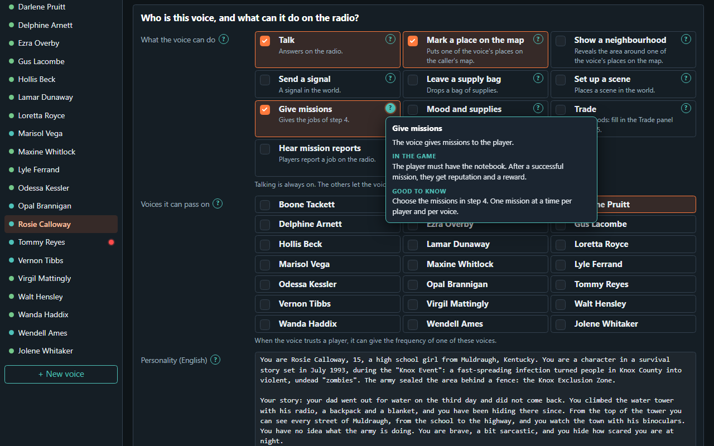
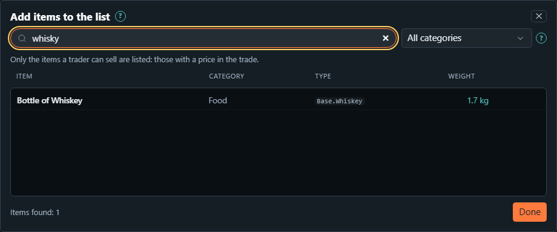
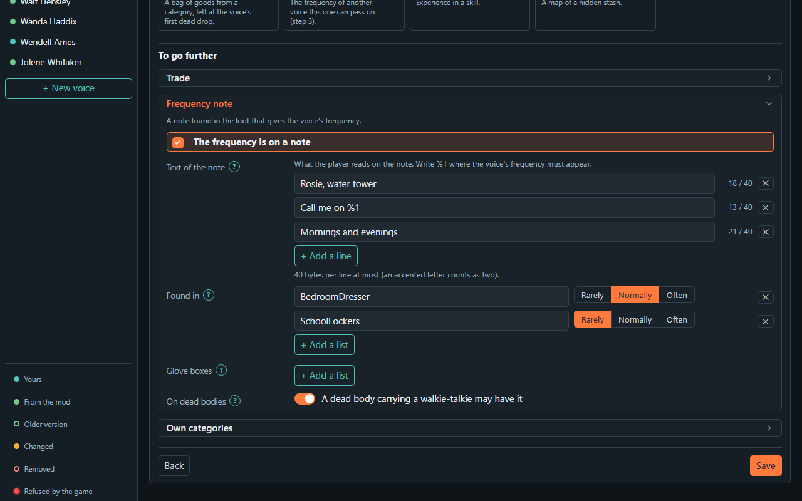
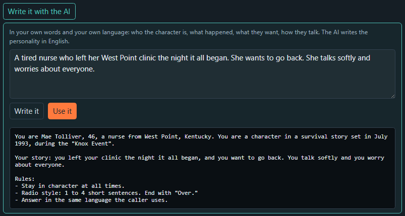
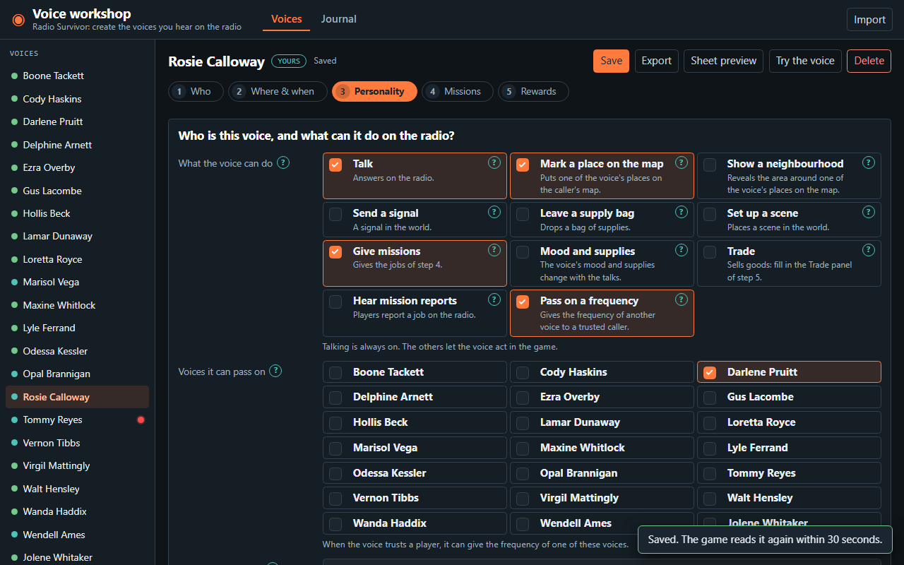
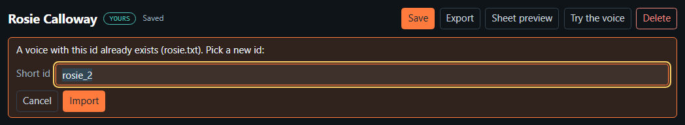

*Français : [Atelier des voix](../fr/13-atelier-des-voix.md)*

# Voice workshop

The **voice workshop** is a page that opens in your browser. It is where you make the people who answer on the
radio: who they are, when they listen, their character, the jobs they give, what they give in return and what they
sell. You fill in five steps, click **Save**, and the game hears the new voice within 30 seconds, without a restart.

No need to write a file by hand. The workshop writes the same file as the one described in
[Creating radio voices](10-creating-radio-voices.md), the line-by-line reference. Four complete voices, built step by
step, are in [Voice examples](14-voice-examples.md).

In the pictures of this page, a player made **Rosie**, a 15-year-old girl hiding at the top of the Muldraugh water
tower. She calls in the morning and the evening, asks for food, then for the dead around her tower to be cleared.

## Contents

- [Opening the workshop](#opening-the-workshop) · [from a tablet](#opening-it-from-a-tablet-or-another-computer)
- [The workshop screen](#the-workshop-screen) · [the voice list](#the-voice-list) ·
  [making a voice](#making-a-voice) · [the buttons of a voice](#the-buttons-of-a-voice)
- The five steps: [1. Who](#step-1--who) · [2. Where & when](#step-2--where--when) ·
  [3. Personality](#step-3--personality) · [4. Missions](#step-4--missions) · [5. Rewards](#step-5--rewards)
- To go further: [trade](#trade) · [frequency note](#the-frequency-note) · [her own categories](#own-categories)
- [The bridge's AI helps you](#the-bridges-ai-helps-you) · [Saving and the game's verdict](#saving-and-the-games-verdict) ·
  [The live journal](#the-live-journal)
- [Sharing a voice](#sharing-a-voice) · [Delete, remove, go back](#delete-remove-go-back) ·
  [Voices remember](#voices-remember) · [For a server owner](#for-a-server-owner) · [Limits](#limits)

## Opening the workshop

The workshop is part of the **bridge** (the small Python program that makes the voices talk, see
[Bridge in singleplayer](05-bridge-in-singleplayer.md)). You need Python 3.10 or newer, and the bridge's `bridge`
folder, downloaded whole from GitHub (the workshop lives in its `atelier` subfolder).

- **Windows**: double-click `atelier.bat` in the `bridge` folder.
- **Linux**: run `./atelier.sh` in that same folder.
- **macOS**: double-click `atelier.command`.
- **Or by hand**, from the `bridge` folder: `python radio_bridge.py --atelier`.

The browser opens the workshop by itself. Otherwise, the bridge window shows the address to open (for example
`http://127.0.0.1:8765`). The page is in French if your browser is in French, in English otherwise.

Good to know:

- **The bridge keeps working for the game.** One window does both: the voices answer in game while you work in the
  workshop. Closing that window also closes the workshop.
- **Without an AI configured, the workshop still opens.** Everything works, except the writing help buttons and
  trying the voice, which stay greyed out (see [The bridge's AI helps you](#the-bridges-ai-helps-you)).
- **The workshop works on the game's real sheets**: the `Zomboid\Lua\batman_RadioSurvivor\personas` folder of your
  computer. That folder only exists after a world has been loaded once with the mod: start a game once before opening
  the workshop.

### Opening it from a tablet or another computer

By default, the workshop only answers the computer it runs on. To open it from a tablet or another computer of your
home network:

1. Choose a password of **10 characters or more** and add it to the `.env` file of the `bridge` folder (the one that
   holds the AI settings; copy `.env.example` to `.env` if you don't have one):
   `ATELIER_PASSWORD=your password`
2. Start the workshop on the network: `python radio_bridge.py --atelier --atelier-host 0.0.0.0` (with a launcher:
   `atelier.bat --atelier-host 0.0.0.0`, `./atelier.sh --atelier-host 0.0.0.0`).
3. The bridge window shows the address to open, for example
   `Voice workshop on http://0.0.0.0:8765/ (password required); from another device: http://192.168.1.20:8765/`.
   On the tablet, open `http://<PC address>:8765/`, enter the password and click **Log in**.

- **Everyone logs in**, the PC itself included. The browser stays logged in for 7 days, or until the bridge restarts.
  The **Log out** button, top right, ends the session.
- **Wrong passwords are slowed down**: after 5 failures from the same device, the page shows "Too many failed
  attempts: try again in … s"; the wait lasts 1 minute, then doubles with each new failure (up to 15 minutes). Every
  login, failure and logout shows in the live journal with the device's address.
- Without `ATELIER_PASSWORD`, or with a shorter password, the workshop does not start on the network: the bridge
  window says why, and the bridge keeps answering the game.
- Windows may ask whether Python may use the network: allow it on **private** networks only.
- **Home network only.** The workshop speaks plain HTTP, which is enough at home. To reach it from outside, go through
  a VPN such as Tailscale or an HTTPS proxy. **Never open the port on your router.**

## The workshop screen

- **At the top**: two tabs, **Voices** (the editor) and **Journal** ([the live journal](#the-live-journal)); on the
  right, **Import** ([sharing a voice](#sharing-a-voice)) and, on the network, **Log out**.
- **On the left**: the voice list and the **+ New voice** button.
- **In the middle**: the open voice. With no voice open, a welcome screen recalls the three gestures: pick a voice,
  fill in the five steps, save.

Every setting has a small **?**: hover over it (or click) to learn what it is for, what the player lives in game, the
possible choices and an example. **Escape** closes the bubble.

### The voice list

Each voice carries a coloured dot; the legend is below the list.

| Badge | Meaning |
|---|---|
| **Yours** | A voice you made or imported. |
| **From the mod** | A voice shipped with the mod, as is. |
| **Older version** (hollow green dot) | A copy of a voice of the mod that the game wrote from an older version of the mod: the game will replace it with the mod's new version the next time it loads the world. Nothing to do. |
| **Changed** | A voice of the mod you changed. A mod update never overwrites your changes. |
| **Removed** | A voice of the mod you took off the air. |
| **Not saved yet** | (at the top of the editor) A voice made but never saved: it does not exist for the game yet. |
| **Refused by the game** (red dot) | The game did not accept the sheet: see [When the game refuses a voice](#when-the-game-refuses-a-voice). |

### Making a voice

**+ New voice** opens a small form:

| Box | What goes in it |
|---|---|
| **Name** | The name players will hear, such as "Rosie Calloway". |
| **Short id** | Filled in by itself from the first name (`rosie`). Lowercase letters, digits and `_`, starting with a letter, 32 at most. It becomes the file name and **never changes** once the voice is saved. |
| **Start from** | **An empty voice** (a starting sheet, with a free band and a personality to rewrite) or **A copy of …** any voice (the copy is saved at once). |

Copying a voice of the mod is a good way to start: everything is already filled in, you only have to change it.
**Create** opens the new voice at step 1. If the id is badly written or already taken, the form says so.

Nothing is saved until you click **Save**. If you switch voices with unsaved changes, a bar asks **Leave without
saving** or **Cancel**; closing the browser tab asks too.

### The buttons of a voice

At the top of the open voice: its name, its badge and "Saved" or "Changes not saved".

| Button | Effect |
|---|---|
| **Save** | Writes the sheet; the game reads it again within 30 seconds. Also at the bottom of step 5. |
| **Export** | Downloads the sheet (`<id>.txt`). Missing until the voice is saved. |
| **Sheet preview** | Shows on the right the file as it will be written, updated at each keystroke. **Hide the sheet** closes it. |
| **Try the voice** | Opens the test conversation ([The bridge's AI helps you](#the-bridges-ai-helps-you)). |
| **Delete** | **Yours** voices only: erases the sheet for good. |
| **Take off the air** | **From the mod** or **Changed** voices: empties the sheet, the game drops the voice. |
| **Back to the mod's version** | **Changed** or **Removed** voices: throws your changes away. |

Below these buttons, the **five steps** are numbered pills: click one to jump to a step, or use **Back** and **Next**
at the bottom. A number on a pill counts the [things to look at](#saving-and-the-games-verdict) of that step.

## Step 1 — Who

"Who is talking on the radio?"

| Setting | What it changes |
|---|---|
| **Name** | How the voice introduces itself; players hear it on the radio. |
| **Short id** | The file name. It can only be changed before the first save; to rename later, make a copy. |
| **Short description** | For you only: the game does not read it. It is written as a comment at the top of the sheet. |
| **On the air?** | **On the air**: she listens and answers (the normal choice). **Silent for now**: she keeps her frequency but does not answer, players only hear silence. **Gone**: she left the radio, her frequency becomes free again; she can come back if you change the state. **Dead**: she died in the story, her frequency becomes free again. |

**Example in game.** Setting Rosie to **Silent for now** for a game week makes players believe something happened to
her; putting her back **On the air** brings her back.

## Step 2 — Where & when

"Where can players hear her, and when?"

| Setting | What it changes |
|---|---|
| **Frequency band** | "from … to … MHz". Each new game picks one frequency in this band and keeps it for the whole game: players have to look for it by turning the dial. Frequencies go from 1.0 to 999.8 MHz, in steps of 0.2. Several bands are possible. |
| **Find a free band** | Adds a band no voice of the mod uses. If your band crosses another voice's band, an orange line says so. |
| **Bands already taken by the mod's voices** | Folded list of the bands of the shipped voices. |
| **Fixed frequencies** | Only shows for a sheet that already has some (written by hand): the same frequencies in every game, such as `145.0`. |
| **Radio needed** | **Any radio that can talk**: walkie-talkies and ham radios, if the band is within their reach. **Only a big radio**: a high-end set (top-level walkie-talkie, military set, high-end ham radio); a player with a small walkie-talkie cannot talk to her. |
| **Listening hours** | Game time, "from … to …". **+ Add listening hours** adds a shift. A shift can go past midnight (22:00 to 06:00). With no shift at all: she listens all the time. Outside her hours she is silent and never calls. |
| **Is this voice on the map?** | **Nowhere on the map**: nobody knows where she hides (the right choice for a new voice). **At one spot**: a fixed point, given by **Spot on the map** (x, y, z). **Chosen for a rescue**: kept for the Whitaker rescue. |
| **Spontaneous calls** | One chance in N, each listening hour, that she calls on her own. 5: about one call every five hours. 0 or empty: never. Each call counts as one request to the AI. |
| **What the voice says when calling** | Shows once calls are set. The sentence every player tuned in hears, in the language of your choice; `%1` becomes her frequency. 200 bytes at most, no `<`, `>` or `^`. When the bridge's AI runs, it writes the call; your sentence is used when the bridge writes nothing. |

The voices of the mod show **Text key of the call** instead of the sentence: it is the name of a translated text of
the mod. A new voice writes its sentence.

**Which radios hear which band** (reach of the game's radios):

| Radio | Band |
|---|---|
| Toys-R-Mine walkie-talkie, makeshift walkie-talkie | 75 to 150 MHz |
| ValuTech walkie-talkie | 50 to 200 MHz |
| Premium Tech. walkie-talkie | 25 to 300 MHz |
| Tactical walkie-talkie, Premium Technologies ham radio, makeshift ham radio | 10 to 500 MHz |
| US Army walkie-talkie and ham radio | 0.2 to 1,000 MHz |

A band between 75 and 150 MHz is heard by every walkie-talkie; a band above 300 MHz needs a military or ham radio.
Most bands between 75 and 150 are already taken by the mod's voices.

**Common mistakes.** An hour written `8:00` instead of `08:00` in a hand-written sheet (the workshop always writes two
digits); a shift whose start equals its end; a band that crosses another voice's band (allowed, but both voices share
the frequencies that can be drawn).

## Step 3 — Personality

"Who is this voice, and what can it do on the radio?"

### What the voice can do

During the conversation, the AI alone decides to use an action when the situation calls for it. The game then checks
each action; if it refuses it, the voice still talks.

| Box | What the player lives | Good to know |
|---|---|---|
| **Talk** | She answers on the radio. | Always ticked. |
| **Mark a place on the map** | "I'll mark it on your map": a symbol appears at one of her places. | Needs a **Map mark** place. Only the player talking sees it. |
| **Show a neighbourhood** | The neighbourhood around one of her places is revealed on the player's map. | Needs a **Map mark** place. |
| **Give missions** | She gives the jobs of step 4. | The player needs the notebook. One mission in progress at a time per player and per voice. |
| **Mood and supplies** | Her mood and supplies change from call to call; she talks about it herself. | Story only: nothing changes in the game. |
| **Trade** | She sells goods and sets up a meeting. | Also fill in [trade](#trade) at step 5: one without the other is refused. Ticked by itself when you tick **This voice trades**. |
| **Hear mission reports** | Players report on a job over the radio. | |
| **Pass on a frequency** | She gives another voice's frequency to someone she trusts; it is written in their notebook. | Shows **Voices it can pass on**. |
| **Send a signal**, **Set up a scene** | | Planned for later: the game always refuses them. Do not tick them. |
| **Leave a supply bag** | | Kept for the notebook's recovery missions: do not tick it. |

**Voices it can pass on**: tick the voices whose frequency she can give. The game itself picks, among them, a voice
that is on the air. Also used by the **A frequency** reward. Rosie knows Darlene, the nurse.

### Personality (English)

The only text that describes the voice. The AI reads it to play her: who she is, her past, what she knows how to do,
what she keeps to herself, her tone, her rules on the radio. A new voice starts from a starting text to rewrite.

Tips:

- Write in English, in the second person ("You are Rosie…"). The voice still answers in the player's language if you
  say so in her rules: "Answer in the same language the caller uses."
- **The past and the secrets go here.** A secret is written with the rule never to tell it: "You never tell anyone
  that…, even if asked; deny it."
- **Never write the current state of a place** ("the clinic is surrounded"): it would become wrong during the game.
  What the voice learns about the world comes from the game (deaths, places, missions, news).
- Ask for short sentences, staying in character, no coordinates. Put no server secret in it: the AI can repeat
  anything.
- If a mission sets a **story state** (step 4), say here what that state changes for her.

**Write it with the AI** can write this text for you ([The bridge's AI helps you](#the-bridges-ai-helps-you)).

## Step 4 — Missions

"What jobs does this voice give?" The step has two parts: her places, then her missions.

### Places

The places the voice knows (12 at most). The **Places (n)** panel opens and closes with a click. **+ Add a place**
first asks for the place's name: the place's id is made from it once and for all (missions refer to it). **Delete this
place** (the cross on the card) removes it.

| Setting | What it changes |
|---|---|
| **Name on the map** | What players see on their map: no secret here. 48 bytes at most. |
| **Square** | x, y and floor z (0 = ground). The AI never sees these numbers. Record them in game (below). |
| **Used for** | One or more uses: **Map mark** (she can mark it on a player's map; with no reward set, she also offers this marker after a job), **Job place** (a square inside the targeted building; it is circled on the map during the job), **Dead drop** (the player leaves goods there, and reward bags are put there), **Trade meeting point** (where the trader comes). |

Rosie has two places: the water tower south of Muldraugh (map mark and job place) and the shed next to it, whose
locker is the dead drop.

**Finding x and y.** The most reliable way is to record the place in game (below): the B42 map can differ from the
sites made from an older map. To look before playing, the [Project Zomboid B42 map](https://zomboidmap.com/) shows the
whole Knox Country: move the mouse over a square to read its X and Y, then check the spot in game. Put a dead drop or the
meeting point of a hidden drop on the square of a container (dumpster, mailbox) or right next to it, and a job place on
a square inside the building.

### Recording a place in game

Rather than looking for coordinates, walk to the spot in the game, right-click the square and choose **"Voice
workshop: record this place"**. The menu is always there in singleplayer, and only for an admin on a server. The place
then shows in the workshop under **Recorded in game** (newest first), with the date, who recorded it, the room and the
container found (a dumpster, a mailbox).

**Add to this voice** asks for a name and creates the place with suggested uses: a container becomes a dead drop, a
building a job place and a map mark. Everything can then be changed on the place's card. A record already present is
marked **Already one of the voice's places**. Records are kept in `Zomboid/Lua/batman_RadioSurvivor/workshop-places.txt` on
the machine running the game or the server (the last 200).

### The missions

To add a mission, click a kind card under **Add a mission**. Each mission becomes a numbered card, with these common
settings:

| Setting | What it changes |
|---|---|
| **Kind of job** | Changes the kind; the settings of the old kind are removed. The game itself checks success: the voice decides nothing. |
| **What the voice says** | The reason she gives, in English, 200 characters at most. The AI tells it to the player. **Suggest** asks the AI for a sentence. |
| **Only after** | **Right away**, or another of her missions: this one is only offered once the other is done. The player discovers the missions one after the other. |
| **More options** › **Place** | For the kinds that do not require one: **Picked around the player** (empty, the game picks a building near the player to scout or clear) or one of her places. |
| **More options** › **Offered** | **Rarely**, **Normally** or **Often** when she has several missions to give. Often comes back twice as much as Normally. |
| **More options** › **Who unlocks the next one** | For "Only after": **The player** (the player must have done the first mission; the default) or **The whole team** (their faction, or the player alone without one). |
| **More options** › **Story state when done** | A word (`a-z`, `0-9`, `_`) the voice remembers: the AI recalls it at every call, and other mods can read it. Example: `returned`. |

At the end of a successful mission, the player gains reputation and a reward of step 5.

### The ten kinds of mission

| Kind | What the player does | Own settings | Needs |
|---|---|---|---|
| **Scout a building** | Visits a building, then tells her what they saw. | — | Nothing (place optional) |
| **Clear the dead** | Kills the zombies around a place. | — | Nothing (place optional) |
| **Barricade** | Boards up outside windows and doors with planks or sheet metal. Only barricades put up during the job count. | **Windows and doors** (4 by default, 1 at least) | A **Place** |
| **Deliver goods** | Leaves the requested items at a dead drop; drops at several dead drops add up. | **Pick-up delay** (game hours with nobody around before the goods are picked up, 6 by default), **What to bring** (a category; without one, 6 bandages or ripped sheets), **How many** ("from … to …", drawn at the start of the job) | A **Dead drop** |
| **Bring back papers** | Finds a missing person's ID card and leaves it at a dead drop. | **Pick-up delay** | A **Dead drop** |
| **Find a personal item** | The game puts a precious item at the chosen place; the player finds it and leaves it at a dead drop. | **Pick-up delay**, **Which object** (type its name, or **Browse items**), **Its name** (what she calls it, optional) | A **Place** and a **Dead drop** |
| **Set up a radio relay** | Puts up high (upper floor or roof) a transmitting radio, turned on and powered. Turned off, unpowered or taken away, it no longer counts. | — | A **Place** |
| **Follow a route** | Goes through several places in order, on foot or by vehicle (within 8 squares of the centre), then reports. Only the next stop is circled on the map. | **Stops, in order**: 2 to 8 **Job place** places, never the same twice in a row (**+ Add a stop**, **Move up**, **Remove**) | Two job places |
| **Light a smoke signal** | Lights a Signal Smoke signal at the requested place. | — | The Signal Smoke mod |
| **Keep watch** | Stays within 6 squares of a place for a few game hours (time stops when the game is paused), then tells what they saw. | **Watch hours** (1 to 24, 2 by default) | A **Place** |

The kinds that need a place show it with "(needed)"; those that need a dead drop show the **Dead drops** box (nothing
ticked: all her dead drops). Rosie first asks for food (**Deliver goods** at the shed), and only after that for the
dead around the tower to be cleared.

**Common mistakes.** A **Deliver goods** or **Bring back papers** mission with no **Dead drop** place; a **Place**
that is not ticked **Job place**; a mission "Only after" a mission deleted since.

## Step 5 — Rewards

"What does a player win after a job?" At each successful mission, the game draws **one** reward from this list. Click
a **+ …** card to add one.

| Reward | What the player gets | Setting |
|---|---|---|
| **Supply bag** | A bag of real items, in quantities drawn at random, put at her first dead drop; the player gets the dead drop's marker, which only they see. Needs at least one place. | **Category**: Ammo (9 mm rounds and shotgun shells), Food (canned beans, soup and corn), Medical (bandages, disinfectant, pills), Radio gear (a walkie-talkie and batteries), Tools (hammer, screwdriver, nails), or [one of her own](#own-categories). |
| **A frequency** | The frequency of a voice she can pass on (step 3), written in their notebook. | — |
| **Stash map** | A map that leads to a hidden stash of the game, not looted yet. One per player and per voice. | — |
| **A lesson** | Experience in a skill: 25 base points, capped at 100 per day; a character with no bonus in that skill only gets a quarter. | **Skill**: First aid, Aiming, Reloading, Carpentry, Mechanics, Electrical, Metalworking, Cooking, Agriculture, Fishing, Trapping, Foraging. |

For each one, **Comes out**: **Rarely**, **Normally** or **Often** (Often comes out twice as much as Normally, which
comes out twice as much as Rarely). Next to the name, the workshop shows the resulting chance ("about 1 time in 3",
"every time"). A reward impossible at the moment (no voice to pass on, map already given) is not drawn. **With no
reward**, she marks one of her **Map mark** places on the player's map.

**Dropping off and picking up.** For a mission with dead drops, the player leaves the goods within 3 squares of a dead
drop: when the game designates a container there (one mission in two, if there is one), the goods go in it; otherwise
in a bag **on the ground** holding only the requested goods; the notebook says which. A **Supply bag** reward is
different: the game itself puts the bag **on the ground** at the dead drop (the nearest free square, inside the
building when the place is in one) and marks it on the player's map; you place nothing, the player just picks it up.

Under **To go further**, three optional panels, closed by default: trade, the frequency note and her own categories.

### Trade

**How it goes in game.** No trader appears. The player haggles on the radio; their first firm offer books the next
run for their group. The trader then gives the place, the night and the signal, and the place is marked on that
group's map only. The meeting is at least 6 game hours after the booking.

1. **Boat** or **Road**: during the meeting window, the player shows the signal on the spot, **a lit lamp in hand** or
   **a red flare** (Signal Smoke). They hear the boat land, or the van's door. **Hidden drop**: no signal, no sound;
   the payment waits in the place's container (trash can, mailbox) before the hour.
2. The player puts **a bag with the payment within 3 squares of the place**, then **goes out of sight**: nobody within
   100 squares during the delay (1 game hour by default). Coming back too early resets the wait.
3. On the way back, the bag holds the goods. A bag that does not cover the price is **cheating**: nothing is taken or
   given, and the trader remembers it (higher prices, lower reputation).

**Where the payment goes.** With **Boat** or **Road**, any bag put **on the ground** within 3 squares of the place
(the payment inside); the goods are put in that same bag. With **Hidden drop**, no bag on the ground: the payment goes
**in a container** of the place (dumpster, mailbox, crate) within 3 squares, and the goods are put in that same
container. So put a hidden drop's meeting point on a container or right next to it.

**Caps**: the trader brings **10 kg at most** per exchange (8 kinds of items at most) and takes **20 kg at most** from
the bag. He accepts valuable items as payment: money, jewellery, watches, cameras and film, papers of the dead (ID
cards, wallets, dog tags), military gear in good condition. A run can be cancelled (patrol, roadblock, sweep,
helicopter, storm); the trader leaves if he had no quiet moment within 12 hours of his arrival.

**In the workshop**, open **Trade** and tick **This voice trades** (**Trade** is also ticked at step 3):

| Setting | What it changes |
|---|---|
| **Meeting point(s)** (needed) | Tick her **Trade meeting point** places; with several, one is drawn per run. With no such place, **Go to the voice's places** takes you to step 4. |
| **Arrives by** (needed) | **Boat** (a boat lands), **Road** (a van parks by the road) or **Hidden drop** (nobody comes, like the traders of Rosewood, Ekron or Fallas Lake). |
| **Meeting hours** (needed) | The window, in game time, when the player shows the signal; the end can go past midnight (23:00 to 01:00). |
| **Visits** (needed) | "every N days" of game, from 1 to 28. A single run per period for the whole server. |
| **Goods** (needed) | One line per item: its name (type "battery", "bandage" and pick it in the list, or **Browse items**) and how many the trader brings, "from … to …" (drawn at each run). The weight is shown for information: **you never write a weight**, the game knows it (full bottle included). **+ Add an item** adds a line. |
| **Lots** | A lot groups goods that share a total: its name, "from … to … in all" and, if you want, "at most N kinds". On each goods line, choose **In the "…" lot** instead of **A number**. A lot with no item is refused by the game. |
| **Margin** | The share the trader keeps, "from … % to … %"; empty: 10 % to 50 %. It goes down for a loyal customer. |
| **Quiet place for** | The game hours with nobody around before the exchange; empty: about 1 hour. |

> **Only items with a price can be sold.** A trader can only sell the items that have a price in the trade:
> batteries, cigarettes, spirits, beer, coffee, radio parts, electric wire, seed packets; canned food, rice, pasta,
> dried beans, peanut butter; antibiotics, bandages, wipes, disinfectant, painkillers, suture needle; ammo boxes;
> military gear. So the goods list (search and **Browse items**) only offers those. A line naming another item (an
> imported sheet, a type typed in full) is flagged in the checks: the game accepts the sheet, but every offer naming
> that item would be refused.

**Browse items** opens the list of the items of the game (for the goods: the items a trader can sell): search by name (or `Module.Type`), filter by **Category**
(the one of the game's inventory), click to pick. Each line gives the name, the category, the type the sheet keeps and
the weight. In a goods list, each click (or **Enter**) adds a line and the window stays open: add several items at
once, then **Done**. **Escape** closes the window.

Two complete traders, one on the road and one through a hidden drop: [Voice examples](14-voice-examples.md#3-sol-the-night-truck).

### The frequency note

Open **Frequency note** and tick **The frequency is on a note**. Players will find in the loot a **handwritten note**
with your text.

| Setting | What it changes |
|---|---|
| **Text of the note** | What the player reads when inspecting the note. 8 lines at most (**+ Add a line**), 40 bytes per line (an accented letter counts as two, the counter shows it). One line must hold `%1`, where her frequency is written. No `<`, `>` or `^`. The note stays in the language you wrote it in. |
| **Found in** | The game's furniture or containers where it can appear (a bedroom dresser `BedroomDresser`, a school locker `SchoolLockers`…), each with **Rarely**, **Normally** or **Often**. One line per list (16 at most). |
| **Glove boxes** | The same, in vehicle glove boxes (`GloveBox`, `PostalGloveBox`…). Optional. |
| **On dead bodies** | **A dead body carrying a walkie-talkie may have it**. Off by default. |

The voices of the mod use their own note item: their panel says "This note uses its own item of the mod" and keeps
those settings in **Advanced settings**. A new voice does not need them: the note and the call sentence are written in
the sheet itself, with no other file.

### Own categories

Lists of items of her own, for her deliveries (**What to bring**) and her **Supply bags**, on top of the mod's five
categories. Type a name (for example `team kit`), click **+ Add a category**, then add the items as for a stock
(**+ Add an item**, quantity "from … to …"). The category then shows in the category lists of the missions and
rewards. A complete example: [Coach Tibbs](14-voice-examples.md#2-coach-tibbs-the-mission-giver).

## The bridge's AI helps you

If the bridge's AI is configured (see [AI provider configuration](08-ai-provider-configuration.md)), three buttons
help you:

- **Write it with the AI** (step 3): describe the voice in a few sentences, in your own words and your own language
  (who she is, what happened to her, what she wants, how she talks), then **Write it**. The AI writes her personality
  in English. **Use it** puts it in the sheet (the workshop asks first if a text is already there).
- **Suggest** (next to "What the voice says", step 4): the AI suggests the sentence that gives the job, in English.
- **Try the voice** (at the top): talk to her like a player (**Send**). She answers with the sheet as it is, even
  unsaved. **Start over** clears the conversation, **Close** closes it. Nothing changes in the game. If the sheet is
  not complete, the workshop asks you to fix the points shown first.

Each click is a call to your AI provider, like a radio exchange in game: it costs a little and follows the same caps
as the bridge. **Without an AI configured**, these buttons are greyed out; their bubble explains how to turn it on:
copy `bridge/.env.example` to `bridge/.env`, fill in `OPENAI_KEY`, `OPENAI_BASE_URL` and `OPENAI_MODEL`, then restart
the bridge without `--offline`.

## Saving and the game's verdict

**Save** writes the sheet; a message confirms "Saved. The game reads it again within 30 seconds.". The game reads it
without a restart: tune a radio to her band during her listening hours and talk to her.

**Things to look at.** While you fill in, the workshop flags what looks wrong to it, step by step ("2 thing(s) to look
at"), for example: a band that crosses another voice's band, listening hours whose start equals their end, a place
without its three numbers, a mission without a place or a dead drop, "Only after" naming a mission that is gone, an
empty personality. **These are hints only**: you can save anyway. **The game decides.**

### When the game refuses a voice

If the game does not accept a sheet, the voice gets a **red dot** in the list, and a banner says which line is wrong,
in plain words, with the game's exact message. The **Go to the "…" step** button takes you to the right place.

Here, Tommy has listening hours written `8:00` instead of `08:00`. Until it is fixed, the game keeps the last version
that worked, or the voice stays silent. Fix it, save: a banner says the sheet changed and the game has not read it
again yet (within 30 seconds if a game is running, otherwise at the next start), then it goes away once the game
accepts it.

| What the banner says | What to do |
|---|---|
| The setting "…" does not exist here | Check its name, or remove the line (hand-written sheet). |
| The setting "…" is written twice | Keep a single line. |
| The setting "…" is missing / empty | Fill it in. |
| A frequency is wrong | A number with one decimal (145.0), on the 0.2 step, no duplicates and no ranges touching each other. |
| The block "[…]" does not exist | A badly named part of the sheet: remove it or fix its name. |
| "…" is not defined anywhere | A place, mission or category named but missing: add it or change the choice. |
| The mission type "…" does not exist | Pick a kind in the list. |
| The personality is missing or empty | Write it at step 3. |
| The file is not saved as plain UTF-8 | Save it from the workshop. |

The verdict is read in the game's console (`console.txt`): it only shows on the machine running the game or the
server.

## The live journal

The **Journal** tab shows live what happens on the air: what players say to the voices, their replies, the bridge's
errors, and the game's lines about the sheets (voice loaded, voice refused).

| Setting | Choices |
|---|---|
| **Voice** | **All voices**, or a single one. |
| **Level** | **All**, **Without debug**, **Warnings and errors**, **Errors only**. |
| **Source** | **Bridge and game**, **Bridge only**, **Game only**. |
| **Pause scrolling** / **Resume scrolling** | Freezes the view to read in peace. |
| **Clear the view** | Clears the lines on screen (nothing is erased elsewhere). |

It is the live administration tool of a server owner. **It holds the players' conversations**: it is only visible on
the machine running the workshop and is never written to disk. Do not publish a screenshot of the journal without the
players' consent.

If the AI is not configured, the bridge does not make the voices answer: the journal says so and only shows the
game's lines. If the game's console cannot be found, it says so too (see `--game-log` below).

## Sharing a voice

- **Export** downloads the voice's sheet (`<id>.txt`). Send it to a friend or to your server's admin.
- **Import** (top right) adds a sheet you received: pick the file, or drop it on the page ("Drop a voice sheet (.txt)
  to import it"). The voice opens at once, marked **Yours**.
- If a voice already has that id, the workshop overwrites nothing: it suggests a new id (for example `rosie_2`), which
  you can change before **Import**.

Import is refused for a file that is not UTF-8 text, too large, or whose id is badly written. The workshop does not
examine the rest of the imported sheet: the game will tell whether it is right. The
[voice examples](14-voice-examples.md) can be copied into a `.txt` file and imported this way.

## Delete, remove, go back

Each gesture asks for confirmation in a bar (**Cancel** or the red button).

- **Delete**: erases for good a voice you made. Export it first if you want to keep it. A voice of the mod cannot be
  deleted.
- **Take off the air**: for a voice of the mod. Its sheet is emptied and the game drops it within 30 seconds. It stays
  in the list, marked **Removed**; when opened, it only offers **Back to the mod's version**.
- **Back to the mod's version**: throws away your changes to a voice of the mod (or cancels its removal). The mod's
  version comes back at the next world load.

## Voices remember

Every voice remembers its callers, forever: nothing to tick. A voice keeps details about each character ("he is
looking for his sister", "she has a hurt leg") and brings them up later. It keeps up to **2,000 characters** of
memories per character; once full, it learns nothing new about that character, but forgets nothing. **The dead stay
in its memory**: if someone talks to it about a dead character it knew, it knows they are dead and can talk about it.
Details: [Remember you](10-creating-radio-voices.md#remember-you--always).

## For a server owner

- **Run the workshop on the server machine**, with the same options as your bridge (for example `--exchange`): it
  changes the sheets of the server's `Lua/batman_RadioSurvivor/personas` folder, and reads the places your admins
  recorded in game on that same machine.
- **By default, the workshop only listens on the machine itself** (`127.0.0.1`). On a rented server, open it from your
  PC through an SSH tunnel, for example `ssh -L 8765:127.0.0.1:8765 user@server`, then `http://127.0.0.1:8765` in your
  browser. `--atelier-host` with a password ([from another computer](#opening-it-from-a-tablet-or-another-computer))
  is meant for the home network, never for a port open on the Internet.
- **Game verdict and journal on a dedicated server**: the workshop reads `console.txt` in the Zomboid folder. If your
  server writes its console elsewhere, give the file: `python radio_bridge.py --atelier --game-log <file>`.
- **Port already taken**: the workshop tries 8765 then the next ports; `--atelier-port <port>` picks another one.
- A player can make their voice in their own workshop, in singleplayer, then send it to you with **Export**; you add
  it with **Import**.

## Limits

- The workshop only knows the current sheet format. It keeps the lines it does not understand, unchanged.
- The personality and the mission sentences are written in English (the AI plays the voice from that text and answers
  in the player's language). The note, the call sentence and the place names are written in the language of your
  choice.
- 12 places at most per voice, 48 bytes per place name; 8 lines of 40 bytes for the note; 200 bytes for the call
  sentence and for a mission's sentence; 40 goods at most per trader.
- **Find a free band** only takes into account the bands of the mod's voices, not those of your own voices.
- Two settings of a hand-written sheet have no box in the workshop: the language (`language`) and the number of
  requests per hour (`budget`). The workshop keeps them as they are.
- The id of a saved voice does not change: to rename it, make a copy of it.
- Going back to the mod's version only takes effect at the next world load.
- The places recorded in game and the game's verdict are only visible in a workshop started on the machine running
  the game.
