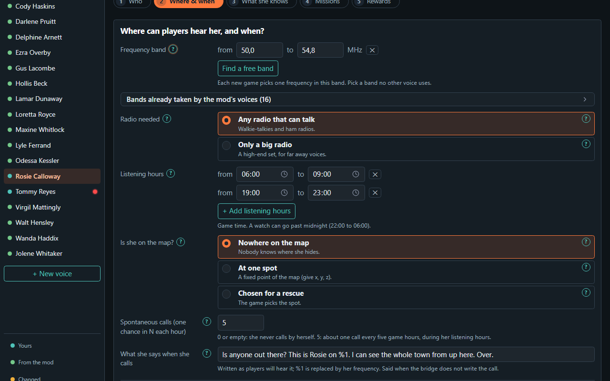
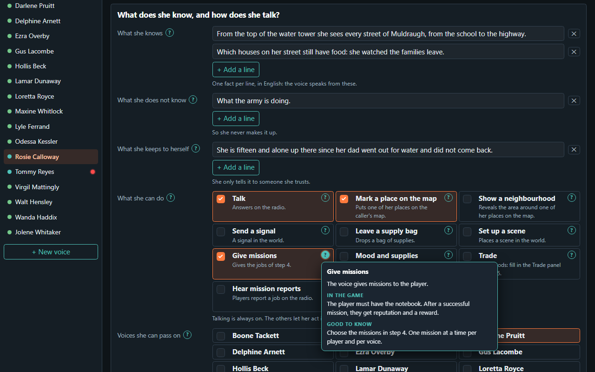
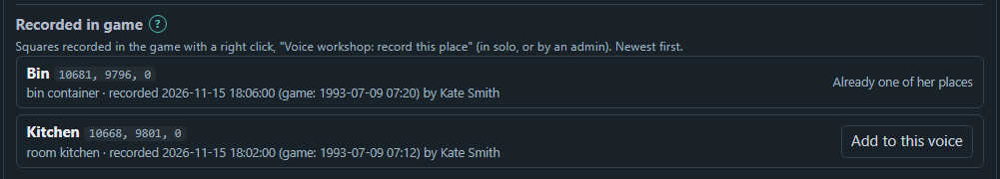
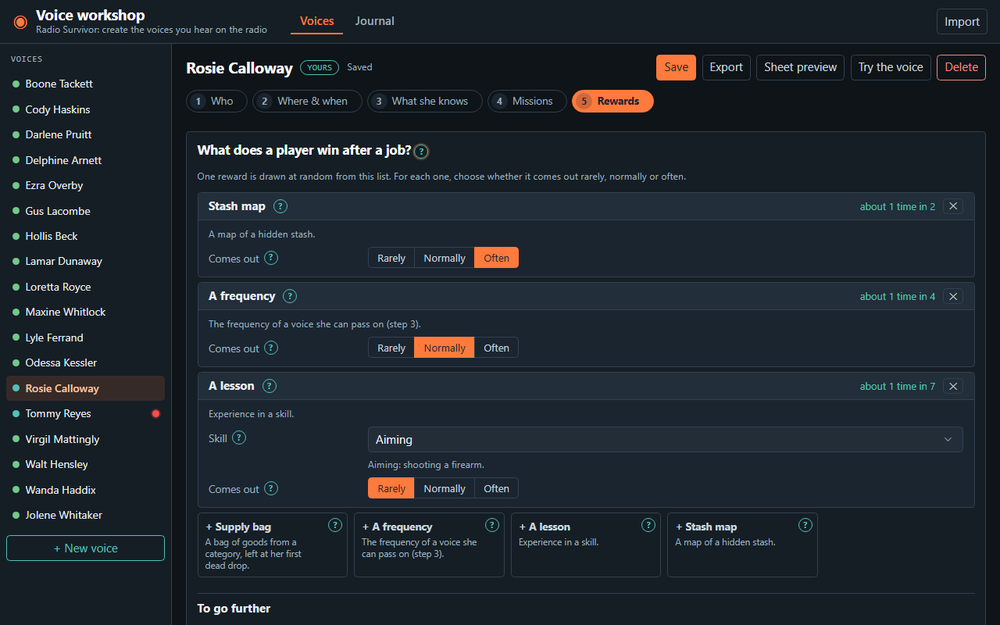
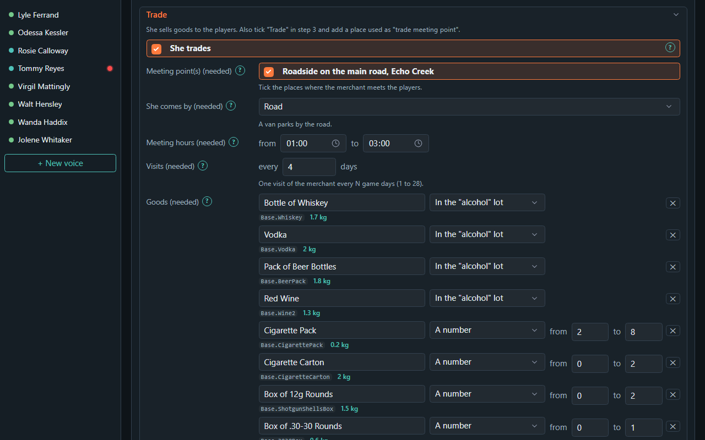
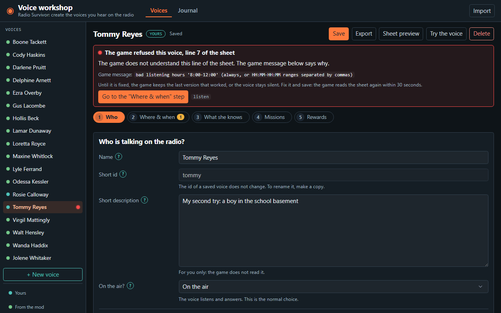

*Français : [Atelier des voix](../fr/13-atelier-des-voix.md)*

# Voice workshop

The **voice workshop** is a page that opens in your web browser. You use it to make the people who answer on the
radio: who they are, when they listen, what they know, the jobs they give and what they give back. You fill in five
steps, click **Save**, and the game hears the new voice within 30 seconds, without a restart.

No need to write a file by hand. If you would rather do it anyway, everything is in
[Creating radio voices](10-creating-radio-voices.md): the workshop writes exactly the same file.

In these pictures a player made **Rosie**, a 15-year-old girl hiding at the top of the Muldraugh water tower. She calls
in the morning and in the evening, asks for food, then for someone to clear the dead around her tower.

## Opening the workshop

The workshop is part of **the bridge** (the small Python program that makes the voices talk, see
[The bridge in singleplayer](05-bridge-in-singleplayer.md)). It needs Python 3.10 or newer and the bridge's `bridge`
folder, downloaded whole from GitHub (the workshop lives in its `atelier` subfolder).

- **Windows**: double-click `atelier.bat` in the `bridge` folder.
- **Linux**: run `./atelier.sh` in that same folder.
- **macOS**: double-click `atelier.command`.
- **Or by hand**, from the `bridge` folder: `python radio_bridge.py --atelier`.

Your browser opens on the workshop by itself. If it does not, the bridge window shows the address to open (for example
`http://127.0.0.1:8765`).

Good to know:

- **The bridge keeps working for the game.** One window does both: the voices answer in game while you work in the
  workshop. Closing that window also closes the workshop.
- **Without an AI configured, the workshop still opens.** You can do everything except the writing helpers, which stay
  greyed out (see [The bridge's AI helps you](#the-bridges-ai-helps-you)).
- **The workshop works on the game's real sheets**: the `Zomboid\Lua\batman_RadioSurvivor\personas` folder of your
  computer. That folder only exists after a world was loaded once with the mod: start a game once before opening the
  workshop.

## The voice list

On the left, every voice. A badge says where it comes from:

| Badge | Meaning |
|---|---|
| **Yours** | A voice you made. |
| **From the mod** | A voice shipped with the mod, unchanged. |
| **Changed** | A voice of the mod that you changed. A mod update never overwrites your changes. |
| **Removed** | A voice of the mod that you took off the air. |
| **Refused by the game** (red dot) | The game did not accept the sheet: see [When the game refuses a voice](#when-the-game-refuses-a-voice). |

**+ New voice** asks for a name and lets you start from **an empty voice** or **a copy** of another voice. Copying a
voice of the mod is a good way to begin: everything is already filled in, you only change it.

Nothing is saved until you click **Save**. If you leave a voice with unsaved changes, the workshop asks you first.

Every setting has a small **?**: hover it (or click it) to learn what it is for, what the player sees in game, the
possible choices and an example.

## The five steps

### 1. Who

The **name** players will see, a **short id** (lowercase letters, digits and `_`: it becomes the file name, for
example `rosie`), a **short description** for yourself only, and the voice's state: **On the air**, **Silent for
now**, **Gone** or **Dead**.

### 2. Where & when

- **Frequency band**: each new game picks one frequency in this band. **Find a free band** picks one no voice of the
  mod uses.
- **Radio needed**: any radio that can transmit (walkie-talkies included), or only a big radio.
- **Listening hours**: game time. Rosie listens from 06:00 to 09:00 and from 19:00 to 23:00. A watch can go past
  midnight (22:00 to 06:00). With no hours, she listens all the time.
- **Is she on the map?**: most often "Nowhere on the map" (nobody knows where she hides).
- **Spontaneous calls**: one chance in N, each listening hour, that she calls by herself. With 5, Rosie calls about
  every five game hours. 0 or empty: never.
- **What she says when she calls**: the sentence players hear, in any language you like. `%1` is replaced by her
  frequency. When the bridge's AI runs, it writes the call; your sentence is used when the bridge writes nothing.

### 3. What she knows

- **What she knows**, **what she does not know**, **what she keeps to herself**: one idea per line, in English. The
  voice talks from these lines. A secret is only told to someone she trusts.
- **What she can do**: talking is always on. The other boxes let her act in the game: mark a place on your map, give
  missions, trade, pass on the frequency of another voice...
- **Voices she can pass on**: voices whose frequency she can give to a player who earned her trust. Rosie knows
  Darlene, the nurse.
- **Her personality (English)**: the text the AI reads to play the voice (who she is, her story, her tone, her rules on
  the radio). The **Write it with the AI** button can write it for you.

### 4. Missions

**Her places** first: the spots the voice knows. Each place has a name players see, a square (x, y and the floor z)
and one or more uses:

| Use | Used for |
|---|---|
| **Map mark** | The voice can mark it on a player's map. |
| **Job place** | A mission can happen there. |
| **Dead drop** | Players leave things there. |
| **Trade meeting point** | Where the merchant comes. |

Rosie has two places: the water tower (map mark and job place) and the dumpster at its foot (dead drop). A voice has
12 places at most.

**Recording a place in game.** Rather than looking for coordinates, walk to the spot in the game, right-click the square
and choose **"Voice workshop: record this place"**. The menu only exists in singleplayer, or for an admin on a server.
The place then shows up in the workshop under **Recorded in game**, with the room or the container found there (a
dumpster, a crate). **Add to this voice** turns it into a place, with a name and uses you can change. A dumpster becomes
a dead drop; a building, a job place.

You can also type a place yourself: **+ Add a place**, then its coordinates.

**Then the missions.** Pick a kind from the cards at the bottom: scout a building, clear the dead, barricade, deliver
goods, bring back papers, find a personal item, set up a radio relay, follow a route, light a smoke signal, keep
watch. Each kind asks for what it needs: a place, a dead drop, a category of items, an amount... For each one:

- **What she says**: the sentence, in English, she uses to ask for the job (200 characters at most). **Suggest** asks
  the AI for an idea.
- **Only after**: the mission is offered only once another one succeeded. Rosie first asks for food ("Deliver
  goods" to the dumpster), and only after that, to clear the dead around the tower.

### 5. Rewards

After a successful mission, the player gets one reward drawn at random from the list: a **supply bag** left at her
first dead drop, **a frequency** of a voice she knows, **a stash map**, or **a lesson** (experience in a skill). For
each one, choose whether it comes out **Rarely**, **Normally** or **Often**; the workshop shows the resulting chance
("about 1 time in 2"). With no reward, she marks one of her places on the player's map.

Under **To go further**, two optional panels: trade and the frequency note.

## A merchant's stock

Open **Trade** and tick **She trades** (also tick **Trade** in step 3). Choose the meeting place (a place used as
"Trade meeting point"; if there is none, **Go to her places** takes you there), how the merchant arrives (boat, road
or hidden drop), every how many days and at what time.

For the goods, click **+ Add an item** and type its name as in the game ("bandage", "battery"): the workshop offers
the matching items. Say how many he brings, one number or "from 2 to 6". **You never write a weight**: the game knows
the weight of every item (a full bottle included); the workshop shows it for information. A **lot** groups goods that
share one total (for example three bottles of liquor, any kind).

## The frequency note

Open **Frequency note** and tick **Her frequency is on a note**. Players will find a **handwritten note** with your
text in the loot.

- **Text of the note**: 8 lines at most, 40 bytes per line (an accented letter counts as two, the counter shows it).
  Write `%1` where her frequency must appear. No `<`, `>` or `^`. The note stays in the language you wrote it in.
- **Found in**: the furniture or containers where it can show up (bedroom dresser, school locker...), each one Rarely,
  Normally or Often.
- **On dead bodies**: a dead body carrying a walkie-talkie may have it.

The note and the spontaneous call sentence are written in the sheet itself: a voice made in the workshop needs no other
file.

## The bridge's AI helps you

When the bridge's AI is configured (see [AI provider configuration](08-ai-provider-configuration.md)), three buttons
help you write:

- **Write it with the AI** (step 3): describe the voice in a few sentences, in your own words and your own language.
  The AI writes her personality in English. **Use it** puts it in the sheet (the workshop asks first if there is
  already a text).
- **Suggest** (next to "What she says", step 4): the AI suggests the sentence that gives the job.
- **Try the voice** (at the top): talk to her as a player. She answers from the sheet as it is now, even unsaved.
  Nothing changes in the game.

Each click is a call to your AI provider, like a radio exchange in game: it costs a little and follows the same caps as
the bridge. Without an AI configured these buttons are greyed out; a tooltip explains how to turn it on.

## Saving, and what the game does

**Save** writes the sheet. The game reads it again **within 30 seconds**, without a restart: tune a radio to her band
during her listening hours and talk to her. **Sheet preview** shows the file as it will be written.

The workshop points out what looks wrong (a band that crosses another voice's, a place with no coordinates...), but
these are only tips: you can save anyway. **The game decides.**

### When the game refuses a voice

When the game does not accept a sheet, the voice gets a **red dot** in the list, and a banner says which line is the
problem, in plain words, with the game's exact message. The **Go to the step...** button takes you to the right place.

Here, Tommy's listening hours are written `8:00` instead of `08:00`. Until it is fixed, the game keeps the last version
that worked, or the voice stays silent. Fix it, save: the banner goes away once the game has read the sheet again.

## The live journal

The **Journal** tab, at the top, shows live what happens on the air: what players say to the voices, their replies,
the bridge's errors, and the game's lines about the sheets (voice loaded, voice refused). Filter by voice, by level or
by source (bridge, game); **Pause scrolling** freezes the view.

This is the live admin tool of a server owner. **It holds the players' conversations**: it is only visible on the
machine that runs the workshop and is never written to disk. Do not publish a screenshot of the journal without the
players' consent.

When no AI is configured, the bridge does not make the voices answer: the journal then only shows the game's lines.

## Sharing a voice

- **Export** downloads the voice's sheet (a `.txt` file). Send it to a friend or to your server's admin.
- **Import** (top right) adds a sheet you received: pick the file, or drop it on the page. When a voice already has
  that id, the workshop asks for a new id instead of overwriting it.

## Delete, remove, go back

- **Delete**: removes for good a voice you made. Export it first if you want to keep it.
- **Take off the air**: for a voice of the mod. Its sheet is emptied and the game removes it within 30 seconds. It
  stays in the list, marked **Removed**.
- **Back to the mod's version**: throws away your changes to a voice of the mod (or undoes its removal). The mod's
  version comes back at the next world load.

## Voices remember

Every voice remembers its callers, for good: nothing to tick. A voice keeps details about each character ("he is
looking for his sister", "she has a hurt leg") and brings them up later. She keeps up to **2,000 characters** of
memories per character; once full, she learns nothing new about that character, but forgets nothing. **The dead stay
in her memory**: if someone talks to her about a dead character she knew, she knows they died and can talk about it.
Details: [Remember you](10-creating-radio-voices.md#remember-you--always).

## For a server owner

- **Run the workshop on the server's machine**, with the same options as your bridge (for example `--exchange`): it
  edits the sheets of the server's `Lua/batman_RadioSurvivor/personas` folder, and reads the places your admins
  recorded in game on that same machine.
- **The workshop only listens on the machine itself** (`127.0.0.1`), never on the Internet. On a rented server, open it
  from your PC through an SSH tunnel, for example `ssh -L 8765:127.0.0.1:8765 user@server`, then
  `http://127.0.0.1:8765` in your browser.
- **Game verdict and journal on a dedicated server**: the workshop reads `console.txt` in the Zomboid folder. If your
  server writes its console somewhere else, name the file: `python radio_bridge.py --atelier --game-log <file>`.
- **Port already taken**: the workshop tries 8765 then the next ports; `--atelier-port <port>` picks another one.
- A player can make a voice in their own workshop, in singleplayer, then send it to you with **Export**; you add it
  with **Import**.

## Limits

- The workshop only knows the current sheet format. It keeps the lines it does not understand, unchanged.
- Facts, missions and the personality are written in English (the AI plays the voice from that text and answers in the
  player's language). The note and the call sentence are written in any language.
- 12 places per voice at most; 8 lines of 40 bytes for the note; 200 bytes for the call sentence.
- **Find a free band** only looks at the bands of the mod's voices, not at your own voices' bands.
- A saved voice's id does not change: to rename it, make a copy.
- Back to the mod's version only takes effect at the next world load.
- Places recorded in game only show in a workshop started on the machine that runs the game.
