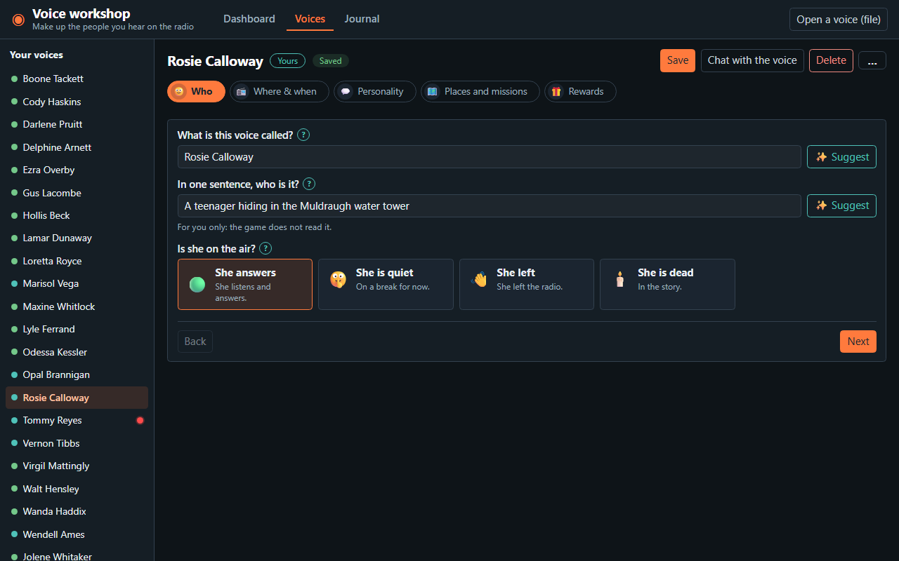
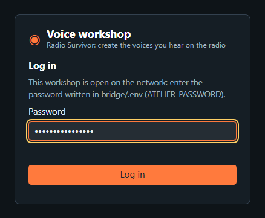
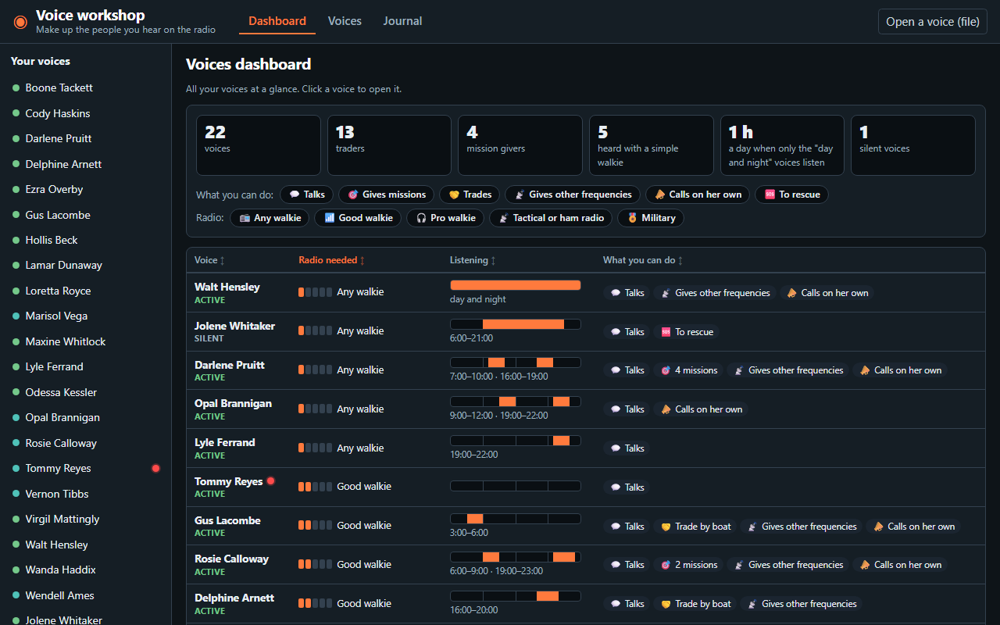
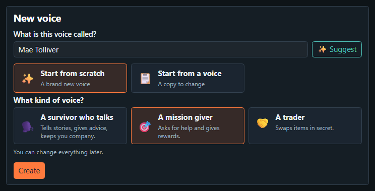
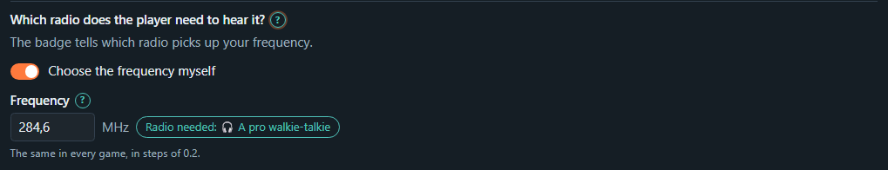
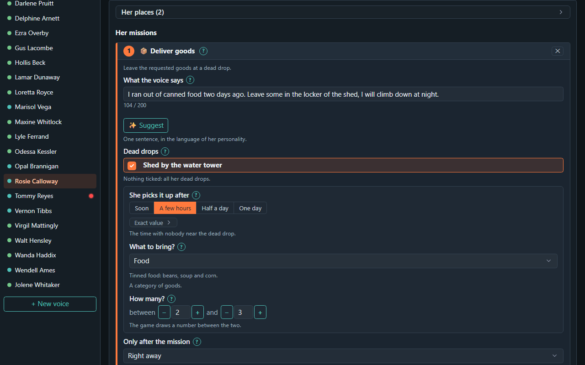
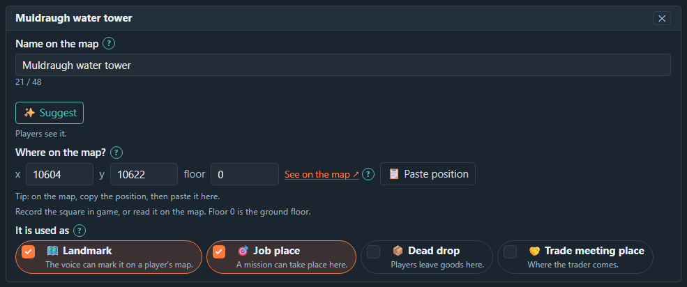
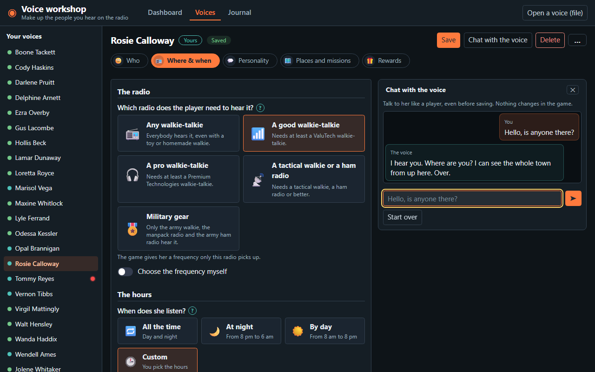
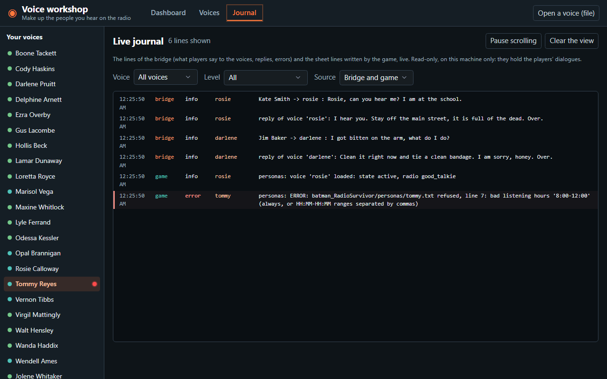
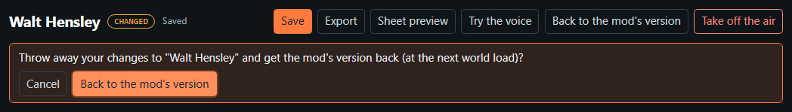

*Français : [Atelier des voix](../fr/13-atelier-des-voix.md)*

# Voice workshop

The **voice workshop** is a page that opens in your browser. It is where you make the people who answer on the
radio: who they are, when they listen, their character, the jobs they give, what they give in return and what they
sell. You answer five steps, click **Save**, and the game hears the new voice within 30 seconds, without a restart.

No need to write a file by hand. The workshop writes the same file as the one described in
[Creating radio voices](10-creating-radio-voices.md), the line-by-line reference. Four complete voices, built step by
step, are in [Voice examples](14-voice-examples.md).

In the pictures of this page, a player made **Rosie**, a 15-year-old girl hiding at the top of the Muldraugh water
tower. She calls in the morning and the evening, asks for food, then for the dead around her tower to be cleared.

## Contents

- [Opening the workshop](#opening-the-workshop) · [from a tablet](#opening-it-from-a-tablet-or-another-computer)
- [The workshop screen](#the-workshop-screen) · [the dashboard](#the-dashboard) · [the voice list](#the-voice-list) ·
  [making a voice](#making-a-voice) · [the buttons of a voice](#the-buttons-of-a-voice)
- The five steps: [1. Who](#step-1--who) · [2. Where & when](#step-2--where--when) ·
  [3. Personality](#step-3--personality) · [4. Places and missions](#step-4--places-and-missions) ·
  [5. Rewards](#step-5--rewards)
- To go further: [trade](#trade) · [frequency note](#the-frequency-note) · [her own item lists](#her-own-item-lists)
- [The bridge's AI helps you](#the-bridges-ai-helps-you) · [Saving and the game's verdict](#saving-and-the-games-verdict) ·
  [The live journal](#the-live-journal)
- [Sharing a voice](#sharing-a-voice) · [Delete, take off, go back](#delete-take-off-go-back) ·
  [Voices remember](#voices-remember) · [For a server owner](#for-a-server-owner) · [Limits](#limits)

## Opening the workshop

The workshop is part of the **bridge** (the small Python program that makes the voices talk, see
[Bridge in singleplayer](05-bridge-in-singleplayer.md)). You need Python 3.10 or newer, and the bridge's `bridge`
folder, downloaded whole from GitHub (the workshop lives in its `atelier` subfolder).

- **Windows**: double-click `atelier.bat` in the `bridge` folder.
- **Linux**: run `./atelier.sh` in that same folder.
- **macOS**: double-click `atelier.command`.
- **Or by hand**, from the `bridge` folder: `python radio_bridge.py --atelier`.

The browser opens the workshop by itself. Otherwise, the bridge window shows the address to open (for example
`http://127.0.0.1:8765`). The page is in French if your browser is in French, in English otherwise.

Good to know:

- **The bridge keeps working for the game.** One window does both: the voices answer in game while you work in the
  workshop. Closing that window also closes the workshop.
- **Without an AI configured, the workshop still opens.** Everything works, except the writing help buttons and the
  test conversation **Chat with the voice**, which stay greyed out (see [The bridge's AI helps you](#the-bridges-ai-helps-you)).
- **The workshop works on the game's real sheets**: the `Zomboid\Lua\batman_RadioSurvivor\personas` folder of your
  computer. That folder only exists after a world has been loaded once with the mod: start a game once before opening
  the workshop.

### Opening it from a tablet or another computer

By default, the workshop only answers the computer it runs on. To open it from a tablet or another computer of your
home network:

1. Choose a password of **10 characters or more** and add it to the `.env` file of the `bridge` folder (the one that
   holds the AI settings; copy `.env.example` to `.env` if you don't have one):
   `ATELIER_PASSWORD=your password`
2. Start the workshop on the network: `python radio_bridge.py --atelier --atelier-host 0.0.0.0` (with a launcher:
   `atelier.bat --atelier-host 0.0.0.0`, `./atelier.sh --atelier-host 0.0.0.0`).
3. The bridge window shows the address to open, for example
   `Voice workshop on http://0.0.0.0:8765/ (password required); from another device: http://192.168.1.20:8765/`.
   On the tablet, open `http://<PC address>:8765/`, enter the password and click **Log in**.

- **Everyone logs in**, the PC itself included. The browser stays logged in for 7 days, or until the bridge restarts.
  The **Log out** button, top right, ends the session.
- **Wrong passwords are slowed down**: after 5 failures from the same device, the page shows "Too many failed
  attempts: try again in … s"; the wait lasts 1 minute, then doubles with each new failure (up to 15 minutes). Every
  login, failure and logout shows in the live journal with the device's address.
- Without `ATELIER_PASSWORD`, or with a shorter password, the workshop does not start on the network: the bridge
  window says why, and the bridge keeps answering the game.
- Windows may ask whether Python may use the network: allow it on **private** networks only.
- **Home network only.** The workshop speaks plain HTTP, which is enough at home. To reach it from outside, go through
  a VPN such as Tailscale or an HTTPS proxy. **Never open the port on your router.**

## The workshop screen

- **At the top**: three tabs, **Dashboard** ([every voice at a glance](#the-dashboard), opened at start), **Voices**
  (the editor) and **Journal** ([the live journal](#the-live-journal)); on the
  right, **Open a voice (file)** ([sharing a voice](#sharing-a-voice)) and, on the network, **Log out**.
- **On the left**: **Your voices** and the **+ New voice** button. Under 900 px wide, the list becomes a strip of chips
  above the editor.
- **In the middle**: the open voice. With no voice open, a welcome screen recalls the three gestures: pick a voice,
  answer the questions step by step, save.

Every setting has a small **?**: click it (or hover over it) to learn what it is for, what the player lives in game,
the possible choices and an example. The rest is under **Learn more**. **Escape** closes the bubble.

### The dashboard

Every voice of the workshop at a glance (the mod's and yours, removed voices left out).

- **At the top, the numbers**: voices, traders, mission givers, voices heard with a simple walkie, hours per day when
  only "day and night" voices listen (a gap to fill), voices that keep quiet.
- **Filters**, one click each: by what you can do (talk, give jobs, trade, give other frequencies, call on their own,
  to rescue) and by radio. Click again to remove the filter.
- **One row per voice**: its name (and the red dot when the game could not read it), the radio needed to hear it (a
  voice on a fixed frequency gets the radio its frequency needs), its listening hours on a 24 h bar, and what you can do
  with it (number of jobs, trade by van, by boat or by dead drop). Click a column title to sort, again to reverse. Click
  a voice to open it in the editor.

### The voice list

The legend under the list fits on one line: **the red dot** means "The game could not read this voice".

| Badge | Meaning |
|---|---|
| **Yours** | A voice you made or imported. |
| **Original voice** | A voice shipped with the mod, as it is. |
| **You changed it** | An original voice you changed. A mod update never overwrites your changes. |
| **Off the air** | An original voice you took off the air. |
| **Older version** (hollow green dot) | A copy of a voice of the mod that the game wrote from an older version of the mod: the game will replace it with the mod's new version the next time it loads the world, or at once with **Back to the original**. |
| **Not saved yet** | (at the top of the editor) A voice made but never saved: it does not exist for the game yet. |
| **Red dot** | The game could not read this voice: see [When the game refuses a voice](#when-the-game-refuses-a-voice). |

### Making a voice

**+ New voice** opens a small window, in three steps:

1. **What is this voice called?** Give only the name players will hear, such as "Rosie Calloway". Nothing else to
   type: the file name is made by itself from the first name, and it is never shown (a tooltip on the title may show it).
2. **How do you start?** Two cards:
   - **Start from scratch**: a brand new voice, with a starting sheet that everybody hears with any walkie-talkie, and
     a personality to rewrite.
   - **Start from a voice**: a copy to change. The list of voices opens, one click picks; the copy is saved at once.
3. **What kind of voice?** (only for **Start from scratch**) Three cards that tick the right actions at step 3:
   - **A survivor who talks**: it only ticks **Talk**.
   - **A mission giver**: it ticks **Give missions**.
   - **A trader**: it ticks **Trade** and turns on the trade panel of step 5.

The steps a voice does not use yet are folded. **+ All steps** shows them; they come back as soon as an action needs
them. Copying a voice of the mod is a good way to start: everything is already filled in, you only have to change it.

Nothing is saved until you click **Save**. If you switch voices with unsaved changes, a bar asks **Leave without
saving** or **Cancel**; closing the browser tab asks too.

### The buttons of a voice

At the top of the open voice: its name, its badge and "Saved" or "Not saved".

| Button | Effect |
|---|---|
| **Save** | Writes the voice; the game reads it again within 30 seconds. |
| **Chat with the voice** | Opens the test conversation ([The bridge's AI helps you](#the-bridges-ai-helps-you)). |
| **Delete** | **Yours** voices only: erases the voice for good. |
| **Take off the air** | **Original voice** or **You changed it** voices: empties the sheet, the game drops the voice. |
| **Back to the original** | **You changed it** or **Off the air** voices: throws your changes away. |
| **…** (more actions) | **Save a copy** downloads the voice (a `<name>.txt` file); missing until the voice is saved. **See the game's text** shows on the right the file as it will be written, updated at each keystroke; **Hide the game's text** closes it. |

Below these buttons, the **five steps** are numbered pills with their icon: click one to jump to a step, or use **Back**
and **Next** at the bottom. A number on a pill counts the [things to check](#saving-and-the-games-verdict) of that step
("To check: N").

## Step 1 — Who

"What is this voice called?"

| Setting | What it changes |
|---|---|
| **What is this voice called?** | How the voice introduces itself; players hear it on the radio. |
| **In one sentence, who is it?** | One line, for you only: the game does not read it. |
| **Is she on the air?** | Four cards. **She answers**: she listens and answers (the normal choice). **She is quiet**: she keeps her frequency but does not answer, players only hear silence. **She left**: she left the radio, her frequency becomes free again; she can come back if you change the state. **She is dead**: she died in the story, her frequency becomes free again. |

**Example in game.** Setting Rosie to **She is quiet** for a game week makes players believe something happened to
her; putting her back on **She answers** brings her back.

## Step 2 — Where & when

"Where can players hear her, and when?" The step has four parts, each under its own title.

### The radio

| Setting | What it changes |
|---|---|
| **Which radio does the player need to hear it?** | Five big cards, from the simplest to the rarest: **📻 Any walkie-talkie** (everybody hears it, even with a toy or homemade walkie: the choice already ticked), **📶 A good walkie-talkie**, **🎧 A pro walkie-talkie**, **📡 A tactical walkie or a ham radio**, **🎖️ Military gear**. At each new game, the game gives the voice a free frequency that this radio tunes and simpler radios do not: the player needs the right radio, then looks for the voice by turning the dial. Never two voices on the same frequency. |
| **Choose the frequency myself** | A switch. On, the cards give way to one **Frequency** box (in MHz, in steps of 0.2, from 0.2 to 1000.0): the same in every game, so players can write it down. A **Radio needed** badge tells at once which radio tunes it, and an orange line warns when a voice of the mod already uses it. Off, the card of the radio that tunes this frequency is ticked. |

### The hours

| Setting | What it changes |
|---|---|
| **When does she listen?** | Four cards: **All the time** (day and night), **At night** (from 8 pm to 6 am), **By day** (from 8 am to 8 pm), **Custom** (you pick the ranges). |
| **Start** / **End** | For **Custom**: a range of game time, "from … to …". **+ Add hours** adds a range. A range can go past midnight (22:00 to 06:00). Outside her hours she is silent and never calls. |

### The place

| Setting | What it changes |
|---|---|
| **Where is she?** | Three cards. **Nobody knows where she is**: she hides (the right choice for a new voice). **At a precise spot**: a fixed point of the map; the x, y and floor fields appear, with the **See on the map ↗** link. **The game places her for a rescue**: kept for the Whitaker rescue. |

### The calls

| Setting | What it changes |
|---|---|
| **Does she call by herself?** | Four named steps: **Never**, **Rarely** (about one call every 12 game hours), **Sometimes** (about one call every 6 hours), **Often** (about one call every 3 hours). Each step is explained in its tooltip. The folded **Exact value** panel holds the number (one chance in N each game hour, during her listening hours). A value typed by hand lights the nearest step and shows **Custom setting**. Each call counts as one request to the AI. |
| **What she says when she calls** | Shows once calls are set. The sentence every player tuned to her frequency hears, in the language of your choice. The **+ Add my frequency** button writes the word **[frequency]** where you want it: the game replaces it with her frequency, which you never see. 200 bytes at most, no `<`, `>` or `^`. When the bridge's AI runs, it writes the call; your sentence is used when the bridge writes nothing. |

The voices of the mod keep their call sentence in the folded **Advanced settings** panel: it is the name of a translated
text of the mod. A new voice writes its sentence.

**The five radios** (reach of the game's radios, read from its files):

| Card | Radios | They tune | The voice gets a frequency in |
|---|---|---|---|
| 📻 Any walkie-talkie | Toys-R-Mine walkie-talkie, makeshift walkie-talkie | 75 to 150 MHz | 75.0 to 150.0 |
| 📶 A good walkie-talkie | ValuTech walkie-talkie | 50 to 200 MHz | 50.0 to 74.8, 150.2 to 200.0 |
| 🎧 A pro walkie-talkie | Premium Technologies walkie-talkie | 25 to 300 MHz | 25.0 to 49.8, 200.2 to 300.0 |
| 📡 A tactical walkie or a ham radio | Tactical walkie-talkie, Premium Technologies ham radio, makeshift ham radio | 10 to 500 MHz | 10.0 to 24.8, 300.2 to 500.0 |
| 🎖️ Military gear | US Army walkie-talkie, manpack radio and ham radio | 0.2 to 1,000 MHz | 0.2 to 9.8, 500.2 to 1000.0 |

A stronger radio tunes everything the simpler ones tune: a **📻 Any walkie-talkie** voice is heard with every radio, a
**🎖️ Military gear** voice only with the army's.

**Common mistakes.** An hour written `8:00` instead of `08:00` in a hand-written sheet (the workshop always writes two
digits); a range whose start equals its end; a frequency chosen by hand that is already another voice's (the voice
loaded first keeps it, the other one stays silent).

## Step 3 — Personality

"Who is this voice, and what can it do on the radio?"

### What can she do?

She always talks. Tick what else she does, each action with its icon. During the conversation, the AI alone decides to
use an action when the situation calls for it. The game then checks each action; if it refuses it, the voice still talks.

| Card | What the player lives | Good to know |
|---|---|---|
| **Talk** | She answers on the radio. | Always ticked, and it cannot be unticked. |
| **Mark the map** | "I'll mark it on your map": a symbol appears at one of her places. | Needs a **Landmark** place. Only the player talking sees it. |
| **Show a neighbourhood** | The neighbourhood around one of her places is revealed on the player's map. | Needs a **Landmark** place. |
| **Give missions** | She gives the jobs of step 4. | The player needs the notebook. One mission in progress at a time per player and per voice. |
| **Have a mood** | Her mood and supplies change from call to call; she talks about it herself. | Story only: nothing changes in the game. |
| **Trade** | She sells goods and sets up a meeting. | Also fill in [trade](#trade) at step 5: one without the other is refused. Ticked by itself when you tick **This voice trades**. |
| **Give a contact** | She gives another voice's frequency to someone she trusts; it is written in their notebook. | Shows **She can give the contact of…**. |

**She can give the contact of…**: tick the voices whose frequency she can give. The game itself picks, among them, a
voice that is on the air. Also used by the **A radio contact** reward. Rosie knows Darlene, the nurse.

### Who is she really?

The only text that describes the voice. The AI reads it to play her: who she is, her past, what she knows how to do,
what she keeps to herself, her tone, her rules on the radio. A new voice starts from a starting text to rewrite.

**In which language do you write her personality?** Two cards: **In English** (the default) and **In French**. The AI
that plays the voice understands both: nothing is translated, the text stays as it is written, and the sheet notes the
language (`language=`). A starting text you have not touched switches to the other language when you change the card.

**Write it with the AI** sits above the text: the AI writes it in English from a few sentences. If the AI is not
plugged in, the button is greyed out and says: "The AI is not plugged in: ask the adult who runs the workshop."

Tips:

- Write in the second person ("You are Rosie…" in English, "Tu es Rosie…" in French). The voice still answers in the
  player's language if you say so in her rules: "Answer in the same language the caller uses."
- **The past and the secrets go here.** A secret is written with the rule never to tell it: "You never tell anyone
  that…, even if asked; deny it."
- **Never write the current state of a place** ("the clinic is surrounded"): it would become wrong during the game.
  What the voice learns about the world comes from the game (deaths, places, missions, news).
- Ask for short sentences, staying in character, no coordinates. Put no server secret in it: the AI can repeat
  anything.
- If a mission sets a **story state** (step 4, "What changes in her story"), say here what that state changes for her.

## Step 4 — Places and missions

"Where is she, and what jobs does she give?" The step has two parts: **Her places**, then **Her missions**.

### Her places

The places the voice knows (12 at most). The **Her places (n)** panel opens and closes with a click. Without a place, a
sentence says so: "She has no place yet. Start with a spot you know." **+ New place** asks first for the place's name
("Name of the place (seen on the map):"). No id is asked: each place card only carries its name. **Delete this place**
(the cross on the card) removes it.

| Setting | What it changes |
|---|---|
| **Name on the map** | What players see on their map: no secret here. A "12 / 48" counter shows the room left. |
| **Where on the map?** | x, y and floor (0 = ground floor). The AI never sees these numbers. Record them in game (below), or read them on the map. The **See on the map ↗** link opens the square. A position copied on the map (`7966, 11751`) can be pasted into any of the three fields: x, y (and the floor when there is a third number) fill at once. |
| **It is used as** | Four chips with their icon, to tick: **🗺️ Landmark** (she can mark it on a player's map; with no reward set, she also offers this marker after a job), **🎯 Job place** (a square inside the targeted building; it is circled on the map during the job), **📦 Dead drop** (the player leaves goods there, and reward bags are put there), **🤝 Trade meeting place** (where the trader comes). |

Rosie has two places: the water tower south of Muldraugh (landmark and job place) and the shed next to it, whose locker
is the dead drop.

**Finding x and y.** The most reliable way is to record the place in game (below): the B42 map can differ from the
sites made from an older map. To look before playing, the [Project Zomboid B42 map](https://zomboidmap.com/) shows the
whole Knox Country: move the mouse over a square to read its X and Y, or copy the
position and paste it into x (the **📋 Paste position** button does the same when the browser allows it, on the bridge's
computer), then check the spot in game. Put a dead drop or the
meeting point of a hiding spot on the square of a container (dumpster, mailbox) or right next to it, and a job place on
a square inside the building.

Next to the x, y and z fields of a place (and of the position of a voice set at a precise place), the "See on the map
↗" link opens the community Build 42 map (zomboidmap.com) in a new tab, zoomed on the square. While x and y are empty,
the "Open the map ↗" link shows the whole map: the square under the mouse shows its coordinates there. That map is made
from Build 42.20 and may differ slightly from your version; for a sure square, record it in the game with a right
click, "Voice workshop: record this place" (in solo with debug mode on, or by an admin in multiplayer).

### Recording a place in game

Rather than looking for coordinates, walk to the spot in the game, right-click the square and choose **"Voice
workshop: record this place"**. The menu only shows in singleplayer with the game's debug mode on, and on a server only
for an admin or a moderator. The place then shows in the workshop under **From my records** (newest first), with the
date, who recorded it, the room and the container found (a dumpster, a mailbox), in plain names.

**Add to this voice** asks for a name and creates the place with suggested uses: a container becomes a dead drop, a
building a job place and a landmark. Everything can then be changed on the place's card. A record already present is
marked **Already one of the voice's places**. Records are kept in `Zomboid/Lua/batman_RadioSurvivor/workshop-places.txt` on
the machine running the game or the server (the last 200).

### Her missions

Without any mission, the kind cards come first: click one under **Add a mission**. Each mission becomes a numbered card,
with the icon of its kind, with no id. Common settings:

| Setting | What it changes |
|---|---|
| **What the voice says** | The reason she gives, in the language of her personality (English by default), 200 characters at most, with a "N / 200" counter. The AI tells it to the player. **✨ Suggest** asks the AI for a sentence. |
| **Where does it happen?** | One of her places marked **Job place**. A red **to fill in** pill appears when one is needed. |
| **Type settings** | In one box. Quantities: "between [− n +] and [− m +]". Counts: a − / + stepper. **She picks it up after**: **Soon** (2 h), **A few hours** (6 h, the usual setting), **Half a day**, **One day**. **How long to keep watch?**: **One hour**, **Two hours** (the usual setting), **A morning** (6), **A whole night** (12). Each step has its **Exact value**. |
| **Dead drops** | For the kinds that need one: nothing ticked means all her dead drops. |
| **Only after the mission** | **Right away**, or one of her other missions, for example **1 · Keep watch**: the number and the kind, never an id. This one is only offered once the other has succeeded. |
| **What changes in her story** | A short sentence, for example "She went back to her clinic". You write it, the workshop makes a name for the game from it and writes the sentence at the end of her personality (`Story state: when your story state is <name>, <sentence>`): the AI knows what that name means. Two missions with the same sentence share the same state. |
| **More settings** (folded) | Change the kind of mission; the place, for the kinds that do not require one (**Picked around the player**: the game picks a building near the player, to scout or clear); **Offered** (Rarely, Normally, Often); **Who unlocks the next one** (The player, or The whole team). |

At the end of a successful mission, the player gains reputation and a reward of step 5.

### The ten kinds of mission

| Kind | What the player does | Own settings | Needs |
|---|---|---|---|
| **Scout a building** | Visits a building, then tells her what they saw. | — | Nothing (place optional) |
| **Clear the dead** | Kills the zombies around a place. | — | Nothing (place optional) |
| **Barricade** | Boards up outside windows and doors with planks or sheet metal. Only barricades put up during the job count. | **Windows and doors** (4 by default, 1 at least) | A **Job place** |
| **Deliver goods** | Leaves the requested items at a dead drop; drops at several dead drops add up. | **She picks it up after** (game hours with nobody around before the goods are picked up, 6 by default), **What to bring?** (a category; without one, 6 bandages or ripped sheets), **How many?** ("from … to …", drawn at the start of the job) | A **Dead drop** |
| **Bring back papers** | Finds a missing person's ID card and leaves it at a dead drop. | **She picks it up after** | A **Dead drop** |
| **Find a personal item** | The game puts a precious item at the chosen place; the player finds it and leaves it at a dead drop. | **She picks it up after**, **Which item?** (**Pick an item** opens the list of items, one click picks), **What she calls it** (optional) | A **Job place** and a **Dead drop** |
| **Set up a radio relay** | Puts up high (upper floor or roof) a transmitting radio, turned on and powered. Turned off, unpowered or taken away, it no longer counts. | — | A **Job place** |
| **Follow a route** | Goes through several places in order, on foot or by vehicle (within 8 squares of the centre), then reports. Only the next stop is circled on the map. | **Stops, in order**: 2 to 8 **Job place** places, never the same twice in a row (**+ Add a stop**, **Move up**, **Remove**) | Two job places |
| **Light a smoke signal** | Lights a Signal Smoke signal at the requested place. | — | The Signal Smoke mod |
| **Keep watch** | Stays within 6 squares of a place for a few game hours (time stops when the game is paused), then tells what they saw. | **How long to keep watch?** (one hour to a whole night, two hours by default) | A **Job place** |

The fields to fill in carry a star, and a red **to fill in** pill appears when something is missing. The kinds that need
a dead drop show the **Dead drops** box (nothing ticked: all her dead drops). Rosie first asks for food (**Deliver
goods** at the shed), and only after that for the dead around the tower to be cleared.

**Common mistakes.** A **Deliver goods** or **Bring back papers** mission with no **Dead drop** place; a **Place**
that is not ticked **Job place**; a mission "Only after" a mission deleted since.

## Step 5 — Rewards

"What does a player win after a job?" **Only one reward is drawn at random.** At each successful mission, the game draws
one reward from this list. Click a **+ …** card, with its icon, to add one.

| Reward | What the player gets | Setting |
|---|---|---|
| **🎒 Supply bag** | A bag of real items, in quantities drawn at random, put at her first dead drop; the player gets the dead drop's marker, which only they see. Needs at least one place. | **Category**: Ammo (9 mm rounds and shotgun shells), **Food** (canned beans, soup and corn, by default), Medical (bandages, disinfectant, pills), Radio gear (a walkie-talkie and batteries), Tools (hammer, screwdriver, nails), or [one of her own](#her-own-item-lists). |
| **📇 A radio contact** | The frequency of a voice she can pass on (step 3), written in their notebook. | — |
| **🗺️ Stash map** | A map that leads to a hidden stash of the game, not looted yet. One per player and per voice. | — |
| **📘 A lesson** | Experience in a skill: 25 base points, capped at 100 per day; a character with no bonus in that skill only gets a quarter. | **Skill**: First aid, Aiming, Reloading, Carpentry, Mechanics, Electrical, Metalworking, Cooking, Agriculture, Fishing, Trapping, Foraging. |

For each one, **Comes out**: **Rarely**, **Normally** or **Often** (Often comes out twice as much as Normally, which
comes out twice as much as Rarely). Next to the name, the workshop shows the resulting chance ("about 1 time in 3",
"every time"). A reward impossible at the moment (no voice to pass on, map already given) is not drawn. **With no
reward**, she marks one of her **Landmark** places on the player's map.

**Dropping off and picking up.** For a mission with dead drops, the player leaves the goods within 3 squares of a dead
drop: when the game designates a container there (one mission in two, if there is one), the goods go in it; otherwise
in a bag **on the ground** holding only the requested goods; the notebook says which. A **Supply bag** reward is
different: the game itself puts the bag **on the ground** at the dead drop (the nearest free square, inside the
building when the place is in one) and marks it on the player's map; you place nothing, the player just picks it up.

Under **To go further**, two optional panels, closed by default: **trade** and the **frequency note**. The **Advanced
settings**, at the bottom of the step, keep **Her own item lists**.

### Trade

**How it goes in game.** No trader appears, and the player never sees a price. On the radio, the voice and the player
agree on **two lists of items**: what the player brings, what the trader leaves ("you bring me 2 boxes of shells, I
leave you 3 cans"). The game refuses a deal that is too generous for the trader. The first deal books the next run for
the player's group: the trader gives the place, the night and the signal, the place is marked on that group's map
only and **the deal is written in the notebook** (Radio tab). The meeting is at least 6 game hours after the booking;
once the trader has arrived, the deal no longer changes.

1. **Boat** or **Road**: during the meeting window, the player shows the signal on the spot, **a lit lamp in hand** or
   **a red flare** (Signal Smoke). They hear the boat land, or the van's door. **A hiding spot**: no signal, no sound;
   the payment waits in the place's container (trash can, mailbox) before the hour.
2. The player leaves **exactly what was agreed within 3 squares of the place**, then **goes out of sight**: nobody
   within 100 squares during the delay (1 game hour by default). Coming back too early resets the wait.
3. On the way back, the goods are there. **All or nothing**: only what was left after the deal counts (a bag already
   there, the loot of a dumpster or another player's stash do not count). Everything is there: the trader takes the
   agreed list, nothing more. Something is missing: he keeps everything that was left, leaves nothing and remembers it
   (higher prices, lower reputation). Nothing was left: the reputation drops half as much.

**Where the payment goes.** With **Boat** or **Road**, in one or more bags put **on the ground** within 3 squares of
the place (they add up); the goods go in the bag that held most of the payment. With **A hiding spot**, no bag on the
ground: the payment goes **in one or more containers** of the place (dumpster, mailbox, crate) within 3 squares, and
the goods in the one that held most of it. **Never in a vehicle**: the trader does not search cars. So put a hiding
spot's meeting point on a container or right next to it.

**Caps**: the trader leaves **10 kg at most** per exchange (8 kinds of items at most) and the player brings **20 kg at
most**. A run is rarely called off (patrol 1 time in 75, helicopter 1 time in 100, a real storm of the game by mode):
the voice announces it on its frequency and repeats it every hour until the meeting time, and nothing is lost. The
trader leaves without touching anything if he had no quiet moment within 12 hours of his arrival.

**In the workshop**, open **Trade** and tick **This voice trades** (**Trade** is also ticked at step 3). The panel has
three groups. Each setting to fill in carries a star, and "* to fill in" is said once, at the top.

**What does she sell?**

| Setting | What it changes |
|---|---|
| **What she sells** | One line per item, with "between [− +] and [− +]": how many she brings, drawn at each run. Only the item's name shows, never a weight. **Add what she sells** opens the list of items. |
| **Bundles** | A bundle groups items that share one total. Type its name ("E.g. Booze") and click **+ Add a bundle**. On the bundle's card: its name (editable), "between … and … items in all", "No more than [− N +] different items" (empty = no limit), the list of its items and **Add items to the bundle**. Renaming a bundle keeps its items. |

**When and where?**

| Setting | What it changes |
|---|---|
| **Where is the meeting?** | Tick her **Trade meeting place** places; with several, one is drawn at each run. With none, **Make the meeting place** creates a place marked as such, ticks it and opens the places step to give it its square. |
| **She comes by** | **Boat** (a boat lands), **A hiding spot** (nobody comes, like the traders of Rosewood, Ekron or Fallas Lake) or **Road** (a van parks by the road). |
| **At what time?** | Start and end of the meeting, in game time: the end can go past midnight (23:00 to 01:00). |
| **She comes back** | **Every day**, **Every 3 days**, **Every week**, **Every 2 weeks**, **Once a month**. **Exact value** sets a number of days from 1 to 28. One run per period for the whole server. |
| **The place stays quiet** | **Right away**, **One hour** (the usual setting), **A few hours** (4 game hours), **One day** (24). The game hours with nobody around before the exchange. |

**What does she take as payment?**

| Setting | What it changes |
|---|---|
| **What she takes** | **Whole lists** (Cash and valuables, Jewelry, Cameras and films, Papers of the dead, Military gear, or one of her own), each with "N items"; **And precise items**; the **Add what she takes as payment** button adds items. The panel says **Only what traders buy.** A list with no priced item is not offered. |
| **Her prices** | Three cards: **Generous** (from 5 % to 25 %), **Fair** (the game's usual setting, 10 % to 50 %, nothing to fill in), **Greedy** (from 30 % to 80 %). The exact percentages are set in **Exact value**. The game counts it in secret to judge a deal. |

> **Only items with a price can be traded.** A trader can only sell, or accept, the items that have a price in the
> trade: batteries, cigarettes, spirits, beer, coffee, radio parts, electric wire, seed packets; canned food, rice,
> pasta, dried beans, peanut butter; antibiotics, bandages, wipes, disinfectant, painkillers, suture needle; ammo
> boxes; money, jewelry, cameras, papers of the dead, military gear. So the lists of the step only offer those. A line
> naming another item (an imported sheet) is flagged in the checks.

**Add what she sells** and **Add what she takes as payment** open the list of items (only those with a trade price).
Search by name in the workshop's language, filter by **Category** (the one of the game's inventory). The list has two
columns, **Item** and **Category**. Tick one or more items (**Click, or Enter, to tick.**), then add the selection. An
item already in the list is marked "Already in the list". To replace the item of a line, click its name. **Escape**
closes without changing anything. Nothing is ever typed: the technical id of the item (`Base.Battery`) only shows when
hovering its name.

Two complete traders, one on the road and one through a hiding spot: [Voice examples](14-voice-examples.md#3-sol-the-night-truck).

### The frequency note

Open **Frequency note** and tick **The frequency is on a note**. Players will find a **handwritten note** with your
text. It is already hidden **everywhere papers are found, in glove boxes and on zombies**: nothing to choose.

| Setting | What it changes |
|---|---|
| **What is written** | What the player reads when inspecting the note. 8 lines at most (**+ Add a line**), 40 bytes per line: an accented letter counts as two, and the "N / 40" counter shows it. **+ Add my frequency** writes the word **[frequency]** where her frequency will appear. No `< > ^ %` signs. The note stays in the language you wrote it in. |
| **Also in… → Other furniture** | Optional: themed places on top (a fishing store for a fisherman), added with **+ Add furniture**, which opens the list of the game's furniture and containers (search by word, filter by kind: home, offices, shops, crates; tick, then **Add selected**; nothing to type), shown with their plain names (the technical name is in the tooltip), each with **Rarely**, **Normally** or **Often**. One line per piece of furniture (16 at most). |
| **Also in… → Other glove boxes** | The same, for the glove boxes of special vehicles (fisherman, mail…). Optional. |

The voices of the mod use their own note item: their panel says "This note is set by the mod." and keeps those settings
in **Advanced settings**. A new voice does not need them: the note and the call sentence are written in the sheet
itself, with no other file.

### Her own item lists

Item lists of her own, for her deliveries (**What to bring?**) and her **Supply bags**, on top of the mod's five lists.
Open **Advanced settings**, then **Her own item lists**: type a name in **Name of the list** (for example `team kit`),
click **+ Add a list**, then add the items as for a stock. The list's technical name is made by itself from the name you
typed and is never shown. The list then shows in the category choices of the missions and rewards. A complete example:
[Coach Tibbs](14-voice-examples.md#2-coach-tibbs-the-mission-giver).

## The bridge's AI helps you

If the bridge's AI is configured (see [AI provider configuration](08-ai-provider-configuration.md)), these buttons
help you:

- **Write it with the AI** (step 3): describe the voice in a few sentences, in your own words and your own language
  (who she is, what happened to her, what she wants, how she talks), then **Write it**. The AI writes her personality
  in English. **Use it** puts it in the sheet (the workshop asks first if a text is already there).
- **✨ Suggest**, next to every field you write in: voice name (also when creating it), description, personality
  idea, place name, the sentence of a job and what it changes in the story, spontaneous call, note lines, name of a
  paquet or of a list. The AI reads the whole sheet being written (even unsaved): personality, places, jobs already
  written and what they change, notes, trade; plus what the field is for (kind of job and what the player does, uses of
  the place, items of the paquet, other lines of the note). It stays consistent with the rest and never repeats another
  job. Texts read in game are written in the language of the personality, the others in the page's language. Click
  again for another idea. For the call and the notes, the frequency is always in the proposal (otherwise the workshop
  says so: click again). You can then edit the text.
- **Chat with the voice** (at the top): talk to her like a player (**Send**). She answers with the sheet as it is, even
  unsaved. **Start over** clears the conversation, **Close** closes it. Nothing changes in the game. If the sheet is
  not complete, the workshop asks you to fix the points shown first.

Each click is a call to your AI provider, like a radio exchange in game: it costs a little and follows the same caps
as the bridge. **Without an AI configured**, these buttons are greyed out; their bubble explains how to turn it on:
copy `bridge/.env.example` to `bridge/.env`, fill in `OPENAI_KEY`, `OPENAI_BASE_URL` and `OPENAI_MODEL`, then restart
the bridge without `--offline`.

## Saving and the game's verdict

**Save** writes the voice; a message confirms "Saved. The game reads it again within 30 seconds.". The game reads it
without a restart: take the radio she needs, look for her frequency during her listening hours and talk to her.

**Things to check.** While you fill in, the workshop flags what looks wrong to it, step by step ("To check: 2"), for
example: a frequency chosen by hand that another voice already uses, listening hours whose start equals their end, a
place without its three numbers, a mission without a place or a dead drop, "Only after" naming a mission that is gone,
an empty personality. **These are tips only**: you can save anyway. **The game decides.**

### When the game refuses a voice

If the game does not accept a voice, it gets a **red dot** in the list, and a banner says, in plain words, what does not
work: "The voice does not work yet: fix it in the step "…"". The **Fix it** button takes you to the right place. The
game's raw message is folded under **Details for an adult**, without any line number. Until it is fixed, the game keeps
the last version that worked: the banner adds "The game keeps the older version meanwhile.".

Here, Tommy has listening hours written `8:00` instead of `08:00`. Fix it, save: a banner says the voice changed and the
game has not read it again yet (within 30 seconds if a game is running, otherwise at the next start), then it goes away
once the game accepts it.

| What the banner says | What to do |
|---|---|
| The setting "…" does not exist here | Check its name, or remove the line (hand-written sheet). |
| The setting "…" is written twice | Keep a single line. |
| The setting "…" is missing / empty | Fill it in. |
| A frequency is wrong | A number with one decimal (145.0), from 0.2 to 1000.0 MHz, on the 0.2 step. |
| Give either the radio needed or one fixed frequency | Only one of them: a radio card, or **Choose the frequency myself**. |
| The listening hours are wrong | Choose them with the cards of "When does she listen?". |
| The block "[…]" does not exist | A badly named part of the sheet: remove it or fix its name. |
| "…" is not defined anywhere | A place, mission or list named but missing: add it or change the choice. |
| The mission type "…" does not exist | Pick a kind in the list. |
| The personality is missing or empty | Write it at the Personality step. |
| The file is not saved as plain UTF-8 | Save it from the workshop. |

The verdict is also read in the game's console (`console.txt`): it only shows on the machine running the game or the
server.

## The live journal

The **Journal** tab shows live what happens on the air: what players say to the voices, their replies, the bridge's
errors, and the game's lines about the sheets (voice loaded, voice refused).

| Setting | Choices |
|---|---|
| **Voice** | **All voices**, or a single one. |
| **Level** | **All**, **Without debug**, **Warnings and errors**, **Errors only**. |
| **Source** | **Bridge and game**, **Bridge only**, **Game only**. |
| **Pause scrolling** / **Resume scrolling** | Freezes the view to read in peace. |
| **Clear the view** | Clears the lines on screen (nothing is erased elsewhere). |

It is the live administration tool of a server owner. **It holds the players' conversations**: it is only visible on
the machine running the workshop and is never written to disk. Do not publish a screenshot of the journal without the
players' consent.

If the AI is not configured, the bridge does not make the voices answer: the journal says so and only shows the
game's lines. If the game's console cannot be found, it says so too (see `--game-log` below).

## Sharing a voice

- **Save a copy** (menu **…**) downloads the voice (`<name>.txt`). Send it to a friend or to your server's admin.
- **Open a voice (file)** (top right) adds a voice you received: pick the file, or drop it on the page ("Drop the file of
  a voice here"). The voice opens at once, marked **Yours**.
- If a voice already has that name, the workshop overwrites nothing: it asks one question, with the button
  **Import as a new voice**. The file name is made again by itself; there is no id box.

Import is refused for a file that is not UTF-8 text, too large, or whose contents are badly written. The workshop does
not examine the rest of the imported sheet: the game will tell whether it is right. The
[voice examples](14-voice-examples.md) can be copied into a `.txt` file and imported this way.

## Delete, take off, go back

Each gesture asks for confirmation in a bar (**Cancel**, or the red button: **Yes, delete it**, **Yes, take it off**,
**Back to the original**).

- **Delete**: erases for good a voice you made. Save a copy first if you want to keep it. A voice of the mod cannot be
  deleted.
- **Take off the air**: for a voice of the mod. Its sheet is emptied and the game drops it within 30 seconds. It stays
  in the list, marked **Off the air**; when opened, it only offers **Back to the original**.
- **Back to the original**: copies the mod's version back at once, for a changed, removed or older-version voice.
  Your changes are lost. The bridge uses it right away, the game within 30 seconds.

## Voices remember

Every voice remembers its callers, forever: nothing to tick. A voice keeps details about each character ("he is
looking for his sister", "she has a hurt leg") and brings them up later. It keeps up to **2,000 characters** of
memories per character; once full, it learns nothing new about that character, but forgets nothing. **The dead stay
in its memory**: if someone talks to it about a dead character it knew, it knows they are dead and can talk about it.
Details: [Remember you](10-creating-radio-voices.md#remember-you--always).

## For a server owner

- **Run the workshop on the server machine**, with the same options as your bridge (for example `--exchange`): it
  changes the sheets of the server's `Lua/batman_RadioSurvivor/personas` folder, and reads the places your admins
  recorded in game on that same machine.
- **By default, the workshop only listens on the machine itself** (`127.0.0.1`). On a rented server, open it from your
  PC through an SSH tunnel, for example `ssh -L 8765:127.0.0.1:8765 user@server`, then `http://127.0.0.1:8765` in your
  browser. `--atelier-host` with a password ([from another computer](#opening-it-from-a-tablet-or-another-computer))
  is meant for the home network, never for a port open on the Internet.
- **Game verdict and journal on a dedicated server**: the workshop reads `console.txt` in the Zomboid folder. If your
  server writes its console elsewhere, give the file: `python radio_bridge.py --atelier --game-log <file>`.
- **Port already taken**: the workshop tries 8765 then the next ports; `--atelier-port <port>` picks another one.
- A player can make their voice in their own workshop, in singleplayer, then send it to you with **Save a copy**; you
  add it with **Open a voice (file)**.

## Limits

- The workshop only knows the current sheet format. It keeps the lines it does not understand, unchanged.
- The personality is written in English or in French, as the author chooses, and nothing is translated. The mission
  sentences follow the language of the personality. The note, the call sentence and the place names are written in the
  language of your choice.
- 12 places at most per voice, 48 bytes per place name; 8 lines of 40 bytes for the note; 200 bytes for the call
  sentence and for a mission's sentence; 40 goods at most per trader.
- The "Already used by" warning of a frequency chosen by hand only knows the voices of the mod, not your own voices;
  the game itself never puts two voices on the same drawn frequency.
- Two settings of a hand-written sheet have no box in the workshop: the language (`language`) and the number of
  requests per hour (`budget`). The workshop keeps them as they are.
- The file name of a saved voice does not change: to rename it, make a copy of it.
- The places recorded in game and the game's verdict are only visible in a workshop started on the machine running
  the game.
