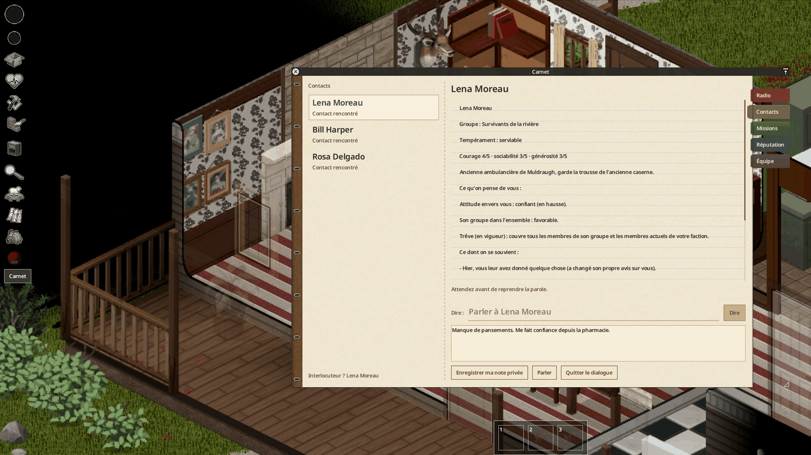
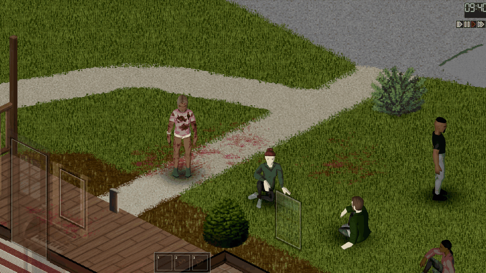
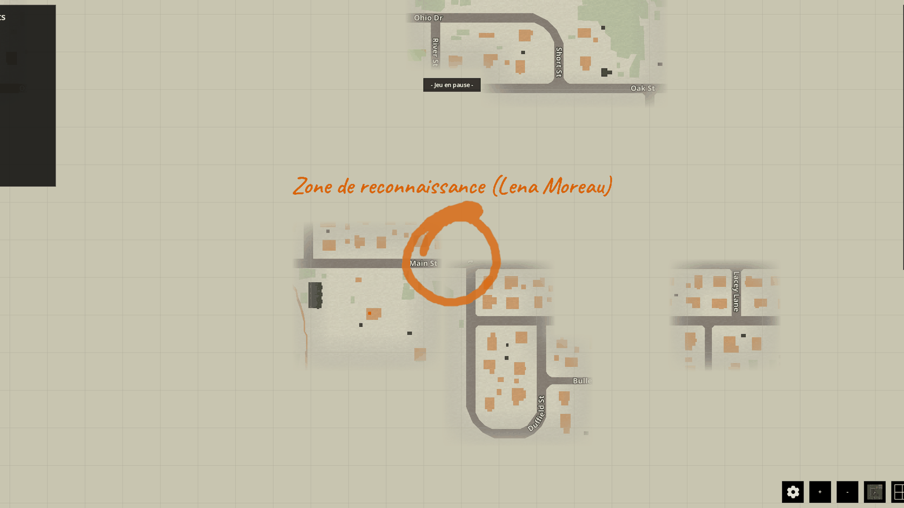

*English: [Presentation](../en/01-presentation.md)*

# Présentation

Radio Survivor (`batman_RadioSurvivor`) fait entrer d'autres survivants dans le comté de Knox, juillet 1993 : des
**voix à la radio**, un **carnet de terrain** qui garde la trace de tous ceux que vous rencontrez, et **Living Knox**,
des groupes de survivants humains qui vivent, se battent et fortifient leur foyer. Solo et multijoueur, Project
Zomboid **Build 42.21**.

Les voix et les PNJ parlent par un modèle d'IA, joint par un petit programme, **le pont**
([Installation et configuration](02-installation-et-configuration.md)). Le serveur du jeu décide de tout ce qui
arrive : l'IA écrit seulement les mots et choisit dans des listes fermées.

## Des voix à la radio

Six voix répondent sur de vraies fréquences tirées pour chaque partie : Walt, le vieux radioamateur, une infirmière,
un déserteur, une famille assiégée, une station pirate et un contrebandier. Chacune a son histoire, ses heures
d'écoute et sa mémoire de vous.

Prenez une radio émettrice **en main** (talkie-walkie, radio HAM) ou une radio militaire portée sur le dos,
allumez-la, réglez-la, ouvrez le micro et écrivez votre phrase dans la section **Émettre** de la fenêtre radio. La
réponse revient sur la radio, comme toute autre émission.

Les fréquences ne sont jamais données : elles sont écrites sur des notes trouvées dans le butin (page de journal
radio, fiche de patient, avis de la Garde nationale, note griffonnée, prospectus). Lisez la note pour savoir où
écouter.

## Le carnet

Le bouton **Carnet** de la barre de gauche ouvre le carnet de terrain de votre personnage. Il garde :

- **Contacts** : tous ceux à qui vous avez parlé, leur groupe, leur tempérament, les conversations entendues par
  votre personnage, votre note privée, et **ce qu'on pense de vous** ;
- **Missions** : les offres et les missions en cours, leur objectif, leur délai et leur récompense ;
- **Radio** : l'historique de chaque fréquence écoutée ;
- **Réputation** : votre réputation parmi les survivants et ce qu'on retient de vos actes.

## Living Knox

Living Knox peuple le comté de 3 à 5 groupes de survivants humains : colons, neutres et pillards. Chaque groupe a un
foyer, un chef, de vraies réserves, des besoins et des habitudes. Ses membres défendent et fortifient leur foyer,
combattent les zombies, partent en expédition et continuent de vivre quand vous êtes loin.

Approchez-vous d'un survivant, sélectionnez-le avec **Ctrl+G** et parlez : il répond dans une bulle, avec sa propre
voix, et se souvient de la conversation.

## Missions et réputation

Survivants et voix demandent de l'aide : livrer des réserves, reconnaître un lieu, retrouver un disparu, nettoyer une
zone, récupérer une cache, allumer un signal. Le serveur vérifie chaque objectif. Certaines missions entourent une
zone approximative sur votre carte du monde.

Ce que vous faites est retenu : missions tenues ou ratées, personnes secourues ou tuées. Cela change votre réputation
et l'attitude de chaque survivant envers vous.

## Voir aussi

- [Installation et configuration](02-installation-et-configuration.md)
- [Utilisation](03-utilisation.md) : guide du joueur pas à pas
- [FAQ](12-faq.md)
