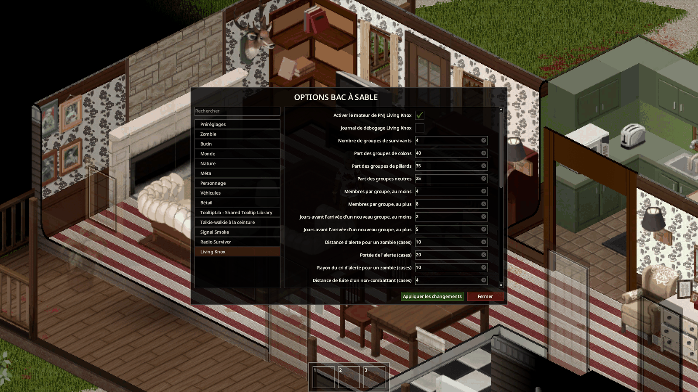

*English: [Installation and configuration](../en/02-installation-and-configuration.md)*

# Installation et configuration

Quatre étapes mènent du Workshop à une partie où les voix et les survivants parlent. Chaque étape a sa page.

## 1. Installer les mods

Abonnez-vous à Radio Survivor et à ses trois mods requis (Belt Walkie-Talkie, TooltipLib, Signal Smoke), activez-les
dans le bon ordre et redémarrez le jeu : [Installation](04-installation.md).

## 2. Lancer le pont

Le pont est un petit programme Python qui porte les demandes du jeu à l'IA et en rapporte les réponses. Il tourne sur
la machine du serveur : votre PC en solo ou dans une partie hébergée depuis le menu, la machine du serveur pour un
serveur dédié.

- Solo et partie hébergée : [Le pont en solo](05-pont-en-solo.md).
- Serveur dédié (Windows, Linux, Docker) : [Le pont sur un serveur dédié](06-pont-sur-serveur-dedie.md).

Sans le pont, le jeu reste jouable : les voix répondent par des parasites et les PNJ restent muets.

## 3. Choisir le fournisseur d'IA

Tout service doté d'une API compatible OpenAI convient (trois réglages : adresse, modèle, clé). Choix, coût et quotas :
[Fournisseur d'IA](08-fournisseur-ia.md).

## 4. Régler les options sandbox

Les réglages sandbox d'une nouvelle partie ont deux pages, **Radio Survivor** et **Living Knox** : voix, limites de
messages, notes de fréquence, nombre et nature des groupes de survivants, leur comportement. Chaque option est décrite
dans [Options sandbox](09-options-sandbox.md).

## Vérifier en jeu

Une fois dans le monde :

1. prenez un talkie-walkie en main, réglez-le sur la fréquence de Walt (note trouvée dans le butin) et écrivez une
   phrase dans la section **Émettre** : Walt répond en quelques secondes ;
2. le bouton **Carnet** de la barre de gauche ouvre le carnet.

Rien ne répond ? Voir [Dépannage](11-depannage.md). Ensuite : le guide du joueur, [Utilisation](03-utilisation.md).

## Aller plus loin : vos propres voix

Chaque voix est une fiche texte sur la machine du serveur, que vous pouvez modifier, ou copier pour créer une nouvelle
voix, sans redémarrer : [Créer une voix radio](10-creer-une-voix-radio.md).
