*English: [Usage](../en/03-usage.md)*

# Utilisation

Un guide pas à pas pour le joueur. Le pont doit tourner pour que les voix et les survivants parlent
([Installation et configuration](02-installation-et-configuration.md)).

## 1. Trouver une fréquence

Les voix émettent sur des fréquences tirées pour chaque partie. Elles sont écrites sur des **notes** trouvées dans le
butin : page de journal radio, fiche de patient, avis de la Garde nationale, note griffonnée, prospectus de Night Owl.
Chaque note se trouve là où sa voix l'aurait laissée (fréquence : option sandbox **Notes de fréquences dans le butin**).

Clic droit sur la note → **Inspecter** (ou **Lire**) pour l'ouvrir. Walt est la première voix à chercher : il répond à
toute heure.

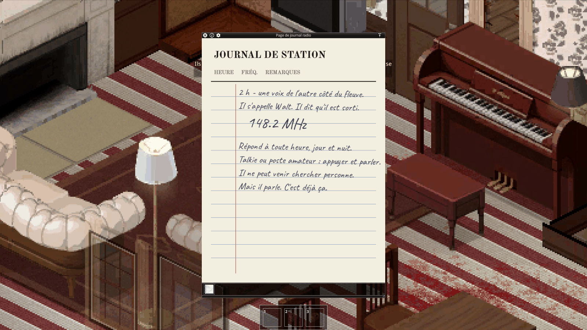

## 2. Parler à une voix à la radio

1. Prenez une radio émettrice **en main** : talkie-walkie, radio HAM (ou une radio militaire portée sur le dos).
2. Allumez-la et réglez-la sur la fréquence de la note.
3. Ouvrez le micro (section **Microphone** de la fenêtre radio).
4. Écrivez votre phrase dans la section **Émettre** en bas de la fenêtre radio, puis Entrée ou **Émettre**.

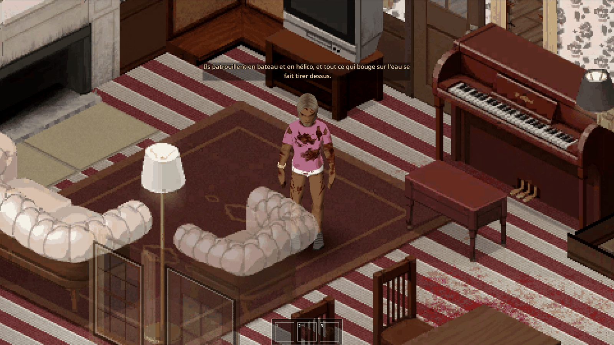

Le champ est grisé pendant que la voix répond ; la réponse passe sur la radio et s'affiche dans les dernières lignes
de la section. Restez bref : une voix à qui l'on parle sans pause vous demande de reprendre votre souffle. Un
talkie-walkie à la ceinture reçoit, mais n'émet pas : prenez-le en main pour parler.

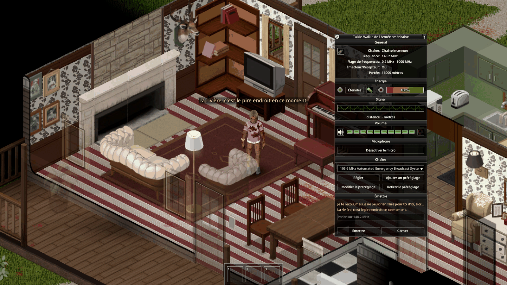

Chaque voix a ses heures d'écoute et se souvient de vous. L'onglet **Radio** du carnet garde ce qui s'est dit sur
chaque fréquence.

## 3. Rencontrer un groupe Living Knox

Des groupes de survivants vivent dans des maisons ou des camps du comté : colons, neutres et pillards. Un groupe a un
chef, des combattants et des ouvriers, un foyer qu'il barricade, des réserves et des besoins. Approchez doucement et
ne pointez pas d'arme : un groupe défend son foyer, et les pillards attaquent.

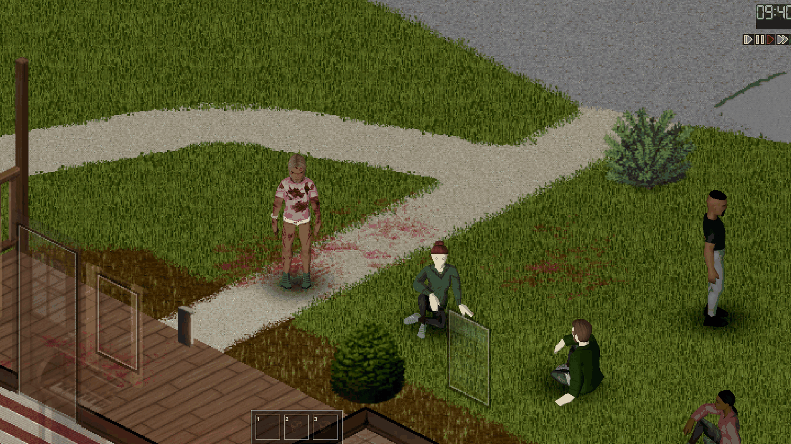

## 4. Parler à un survivant (Ctrl+G)

*Cette section décrit Radio Survivor et Living Knox activés ensemble. Avec Living Knox seul, il n'y a ni Ctrl+G ni
bouton **Parler** dans le carnet : dites une phrase dans le chat local (`/say`) près d'un survivant, ou faites un clic
droit sur lui et choisissez **Parler** ; le survivant le plus proche répond dans une bulle, et les missions qu'il
propose apparaissent dans l'onglet Missions du carnet. À côté du survivant qui a donné la mission, le bouton **Livrer**
de cet onglet remet les objets demandés, et **Récupérer la récompense** prend la récompense une fois la mission
réussie : un objet que le groupe a en trop, sinon la récompense annoncée avec la mission, sinon un lot selon le groupe
(outils chez les colons, vivres chez les neutres, munitions chez les pillards), annoncé dans le carnet.*

1. Près d'un survivant que vous voyez, appuyez sur **Ctrl+G** : le PNJ visible le plus proche est sélectionné (touche
   **Sélectionner un PNJ RadioSurvivor** dans les options du jeu). Le bouton **Parler** d'un contact du carnet fait
   de même.
2. Écrivez sur la ligne **Dire** du carnet (onglet **Contacts**). En multijoueur, le chat local (`/say`) marche aussi.
3. Le survivant répond dans une bulle au-dessus de sa tête. Une longue réponse arrive en plusieurs bulles.

Un inconnu ne dit pas tout : noms, histoire et demandes viennent après quelques échanges. **Quitter le dialogue** met
fin à la conversation.

## 5. Missions et compte rendu

Quand un survivant ou une voix demande de l'aide, l'offre apparaît dans l'onglet **Missions** du carnet (« Nouvelle
offre dans le carnet »).

- **Accepter personnellement** vous engage ; **Inviter sans engager** y associe un autre joueur ; **Abandonner pour
  le groupe** y renonce (cela coûte de la réputation).
- **Livrer** ouvre la fenêtre de livraison : choisissez les objets que le demandeur accepte.
- Les missions de reconnaissance, de recherche, de nettoyage, de récupération et de signal entourent une **zone
  approximative** sur la carte du monde : le lieu est quelque part dedans, pas au centre.
- Une mission **barricader** d'une voix entoure le bâtiment sur la carte et indique le nombre d'ouvertures à
  barricader : fenêtres et portes extérieures, avec des planches ou de la tôle, de l'intérieur ou de l'extérieur
  (chaque ouverture compte une fois). Le serveur compte lui-même ; les barricades déjà en place au début de la
  mission ne comptent pas, et une barricade retirée ne compte plus.
- Une mission **relais radio** d'une voix entoure le lieu sur la carte : posez-y en hauteur (à un étage ou sur le
  toit, au moins au niveau indiqué) une radio qui peut émettre, talkie-walkie ou radio amateur, allumée et
  alimentée par sa pile, le réseau ou un générateur. Le serveur vérifie lui-même ; tant que la radio est éteinte,
  sans courant ou retirée, la mission n'est plus à rapporter et le compte rendu est refusé.
- Une mission **guet** d'une voix entoure le poste de guet sur la carte : restez-y (à moins de 6 cases, un
  étage ou le toit compte aussi) le nombre d'heures de jeu indiqué. Le temps compte en heures de jeu ; une
  absence de plus de 10 minutes de jeu fait recommencer le guet à zéro. Le guet terminé, rappelez la voix :
  elle parle de ce qui s'est passé pendant le guet (hélicoptère entendu, groupe de morts tout proche).
- Une mission **itinéraire** d'une voix fait franchir plusieurs lieux dans l'ordre, à pied ou en
  véhicule : seul le prochain point est entouré sur la carte, le carnet indique « 2 sur 4 ». Un point
  atteint avant le précédent ne compte pas ; le serveur lit lui-même votre position.
- Une mission **objet personnel** d'une voix entoure un lieu sur la carte : l'objet nommé par la voix (un
  médaillon, une photo…) y est posé au sol. Trouvez-le et déposez-le à l'une des planques de la mission ;
  seul cet objet compte, un autre du même genre n'est jamais pris. Il est ramassé hors de vue, après le délai.
- Une fois l'objectif rempli, la mission indique **À rapporter** : retournez voir le demandeur et dites-le-lui
  (**Parler**), ou utilisez **Rendre compte** près de lui. Pour une voix radio, rappelez-la sur sa fréquence. La
  mission ne réussit qu'à ce moment, et le délai continue de courir.

### Ce que vous gagnez

Après réussite et compte rendu, les missions de voix améliorent la réputation et peuvent donner **une** cache de matériel, une fréquence d'une autre voix, une carte-cachette vanilla ou une leçon. Darlene propose du matériel médical et enseigne les soins ; Cody propose des munitions et enseigne le tir. Le serveur tire la récompense au hasard parmi celles que la voix propose, et le contenu d'une cache au hasard dans sa catégorie ; vous ne choisissez ni l'une ni l'autre. Les fréquences rejoignent votre seul carnet ; les caches de voix ont un repère sur votre seule carte. Le matériel posé reste un objet réel du monde.

Les voix peuvent demander reconnaissance, dépôt, papiers à retrouver, nettoyage, signal Signal Smoke, barricadage d'un bâtiment, itinéraire, relais radio, guet ou objet personnel à retrouver selon leur fiche. Certaines missions d'une voix n'arrivent qu'après la réussite d'une autre : un échec les remet en attente jusqu'à la réussite suivante, et une suite réussie peut changer la situation de la voix. Les PNJ peuvent aussi proposer récupération et ravitaillement du groupe. Rapportez toujours une mission de PNJ **en personne** au demandeur.

### Livraisons radio : collecte discrète

Une mission de dépôt d'une voix propose **toutes ses planques à la fois** (clé `drops=` de sa section ; sans elle, tous les lieux `use=drop` de la fiche), chacune entourée sur votre carte avec son nom. La voix demande des objets d'une même famille (soins, nourriture, munitions...) et un nombre fixé au départ de la mission ; le carnet affiche les objets acceptés et le nombre demandé. Déposez où vous voulez : les objets laissés à plusieurs planques s'additionnent jusqu'à la quantité demandée. À chaque planque, le serveur désigne une boîte existante adaptée (une mission sur deux) ou, à défaut, demande un sac au sol. La voix ne ramasse une planque que **hors de vue de tout le monde** (aucun joueur à moins de 100 cases en x comme en y, quel que soit l'étage, ou la case déchargée) **et après environ 6 heures de jeu** (réglable par la fiche de la voix). Le délai suit l'horloge du jeu : il s'arrête en pause, va plus vite en vitesse accélérée ou pendant le sommeil, et ne compte pas serveur arrêté. Un joueur revenu en vue avant la fin remet le délai à zéro. Une planque dont le délai s'est écoulé pendant que sa case était déchargée est vidée dès que la case se charge de nouveau.

Dans une boîte, seuls les objets demandés disparaissent, jamais plus que la quantité restante : boîte, autres objets et surplus restent. Pour un sac, sac et contenu disparaissent ; un sac qui contient des objets étrangers au lot, ou plus que la quantité restante, est refusé pour éviter leur perte. Chaque objet n'est compté qu'une fois, même après un redémarrage. Avant la collecte, vous pouvez reprendre le dépôt et rien n'est validé. **Une fois toute la quantité collectée seulement, rendez compte à la radio**. Validation en jeu solo et MP de cette collecte : **en attente**.

**Papiers à retrouver pour une voix.** La carte d'identité prise sur le corps ne se remet pas à la radio : déposez-la à l'une des planques de la mission, marquées sur votre carte comme pour un dépôt (dans la boîte désignée, ou seule dans un sac au sol). La voix la ramasse avec la même règle, hors de vue et après le délai ; seule la carte de ce corps est prise, une autre carte d'identité reste sur place. **Une fois la carte ramassée seulement, rendez compte à la radio** : le compte rendu ne retire rien de votre inventaire. Validation en jeu MP : **en attente**.

Pour Living Knox, le matériel provient d'abord du surplus réel du foyer, sans toucher aux réserves nécessaires ni au stock rationné ; à défaut, une cache près du foyer utilise une table fermée selon le groupe. Une relation favorable ou confiante, sans mauvaise réputation, ouvre cartes et leçons adaptées au rôle. Un demandeur mort ne remet plus de récompense. Une mission de groupe a **un seul retrait partagé**, effectué par un participant, comme l'ancien lot commun. Un contact de confiance peut partager la radio de son groupe si elle existe, sinon une voix active. Les contrats de ravitaillement déjà dotés d’un lot payé sur les réserves conservent ce lot, pour éviter un second prélèvement.

L'option sandbox du multiplicateur de leçon désactive l'expérience à 0. Les nouvelles récompenses sont écrites ; leur validation solo et MP est **en attente**.

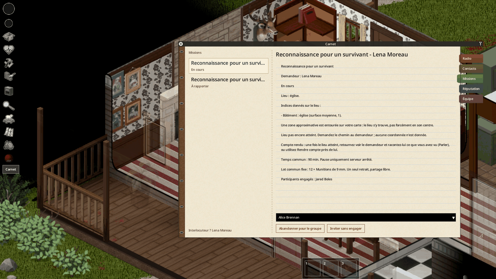

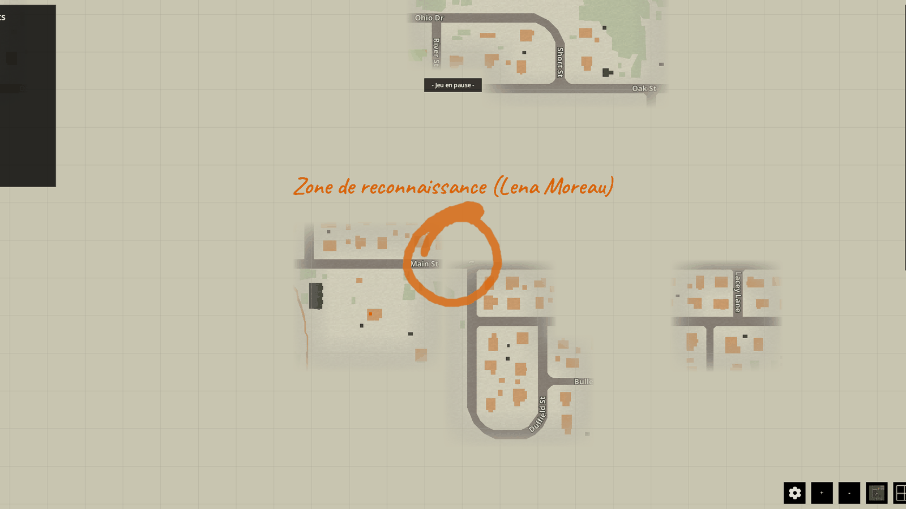

### Troc avec un marchand

Chaque ville vanilla a son marchand radio, chacun sur sa fréquence, avec son histoire et son stock :

| Ville | Marchand | Arrivée |
|---|---|---|
| Riverside | Gus Lacombe, le passeur de l'Ohio | barque |
| West Point | Wanda Haddix, l'ancienne marchande d'appâts | barque |
| Brandenburg | Lamar Dunaway, l'ancien matelot du bac | barque |
| Louisville | Delphine Arnett, la cuisinière d'un pousseur | barque |
| Muldraugh | Hollis Beck, le routier de l'armée | route |
| March Ridge | Loretta Royce, la factrice | route |
| Irvington | Virgil Mattingly, le fermier de la clôture | route |
| Echo Creek | Boone Tackett, le contrebandier d'alcool | route |
| Rosewood | Odessa Kessler, l'infirmière scolaire | planque |
| Ekron | Ezra Overby, le prédicateur | planque |
| Fallas Lake | Maxine Whitlock, la gérante du camping | planque |

Leurs fréquences se trouvent comme celles des autres voix : un mot manuscrit dans le butin (magasins, tiroirs,
boîtes à gants selon le marchand), à **Inspecter** ; un marchand peut aussi vous donner la fréquence d'un voisin.
Un marchand vend son stock à la radio. Votre première offre ferme réserve son
**passage** pour votre groupe : il vous donne le lieu, la nuit et le signal, et le lieu est marqué sur votre carte. Un
autre marchand a son propre passage : réserver chez l'un ne bloque pas l'autre. Pendant la fenêtre, montrez le signal
sur place (barque et route : lampe allumée en main ou fusée rouge) ; vous entendez le moteur de la barque qui accoste,
ou la portière du fourgon garé au bord de la route. Une **planque** ne demande aucun signal : laissez le paiement
dans le conteneur du lieu (poubelle, boîte aux lettres) avant l'heure, personne ne vient vous voir. Posez un sac à moins
de 3 cases du lieu avec de quoi payer, puis **éloignez-vous hors de vue** : il ne passe que lorsque personne n'est à
moins de 100 cases en x comme en y **depuis environ une heure de jeu** (réglable par la fiche du marchand). Revenu trop
tôt, vous remettez l'attente à zéro ; parti loin assez longtemps, l'échange est fait quand vous revenez. Le sac contient
alors votre marchandise ; un sac qui ne couvre pas le prix est une tricherie (rien n'est pris). Un passage peut être
annulé (patrouille, barrage, ratissage, hélicoptère, orage), et le marchand repart s'il n'a jamais eu un moment
tranquille. Validation en
jeu MP du passage de Gus : **en attente**.

## 6. Le carnet

Le bouton **Carnet** de la barre de gauche l'ouvre.

| Onglet | Contenu |
|---|---|
| **Radio** | Historique de chaque fréquence écoutée. |
| **Contacts** | Les personnes rencontrées : groupe, tempérament, conversations entendues, votre note privée (**Enregistrer ma note privée**), et **Ce qu'on pense de vous** (attitude, tendance, accords avec votre camp). |
| **Missions** | Offres et missions : objectif, délai, récompense, participants. |
| **Réputation** | Votre réputation parmi les survivants et ce qu'on retient de vos actes. |
| **Équipe** | Votre faction et ses négociateurs (multijoueur). |

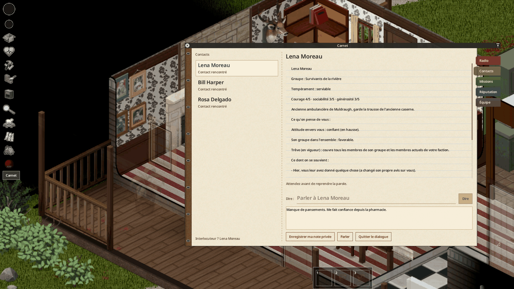

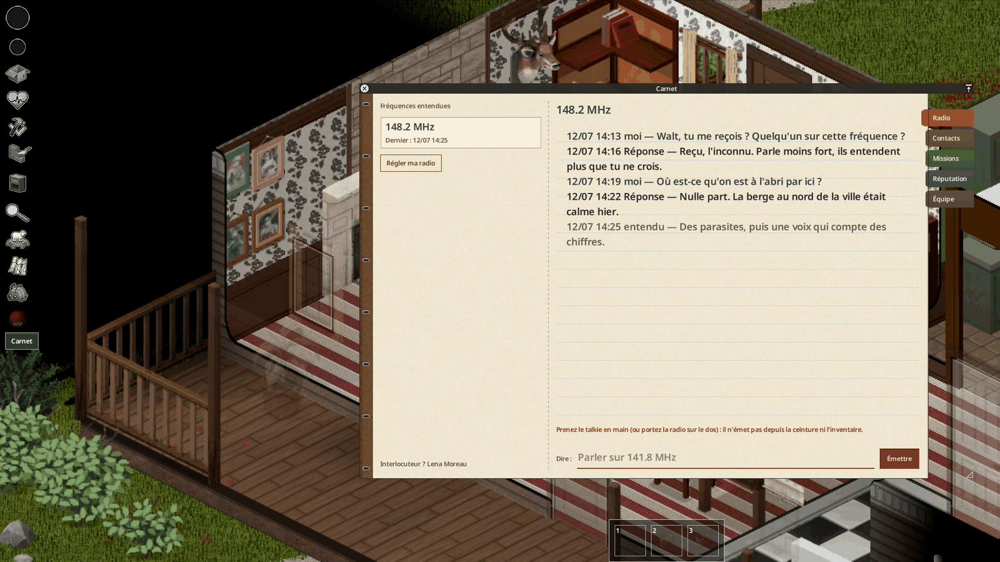

## 7. Réputation

Missions tenues, personnes secourues, un marchand floué, un demandeur tué : ce que vous faites est retenu. L'onglet
**Réputation** montre votre niveau (mauvaise, neutre, bonne), sa tendance et les derniers actes dont on se souvient.
L'attitude de chaque survivant envers vous est une autre chose, montrée sur sa page de contact.

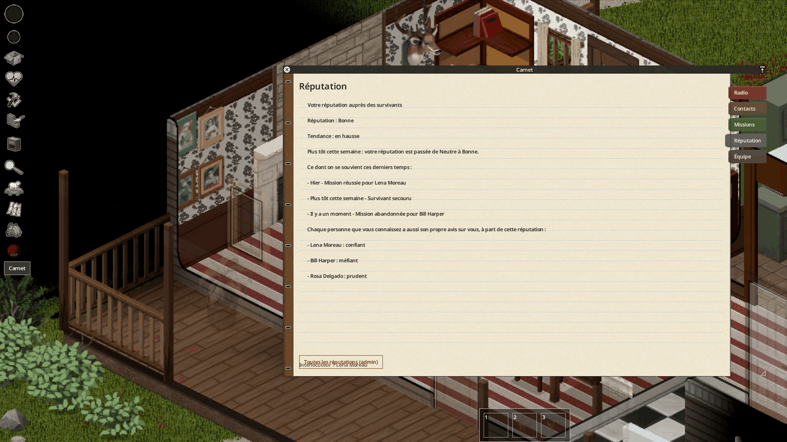

## 8. Outils d'administration

Pour l'administrateur (solo en mode debug, ou rôle `admin` / `moderator` sur un serveur) :

- menu debug → **Living Knox - Admin** : fenêtre **Living Knox : groupes** avec chaque groupe, son foyer, ses
  membres, son histoire et son journal ; déplacer un foyer, forcer un groupe de relève ;
- clic droit sur un survivant → **Détails (Living Knox)** : la fiche de ce PNJ (besoins, santé, décision, arme), avec
  des réglages bornés, le rôle, le nom et la téléportation ;
- onglet **Réputation** → **Toutes les réputations (admin)**.

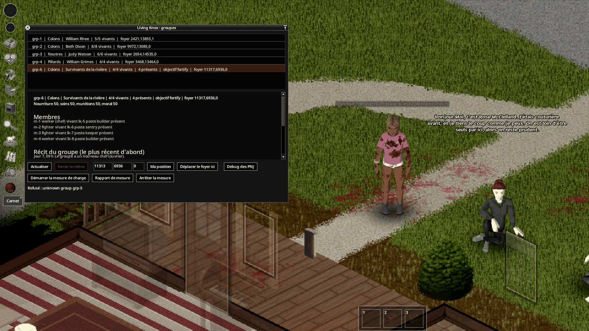

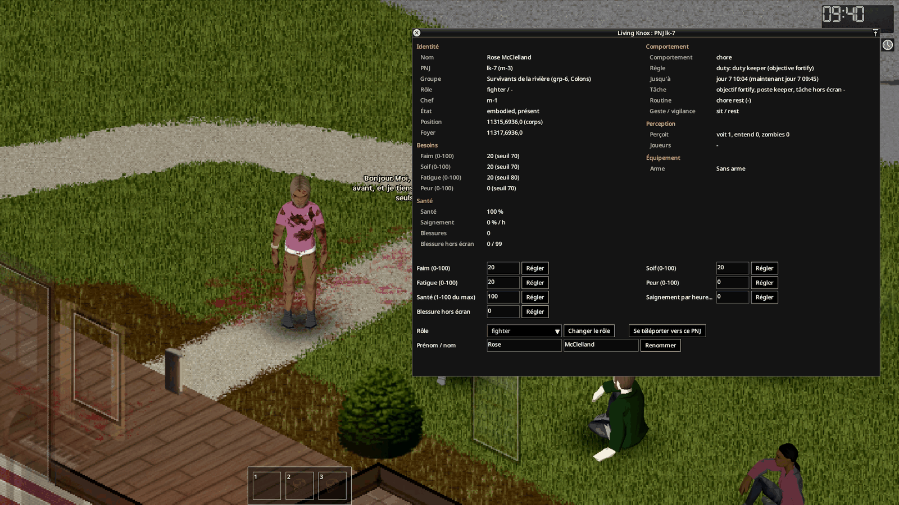
