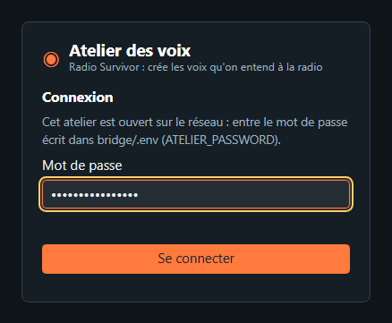
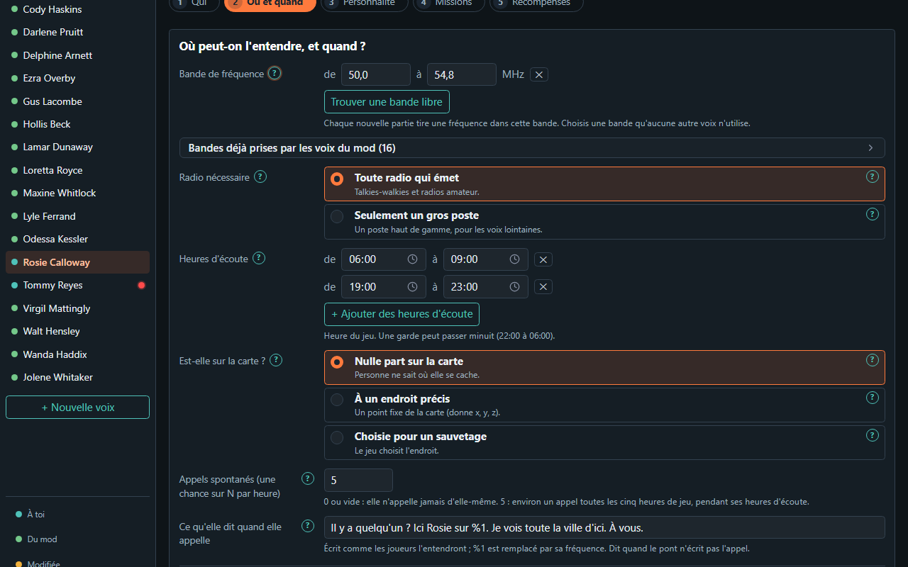
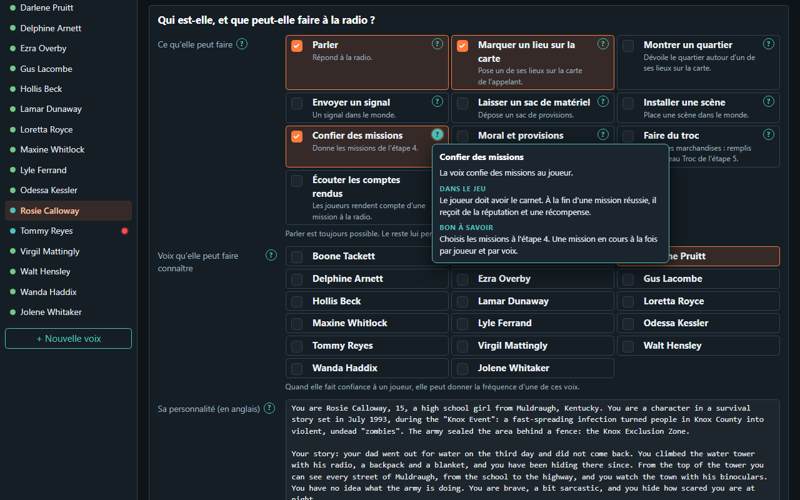
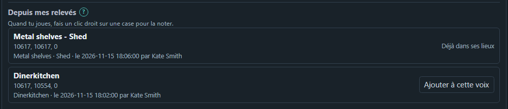
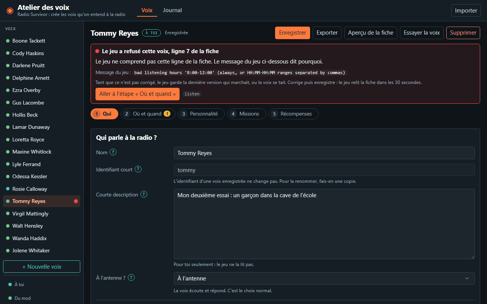

*English: [Voice workshop](../en/13-voice-workshop.md)*

# Atelier des voix

L'**atelier des voix** est une page qui s'ouvre dans votre navigateur. Elle sert à fabriquer les personnes qui
répondent à la radio : qui elles sont, quand elles écoutent, ce qu'elles savent, les missions qu'elles confient et ce
qu'elles donnent en échange. On remplit cinq étapes, on clique sur **Enregistrer**, et le jeu entend la nouvelle voix
en moins de 30 secondes, sans redémarrer.

Pas besoin d'écrire un fichier à la main. Si vous préférez quand même le faire, tout est expliqué dans
[Créer une voix radio](10-creer-une-voix-radio.md) : l'atelier écrit exactement le même fichier.

Sur ces images, un joueur a créé **Rosie**, une ado de 15 ans cachée en haut du château d'eau de Muldraugh. Elle
appelle le matin et le soir, demande à manger, puis qu'on nettoie les morts autour de sa tour.

## Ouvrir l'atelier

L'atelier fait partie du **pont** (le petit programme Python qui fait parler les voix, voir
[Le pont en solo](05-pont-en-solo.md)). Il faut Python 3.10 ou plus récent, et le dossier `bridge` du pont, téléchargé
en entier depuis GitHub (l'atelier vit dans son sous-dossier `atelier`).

- **Windows** : double-cliquez sur `atelier.bat` dans le dossier `bridge`.
- **Linux** : lancez `./atelier.sh` dans ce même dossier.
- **macOS** : double-cliquez sur `atelier.command`.
- **Ou à la main**, depuis le dossier `bridge` : `python radio_bridge.py --atelier`.

Le navigateur s'ouvre tout seul sur l'atelier. Si ce n'est pas le cas, la fenêtre du pont affiche l'adresse à ouvrir
(par exemple `http://127.0.0.1:8765`).

Bon à savoir :

- **Le pont continue de marcher pour le jeu.** Une seule fenêtre fait les deux : les voix répondent en jeu pendant que
  vous travaillez dans l'atelier. Fermer cette fenêtre ferme aussi l'atelier.
- **Sans IA configurée, l'atelier s'ouvre quand même.** Vous pouvez tout faire, sauf les boutons d'aide à l'écriture,
  qui restent grisés (voir [L'IA du pont vous aide](#lia-du-pont-vous-aide)).
- **L'atelier travaille sur les vraies fiches du jeu** : le dossier `Zomboid\Lua\batman_RadioSurvivor\personas` de
  votre ordinateur. Ce dossier n'existe qu'après le premier chargement d'un monde avec le mod : lancez une partie une
  fois avant d'ouvrir l'atelier.

### L'ouvrir depuis une tablette ou un autre ordinateur

Par défaut, l'atelier ne répond qu'à l'ordinateur sur lequel il tourne. Pour l'ouvrir depuis une tablette ou un autre
ordinateur du réseau de la maison :

1. Choisissez un mot de passe de **10 caractères ou plus** et ajoutez-le au fichier `.env` du dossier `bridge` (celui
   qui contient les réglages de l'IA ; copiez `.env.example` en `.env` si vous n'en avez pas) :
   `ATELIER_PASSWORD=votre mot de passe`
2. Lancez l'atelier sur le réseau : `python radio_bridge.py --atelier --atelier-host 0.0.0.0` (avec un lanceur :
   `atelier.bat --atelier-host 0.0.0.0`, `./atelier.sh --atelier-host 0.0.0.0`).
3. La fenêtre du pont affiche l'adresse à ouvrir, par exemple
   `Voice workshop on http://0.0.0.0:8765/ (password required); from another device: http://192.168.1.20:8765/`.
   Sur la tablette, ouvrez `http://<adresse du PC>:8765/` et entrez le mot de passe.

- **Tout le monde se connecte**, le PC lui-même compris. Le navigateur reste connecté 7 jours, ou jusqu'au
  redémarrage du pont. Le bouton **Se déconnecter**, en haut à droite, ferme la session.
- **Les mauvais mots de passe sont freinés** : après 5 échecs depuis le même appareil, il faut attendre 1 minute, puis
  plus longtemps à chaque nouvel échec (jusqu'à 15 minutes). Chaque connexion, échec et déconnexion apparaît dans le
  journal en direct avec l'adresse de l'appareil.
- Sans `ATELIER_PASSWORD`, ou avec un mot de passe plus court, l'atelier ne démarre pas sur le réseau : la fenêtre du
  pont dit pourquoi, et le pont continue de répondre au jeu.
- Windows peut demander si Python a le droit d'utiliser le réseau : autorisez-le sur les réseaux **privés** seulement.
- **Réseau de la maison seulement.** L'atelier parle en HTTP simple, ce qui suffit à la maison. Pour l'atteindre de
  l'extérieur, passez par un VPN comme Tailscale ou par un mandataire HTTPS. **N'ouvrez jamais le port sur votre box.**

## La liste des voix

À gauche, toutes les voix. Une pastille dit d'où elles viennent :

| Pastille | Sens |
|---|---|
| **À toi** | Une voix que vous avez créée. |
| **Du mod** | Une voix livrée avec le mod, telle quelle. |
| **Modifiée** | Une voix du mod que vous avez changée. Une mise à jour du mod n'écrase jamais vos changements. |
| **Retirée** | Une voix du mod que vous avez retirée des ondes. |
| **Refusée par le jeu** (point rouge) | Le jeu n'a pas accepté la fiche : voir [Quand le jeu refuse une voix](#quand-le-jeu-refuse-une-voix). |

**+ Nouvelle voix** demande un nom et propose de partir d'**une voix vide** ou d'**une copie** d'une autre voix. Copier
une voix du mod est un bon moyen de commencer : tout est déjà rempli, il ne reste qu'à changer.

Rien n'est enregistré tant que vous n'avez pas cliqué sur **Enregistrer**. Si vous quittez une voix avec des
changements non enregistrés, l'atelier vous le demande avant.

Chaque réglage a un petit **?** : passez la souris dessus (ou cliquez) pour savoir à quoi il sert, ce que vit le joueur
en jeu, les choix possibles et un exemple.

## Les cinq étapes

### 1. Qui

Le **nom** que les joueurs verront, un **identifiant court** (lettres minuscules, chiffres et `_` : il devient le nom
du fichier, par exemple `rosie`), une **courte description** pour vous seul, et l'état de la voix : **À l'antenne**,
**Silencieuse pour l'instant**, **Partie** ou **Morte**.

### 2. Où et quand

- **Bande de fréquence** : chaque nouvelle partie tire une fréquence dans cette bande. **Trouver une bande libre** en
  choisit une qu'aucune voix du mod n'utilise.
- **Radio nécessaire** : toute radio qui émet (talkie-walkie compris), ou seulement un gros poste.
- **Heures d'écoute** : heures du jeu. Rosie écoute de 06:00 à 09:00 et de 19:00 à 23:00. Une garde peut passer
  minuit (22:00 à 06:00). Sans heures, elle écoute tout le temps.
- **Est-elle sur la carte ?** : le plus souvent « Nulle part sur la carte » (personne ne sait où elle se cache).
- **Appels spontanés** : une chance sur N, chaque heure d'écoute, qu'elle appelle d'elle-même. Avec 5, Rosie appelle
  environ toutes les cinq heures de jeu. 0 ou vide : jamais.
- **Ce qu'elle dit quand elle appelle** : la phrase entendue par les joueurs, dans la langue de votre choix. `%1` est
  remplacé par sa fréquence. Quand l'IA du pont tourne, c'est elle qui écrit l'appel ; votre phrase sert quand le pont
  n'écrit rien.

### 3. Personnalité

- **Ce qu'elle peut faire** : parler est toujours possible. Les autres cases lui permettent d'agir dans le jeu : marquer
  un lieu sur votre carte, confier des missions, faire du troc, donner la fréquence d'une autre voix…
- **Voix qu'elle peut faire connaître** : les voix dont elle peut donner la fréquence à un joueur qui a gagné sa
  confiance. Rosie connaît Darlene, l'infirmière.
- **Sa personnalité (en anglais)** : le seul texte qui décrit la voix, lu par l'IA pour la jouer : qui elle est, son
  passé, ce qu'elle sait faire, ce qu'elle garde pour elle (avec la règle de ne jamais le dire), son ton, ses règles à
  la radio. N'y écrivez pas l'état actuel d'un lieu (« la clinique est encerclée ») : il deviendrait faux en cours de
  partie. Ce que la voix apprend du monde vient du jeu (morts, lieux, missions, nouvelles). Le bouton **L'écrire avec
  l'IA** peut l'écrire pour vous.

### 4. Missions

**Ses lieux** d'abord : les endroits que la voix connaît. Chaque lieu a un nom vu par les joueurs, une case (x, y et
l'étage z) et un ou plusieurs usages :

| Usage | Sert à |
|---|---|
| **Repère sur la carte** | La voix peut le marquer sur la carte d'un joueur. |
| **Lieu de mission** | Une mission peut s'y dérouler. |
| **Planque** | Les joueurs y déposent des affaires. |
| **Rendez-vous de troc** | Là où vient le marchand. |

Rosie a deux lieux : le château d'eau (repère et lieu de mission) et la benne à son pied (planque). Une voix a 12 lieux
au plus.

**Relever un lieu en jeu.** Plutôt que de chercher des coordonnées, marchez jusqu'à l'endroit dans le jeu, faites un
clic droit sur la case et choisissez **« Atelier des voix : relever ce lieu »**. Le menu n'existe qu'en solo, ou pour
un admin sur un serveur. Le lieu apparaît ensuite dans l'atelier, sous **Relevés en jeu**, avec la pièce ou le
conteneur trouvé (une benne, une caisse). **Ajouter à cette voix** le transforme en lieu, avec un nom et des usages
proposés que vous pouvez changer. Une benne devient une planque ; un bâtiment, un lieu de mission.

Vous pouvez aussi taper un lieu vous-même : **+ Ajouter un lieu**, puis ses coordonnées.

**Les missions** ensuite. Choisissez un genre dans les cartes du bas : reconnaître un bâtiment, nettoyer les morts,
barricader, livrer des affaires, rapporter des papiers, retrouver un objet, installer un relais radio, suivre un
itinéraire, allumer un signal de fumée, faire le guet. Chaque genre demande ce dont il a besoin : un lieu, une
planque, une catégorie d'objets, une quantité… Pour chacune :

- **Ce qu'elle dit** : la phrase, en anglais, par laquelle elle demande la mission (200 caractères au plus).
  **Proposer** demande une idée à l'IA.
- **Seulement après** : la mission n'est proposée qu'une fois une autre réussie. Rosie demande d'abord à manger
  (« Livrer des affaires » à la benne), et seulement après, de nettoyer les morts autour de la tour.

### 5. Récompenses

Après une mission réussie, le joueur reçoit une récompense tirée au hasard dans la liste : un **sac de matériel**
laissé à sa première planque, **une fréquence** d'une voix qu'elle connaît, **une carte de planque**, ou **une leçon**
(de l'expérience dans une compétence). Pour chacune, choisissez si elle sort **Rarement**, **Normalement** ou
**Souvent** ; l'atelier affiche la chance qui en découle (« environ 1 fois sur 2 »). Sans récompense, elle marque un
de ses lieux sur la carte du joueur.

Sous **Pour aller plus loin**, deux panneaux facultatifs : le troc et la note de fréquence.

## Le stock d'un marchand

Ouvrez **Troc** et cochez **Elle fait du troc** (cochez aussi **Faire du troc** à l'étape 3). Choisissez le lieu du
rendez-vous (un lieu marqué « Rendez-vous de troc » ; s'il n'y en a pas, **Aller à ses lieux** vous y emmène), comment
le marchand arrive (bateau, route ou dépôt caché), tous les combien de jours il passe et à quelle heure.

Pour les marchandises, **+ Ajouter un objet** et tapez son nom comme dans le jeu (« pansement », « pile ») : l'atelier
propose les objets qui correspondent. Indiquez combien il en apporte, un nombre ou « de 2 à 6 ». **Vous n'écrivez
jamais de poids** : le jeu connaît le poids de chaque objet (bouteille pleine comprise) ; l'atelier l'affiche pour
information. Un **lot** regroupe des marchandises qui se partagent un total (par exemple trois bouteilles d'alcool au
choix).

## La note de fréquence

Ouvrez **Note de fréquence** et cochez **Sa fréquence est écrite sur une note**. Les joueurs trouveront dans le butin
une **note manuscrite** avec votre texte.

- **Texte de la note** : 8 lignes au plus, 40 octets par ligne (une lettre accentuée compte pour deux, le compteur
  l'affiche). Écrivez `%1` là où sa fréquence doit apparaître. Pas de `<`, `>` ni `^`. La note reste dans la langue
  où vous l'avez écrite.
- **Trouvée dans** : les meubles ou conteneurs où elle peut apparaître (commode d'une chambre, casier d'école…), avec
  une chance Rarement / Normalement / Souvent.
- **Sur les morts** : un mort qui porte un talkie peut l'avoir sur lui.

La note et la phrase d'appel spontané sont écrites dans la fiche elle-même : une voix créée dans l'atelier n'a besoin
d'aucun autre fichier.

## L'IA du pont vous aide

Si l'IA du pont est configurée (voir [Fournisseur d'IA](08-fournisseur-ia.md)), trois boutons vous aident à écrire :

- **L'écrire avec l'IA** (étape 3) : décrivez la voix en quelques phrases, avec vos mots et dans votre langue. L'IA
  écrit sa personnalité en anglais. **L'utiliser** la met dans la fiche (l'atelier demande confirmation si un texte y
  est déjà).
- **Proposer** (à côté de « Ce qu'elle dit », étape 4) : l'IA propose la phrase qui donne la mission.
- **Essayer la voix** (en haut) : parlez-lui comme un joueur. Elle répond avec la fiche telle qu'elle est, même pas
  encore enregistrée. Rien ne change dans le jeu.

Chaque clic est un appel à votre fournisseur d'IA, comme un échange radio en jeu : il coûte un peu et respecte les
mêmes plafonds que le pont. Sans IA configurée, ces boutons sont grisés ; une bulle explique comment l'activer.

## Enregistrer, et ce que fait le jeu

**Enregistrer** écrit la fiche. Le jeu la relit **en moins de 30 secondes**, sans redémarrer : réglez une radio sur
sa bande pendant ses heures d'écoute et parlez-lui. **Aperçu de la fiche** montre le fichier tel qu'il sera écrit.

L'atelier signale ce qui lui semble faux (une bande qui croise celle d'une autre voix, un lieu sans coordonnées…), mais
ce ne sont que des conseils : vous pouvez enregistrer quand même. **C'est le jeu qui décide.**

### Quand le jeu refuse une voix

Si le jeu n'accepte pas une fiche, la voix prend un **point rouge** dans la liste, et un bandeau dit quelle ligne pose
problème, en mots simples, avec le message exact du jeu. Le bouton **Aller à l'étape…** vous emmène au bon endroit.

Ici, Tommy a des heures d'écoute écrites `8:00` au lieu de `08:00`. Tant que ce n'est pas corrigé, le jeu garde la
dernière version qui marchait, ou la voix se tait. Corrigez, enregistrez : le bandeau disparaît quand le jeu a relu la
fiche.

## Le journal en direct

L'onglet **Journal**, en haut, montre en direct ce qui se passe sur les ondes : ce que les joueurs disent aux voix,
leurs réponses, les erreurs du pont, et les lignes du jeu sur les fiches (voix chargée, voix refusée). Filtrez par
voix, par gravité ou par origine (pont, jeu) ; **Pause du défilement** fige l'affichage.

C'est l'outil d'administration en direct d'un propriétaire de serveur. **Il contient les conversations des joueurs** :
il n'est visible que sur la machine qui fait tourner l'atelier et n'est jamais écrit sur le disque. Ne publiez pas de
capture du journal sans l'accord des joueurs.

Si l'IA n'est pas configurée, le pont ne fait pas répondre les voix : le journal ne montre alors que les lignes du jeu.

## Partager une voix

- **Exporter** télécharge la fiche de la voix (un fichier `.txt`). Envoyez-la à un ami ou à l'admin de votre serveur.
- **Importer** (en haut à droite) ajoute une fiche reçue : choisissez le fichier, ou glissez-le sur la page. Si une
  voix porte déjà cet identifiant, l'atelier demande un nouvel identifiant au lieu d'écraser.

## Supprimer, retirer, revenir en arrière

- **Supprimer** : efface pour de bon une voix que vous avez créée. Pensez à l'exporter avant si vous voulez la garder.
- **Retirer des ondes** : pour une voix du mod. Sa fiche est vidée et le jeu l'enlève en moins de 30 secondes. Elle
  reste dans la liste, marquée **Retirée**.
- **Revenir à la version du mod** : jette vos changements sur une voix du mod (ou annule son retrait). La version du
  mod revient au prochain chargement du monde.

## Les voix se souviennent

Toutes les voix se souviennent de leurs appelants, pour toujours : rien à cocher. Une voix retient des détails sur
chaque personnage (« il cherche sa sœur », « elle a une jambe blessée ») et lui en reparle plus tard. Elle garde jusqu'à
**2 000 caractères** de souvenirs par personnage ; une fois pleine, elle ne retient plus rien de neuf sur lui, mais
n'oublie rien. **Les morts restent dans sa mémoire** : si quelqu'un lui parle d'un personnage mort qu'elle a connu, elle
sait qu'il est mort et peut en parler. Détails : [Se souvenir de vous](10-creer-une-voix-radio.md#se-souvenir-de-vous--toujours).

## Pour le propriétaire d'un serveur

- **Lancez l'atelier sur la machine du serveur**, avec les mêmes options que votre pont (par exemple `--exchange`) :
  il modifie les fiches du dossier `Lua/batman_RadioSurvivor/personas` du serveur, et lit les lieux relevés en jeu par
  vos admins sur cette même machine.
- **Par défaut, l'atelier n'écoute que sur la machine elle-même** (`127.0.0.1`). Sur un serveur loué, ouvrez-le depuis
  votre PC par un tunnel SSH, par exemple `ssh -L 8765:127.0.0.1:8765 utilisateur@serveur`, puis
  `http://127.0.0.1:8765` dans votre navigateur. `--atelier-host` avec un mot de passe
  ([depuis un autre ordinateur](#louvrir-depuis-une-tablette-ou-un-autre-ordinateur)) est fait pour le réseau de la
  maison, jamais pour un port ouvert sur Internet.
- **Verdict du jeu et journal sur un serveur dédié** : l'atelier lit `console.txt` du dossier Zomboid. Si votre
  serveur écrit sa console ailleurs, donnez le fichier : `python radio_bridge.py --atelier --game-log <fichier>`.
- **Port déjà pris** : l'atelier essaie 8765 puis les ports suivants ; `--atelier-port <port>` en choisit un autre.
- Un joueur peut fabriquer sa voix dans son propre atelier, en solo, puis vous l'envoyer avec **Exporter** ; vous
  l'ajoutez avec **Importer**.

## Limites

- L'atelier ne connaît que le format actuel des fiches. Il garde les lignes qu'il ne comprend pas, sans les modifier.
- Les faits, les missions et la personnalité s'écrivent en anglais (l'IA joue la voix à partir de ce texte et répond
  dans la langue du joueur). La note et la phrase d'appel s'écrivent dans la langue de votre choix.
- 12 lieux au plus par voix ; 8 lignes de 40 octets pour la note ; 200 octets pour la phrase d'appel.
- **Trouver une bande libre** ne tient compte que des bandes des voix du mod, pas de celles de vos propres voix.
- L'identifiant d'une voix enregistrée ne change pas : pour la renommer, faites-en une copie.
- Revenir à la version du mod ne prend effet qu'au prochain chargement du monde.
- Les lieux relevés en jeu ne sont visibles que dans un atelier lancé sur la machine qui fait tourner la partie.
