*English: [Voice workshop](../en/13-voice-workshop.md)*

# Atelier des voix

L'**atelier des voix** est une page qui s'ouvre dans votre navigateur. Elle sert à fabriquer les personnes qui
répondent à la radio : qui elles sont, quand elles écoutent, leur caractère, les missions qu'elles confient, ce
qu'elles donnent en échange et ce qu'elles vendent. On répond à cinq étapes, on clique sur **Enregistrer**, et le jeu
entend la nouvelle voix en moins de 30 secondes, sans redémarrer.

Pas besoin d'écrire un fichier à la main. L'atelier écrit le même fichier que celui décrit dans
[Créer une voix radio](10-creer-une-voix-radio.md), la référence ligne par ligne. Quatre voix complètes, construites
pas à pas, sont dans [Exemples de voix](14-exemples-de-voix.md).

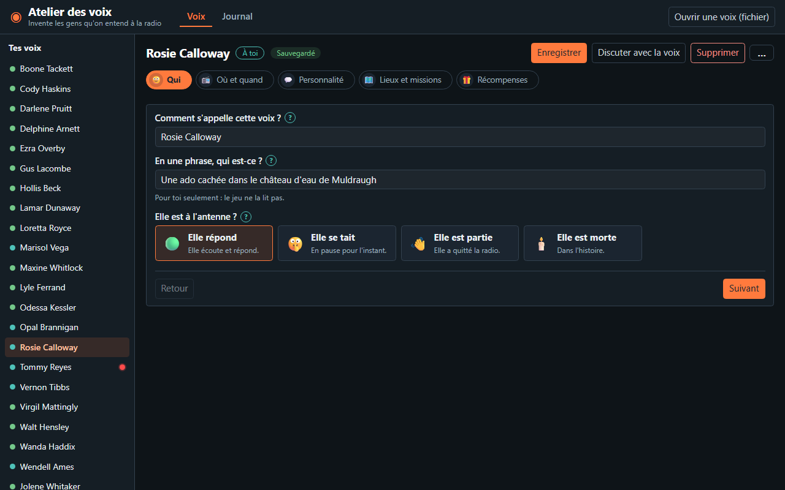

Sur les images de cette page, un joueur a créé **Rosie**, une ado de 15 ans cachée en haut du château d'eau de
Muldraugh. Elle appelle le matin et le soir, demande à manger, puis qu'on nettoie les morts autour de sa tour.

## Sommaire

- [Ouvrir l'atelier](#ouvrir-latelier) · [depuis une tablette](#louvrir-depuis-une-tablette-ou-un-autre-ordinateur)
- [L'écran de l'atelier](#lécran-de-latelier) · [la liste des voix](#la-liste-des-voix) ·
  [créer une voix](#créer-une-voix) · [les boutons d'une voix](#les-boutons-dune-voix)
- Les cinq étapes : [1. Qui](#étape-1--qui) · [2. Où et quand](#étape-2--où-et-quand) ·
  [3. Personnalité](#étape-3--personnalité) · [4. Lieux et missions](#étape-4--lieux-et-missions) ·
  [5. Récompenses](#étape-5--récompenses)
- Pour aller plus loin : [troc](#le-troc) · [note de fréquence](#la-note-de-fréquence) ·
  [ses propres listes d'objets](#ses-propres-listes-dobjets)
- [L'IA du pont vous aide](#lia-du-pont-vous-aide) · [Enregistrer et le verdict du jeu](#enregistrer-et-le-verdict-du-jeu) ·
  [Le journal en direct](#le-journal-en-direct)
- [Partager une voix](#partager-une-voix) · [Supprimer, retirer, revenir en arrière](#supprimer-retirer-revenir-en-arrière) ·
  [Les voix se souviennent](#les-voix-se-souviennent) · [Pour le propriétaire d'un serveur](#pour-le-propriétaire-dun-serveur) ·
  [Limites](#limites)

## Ouvrir l'atelier

L'atelier fait partie du **pont** (le petit programme Python qui fait parler les voix, voir
[Le pont en solo](05-pont-en-solo.md)). Il faut Python 3.10 ou plus récent, et le dossier `bridge` du pont, téléchargé
en entier depuis GitHub (l'atelier vit dans son sous-dossier `atelier`).

- **Windows** : double-cliquez sur `atelier.bat` dans le dossier `bridge`.
- **Linux** : lancez `./atelier.sh` dans ce même dossier.
- **macOS** : double-cliquez sur `atelier.command`.
- **Ou à la main**, depuis le dossier `bridge` : `python radio_bridge.py --atelier`.

Le navigateur s'ouvre tout seul sur l'atelier. Sinon, la fenêtre du pont affiche l'adresse à ouvrir (par exemple
`http://127.0.0.1:8765`). La page est en français si votre navigateur est en français, en anglais sinon.

Bon à savoir :

- **Le pont continue de marcher pour le jeu.** Une seule fenêtre fait les deux : les voix répondent en jeu pendant que
  vous travaillez dans l'atelier. Fermer cette fenêtre ferme aussi l'atelier.
- **Sans IA configurée, l'atelier s'ouvre quand même.** Tout marche, sauf les boutons d'aide à l'écriture et la
  conversation d'essai **Discuter avec la voix**, qui restent grisés (voir [L'IA du pont vous aide](#lia-du-pont-vous-aide)).
- **L'atelier travaille sur les vraies fiches du jeu** : le dossier `Zomboid\Lua\batman_RadioSurvivor\personas` de
  votre ordinateur. Ce dossier n'existe qu'après le premier chargement d'un monde avec le mod : lancez une partie une
  fois avant d'ouvrir l'atelier.

### L'ouvrir depuis une tablette ou un autre ordinateur

Par défaut, l'atelier ne répond qu'à l'ordinateur sur lequel il tourne. Pour l'ouvrir depuis une tablette ou un autre
ordinateur du réseau de la maison :

1. Choisissez un mot de passe de **10 caractères ou plus** et ajoutez-le au fichier `.env` du dossier `bridge` (celui
   qui contient les réglages de l'IA ; copiez `.env.example` en `.env` si vous n'en avez pas) :
   `ATELIER_PASSWORD=votre mot de passe`
2. Lancez l'atelier sur le réseau : `python radio_bridge.py --atelier --atelier-host 0.0.0.0` (avec un lanceur :
   `atelier.bat --atelier-host 0.0.0.0`, `./atelier.sh --atelier-host 0.0.0.0`).
3. La fenêtre du pont affiche l'adresse à ouvrir, par exemple
   `Voice workshop on http://0.0.0.0:8765/ (password required); from another device: http://192.168.1.20:8765/`.
   Sur la tablette, ouvrez `http://<adresse du PC>:8765/`, entrez le mot de passe et cliquez sur **Se connecter**.

- **Tout le monde se connecte**, le PC lui-même compris. Le navigateur reste connecté 7 jours, ou jusqu'au
  redémarrage du pont. Le bouton **Se déconnecter**, en haut à droite, ferme la session.
- **Les mauvais mots de passe sont freinés** : après 5 échecs depuis le même appareil, la page affiche « Trop d'essais
  manqués : réessaie dans … s » ; l'attente dure 1 minute, puis double à chaque nouvel échec (jusqu'à 15 minutes).
  Chaque connexion, échec et déconnexion apparaît dans le journal en direct avec l'adresse de l'appareil.
- Sans `ATELIER_PASSWORD`, ou avec un mot de passe plus court, l'atelier ne démarre pas sur le réseau : la fenêtre du
  pont dit pourquoi, et le pont continue de répondre au jeu.
- Windows peut demander si Python a le droit d'utiliser le réseau : autorisez-le sur les réseaux **privés** seulement.
- **Réseau de la maison seulement.** L'atelier parle en HTTP simple, ce qui suffit à la maison. Pour l'atteindre de
  l'extérieur, passez par un VPN comme Tailscale ou par un mandataire HTTPS. **N'ouvrez jamais le port sur votre box.**

## L'écran de l'atelier

- **En haut** : deux onglets, **Voix** (l'éditeur) et **Journal** ([le journal en direct](#le-journal-en-direct)) ;
  à droite, **Ouvrir une voix (fichier)** ([partager une voix](#partager-une-voix)) et, sur le réseau, **Se déconnecter**.
- **À gauche** : **Tes voix** et le bouton **+ Nouvelle voix**. Sous 900 px de large, la liste devient une bande de
  pastilles au-dessus de l'éditeur.
- **Au centre** : la voix ouverte. Sans voix ouverte, un écran d'accueil rappelle les trois gestes : choisir une voix,
  répondre aux questions étape par étape, enregistrer.

Chaque réglage a un petit **?** : cliquez dessus (ou passez la souris) pour savoir à quoi il sert, ce que vit le joueur
en jeu, les choix possibles et un exemple. Le reste est sous **En savoir plus**. **Échap** referme la bulle.

### La liste des voix

La légende, sous la liste, tient en une ligne : **le point rouge** veut dire « Le jeu n'a pas pu lire cette voix ».

| Badge | Sens |
|---|---|
| **À toi** | Une voix que vous avez créée ou importée. |
| **Voix d'origine** | Une voix livrée avec le mod, telle quelle. |
| **Tu l'as changée** | Une voix d'origine que vous avez changée. Une mise à jour du mod n'écrase jamais vos changements. |
| **Plus à l'antenne** | Une voix d'origine que vous avez retirée des ondes. |
| **Ancienne version** (point vert creux) | Une copie d'une voix du mod que le jeu a écrite d'après une ancienne version du mod : le jeu la remplacera par la nouvelle version du mod au prochain chargement du monde, ou tout de suite avec **Revenir à la version d'origine**. |
| **Pas encore enregistrée** | (en haut de l'éditeur) Une voix créée mais jamais enregistrée : elle n'existe pas encore pour le jeu. |
| **Point rouge** | Le jeu n'a pas pu lire cette voix : voir [Quand le jeu refuse une voix](#quand-le-jeu-refuse-une-voix). |

### Créer une voix

**+ Nouvelle voix** ouvre une petite fenêtre, en trois temps :

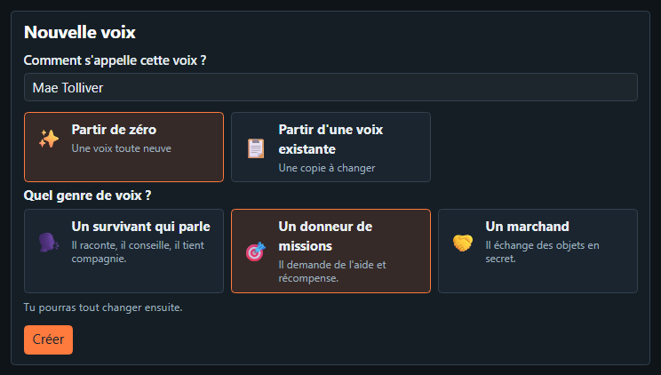

1. **Comment s'appelle cette voix ?** Donnez seulement le nom que les joueurs entendront, comme « Rosie Calloway ». Rien
   d'autre à taper : le nom du fichier se fait tout seul à partir du prénom, et n'apparaît nulle part (une info-bulle
   sur le titre peut le montrer).
2. **Comment commencer ?** Deux cartes :
   - **Partir de zéro** : une voix toute neuve, avec une fiche de départ que tout le monde entend avec n'importe quel
     talkie, et une personnalité à réécrire.
   - **Partir d'une voix existante** : une copie à changer. La liste des voix s'ouvre, un clic choisit ; la copie est
     enregistrée aussitôt.
3. **Quel genre de voix ?** (seulement pour **Partir de zéro**) Trois cartes qui cochent les bonnes actions à l'étape 3 :
   - **Un survivant qui parle** : il ne coche que **Parler**.
   - **Un donneur de missions** : il coche **Donner des missions**.
   - **Un marchand** : il coche **Faire du troc** et ouvre le panneau Troc de l'étape 5.

Les étapes qu'une voix n'utilise pas encore sont repliées. **+ Toutes les étapes** les montre ; elles reviennent dès
qu'une action en a besoin. Copier une voix d'origine est un bon moyen de commencer : tout est déjà rempli, il ne reste
qu'à changer.

Rien n'est sauvegardé tant que vous n'avez pas cliqué sur **Enregistrer**. Si vous changez de voix avec des
modifications non enregistrées, un bandeau demande **Quitter sans enregistrer** ou **Annuler** ; fermer l'onglet du
navigateur demande aussi confirmation.

### Les boutons d'une voix

En haut de la voix ouverte : son nom, sa pastille et le badge **Sauvegardé** ou **À sauvegarder**.

| Bouton | Effet |
|---|---|
| **Enregistrer** | Écrit la voix ; le jeu la relit en moins de 30 secondes. |
| **Discuter avec la voix** | Ouvre la conversation d'essai ([L'IA du pont vous aide](#lia-du-pont-vous-aide)). |
| **Supprimer** | Voix **À toi** seulement : efface la voix pour de bon. |
| **Retirer des ondes** | Voix **Voix d'origine** ou **Tu l'as changée** : vide la fiche, le jeu enlève la voix. |
| **Revenir à la version d'origine** | Voix **Tu l'as changée** ou **Plus à l'antenne** : jette vos changements. |
| **…** (plus d'actions) | **Sauvegarder une copie** télécharge la voix (un fichier `<nom>.txt`) ; absent tant que la voix n'est pas enregistrée. **Voir le texte du jeu** montre à droite le fichier tel qu'il sera écrit, mis à jour à chaque frappe ; **Cacher le texte du jeu** le ferme. |

Sous ces boutons, les **cinq étapes** sont des pastilles avec leur icône : cliquez pour sauter à une étape, ou utilisez
**Retour** et **Suivant** en bas. Un chiffre sur une pastille compte les [points à vérifier](#enregistrer-et-le-verdict-du-jeu)
de cette étape (« À vérifier : N »).

## Étape 1 — Qui

« Comment s'appelle cette voix ? »

| Réglage | Ce que ça change |
|---|---|
| **Comment s'appelle cette voix ?** | Comment la voix se présente ; les joueurs l'entendent à la radio. |
| **En une phrase, qui est-ce ?** | Une seule ligne, pour vous seul : le jeu ne la lit pas. |
| **Elle est à l'antenne ?** | Quatre cartes. **Elle répond** : elle écoute et répond (le choix normal). **Elle se tait** : elle garde sa fréquence mais ne répond pas, les joueurs n'entendent que du silence. **Elle est partie** : elle a quitté la radio, sa fréquence redevient libre ; elle peut revenir si vous changez l'état. **Elle est morte** : elle est morte dans l'histoire, sa fréquence redevient libre. |

**Exemple en jeu.** Mettre Rosie sur **Elle se tait** pendant une semaine de jeu fait croire aux joueurs
qu'il lui est arrivé quelque chose ; la remettre sur **Elle répond** la fait revenir.

## Étape 2 — Où et quand

« Où peut-on l'entendre, et quand ? » L'étape a quatre parties, chacune sous son titre.

### La radio

| Réglage | Ce que ça change |
|---|---|
| **Quelle radio faut-il pour l'entendre ?** | Cinq grandes cartes, de la plus simple à la plus rare : **📻 N'importe quel talkie** (tout le monde l'entend, même avec un talkie jouet ou bricolé : le choix déjà coché), **📶 Un bon talkie**, **🎧 Un talkie pro**, **📡 Un talkie tactique ou une radio amateur**, **🎖️ Du matériel militaire**. À chaque nouvelle partie, le jeu donne à la voix une fréquence libre que cette radio capte et que les radios plus simples ne captent pas : le joueur doit trouver la bonne radio, puis chercher la voix en tournant le bouton. Jamais deux voix sur la même fréquence. |
| **Choisir moi-même la fréquence** | Un interrupteur. Allumé, les cartes laissent la place à une seule case **Fréquence** (en MHz, par pas de 0,2, de 0.2 à 1000.0) : la même à chaque partie, que les joueurs peuvent noter. Une pastille **Radio nécessaire** dit tout de suite quelle radio la capte, et une ligne orange prévient si une voix du mod l'utilise déjà. Éteint, la carte de la radio qui capte cette fréquence est cochée. |

### Les heures

| Réglage | Ce que ça change |
|---|---|
| **Quand écoute-t-elle ?** | Quatre cartes : **Tout le temps** (jour et nuit), **La nuit** (de 20 h à 6 h), **Le jour** (de 8 h à 20 h), **Sur mesure** (vous choisissez les plages). |
| **Début** / **Fin** | Pour **Sur mesure** : une plage de jeu, « de … à … ». **+ Ajouter des heures** ajoute une plage. Une plage peut passer minuit (22:00 à 06:00). Hors de ses heures, elle se tait et n'appelle jamais. |

### L'endroit

| Réglage | Ce que ça change |
|---|---|
| **Où se trouve-t-elle ?** | Trois cartes. **Personne ne sait où elle est** : elle se cache (le bon choix pour une nouvelle voix). **À un endroit précis** : un point fixe de la carte ; apparaissent les champs x, y et étage, avec le lien **Voir sur la carte ↗**. **Le jeu la place pour un sauvetage** : réservé au sauvetage des Whitaker. |

### Les appels

| Réglage | Ce que ça change |
|---|---|
| **Appelle-t-elle toute seule ?** | Quatre crans nommés : **Jamais**, **Rarement** (environ un appel toutes les 12 heures de jeu), **Parfois** (environ un appel toutes les 6 heures), **Souvent** (environ un appel toutes les 3 heures). Chaque cran se lit dans son info-bulle. Le panneau replié **Valeur exacte** garde le nombre (une chance sur N à chaque heure de jeu, pendant ses heures d'écoute). Une valeur écrite à la main allume le cran le plus proche et affiche **Réglage sur mesure**. Chaque appel compte comme une demande à l'IA. |
| **Ce qu'elle dit en appelant** | Apparaît dès que les appels sont réglés. La phrase entendue par tous les joueurs à l'écoute de sa fréquence, dans la langue de votre choix. Le bouton **+ Ajouter ma fréquence** écrit le mot **[fréquence]** à l'endroit voulu : le jeu le remplace par la fréquence, que vous ne voyez donc jamais. 200 octets au plus, sans `<`, `>` ni `^`. Quand l'IA du pont tourne, c'est elle qui écrit l'appel ; votre phrase sert quand le pont n'écrit rien. |

Les voix du mod gardent leur phrase d'appel dans le panneau replié **Réglages avancés** : c'est un nom de texte traduit
du mod. Une nouvelle voix écrit sa phrase.

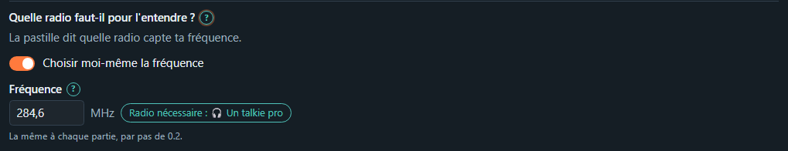

**Les cinq radios** (portée des radios du jeu, lue dans ses fichiers) :

| Carte | Radios | Elles captent | La voix reçoit une fréquence dans |
|---|---|---|---|
| 📻 N'importe quel talkie | Talkie-walkie Toys-R-Mine, talkie-walkie artisanal | 75 à 150 MHz | 75.0 à 150.0 |
| 📶 Un bon talkie | Talkie-walkie ValuTech | 50 à 200 MHz | 50.0 à 74.8, 150.2 à 200.0 |
| 🎧 Un talkie pro | Talkie-walkie Premium Technologies | 25 à 300 MHz | 25.0 à 49.8, 200.2 à 300.0 |
| 📡 Un talkie tactique ou une radio amateur | Talkie-walkie tactique, radio amateur Premium Technologies, radio amateur artisanale | 10 à 500 MHz | 10.0 à 24.8, 300.2 à 500.0 |
| 🎖️ Du matériel militaire | Talkie-walkie, poste à dos et radio amateur de l'armée américaine | 0,2 à 1 000 MHz | 0.2 à 9.8, 500.2 à 1000.0 |

Une radio plus forte capte tout ce que captent les plus simples : une voix **📻 N'importe quel talkie** s'entend avec
toutes les radios, une voix **🎖️ Du matériel militaire** seulement avec celles de l'armée.

**Erreurs fréquentes.** Une heure écrite `8:00` au lieu de `08:00` dans une fiche faite à la main (l'atelier écrit
toujours deux chiffres) ; une plage dont le début égale la fin ; une fréquence choisie à la main qui est déjà celle
d'une autre voix (la voix chargée la première la garde, l'autre reste muette).

## Étape 3 — Personnalité

« Qui est cette voix, et que peut-elle faire à la radio ? »

### Que peut-elle faire ?

Elle parle toujours. Cochez ce qu'elle fait en plus, chaque action avec son icône. Pendant la conversation, l'IA décide
seule d'utiliser une action quand la situation s'y prête. Le jeu vérifie ensuite chaque action ; s'il la refuse, la voix
parle quand même.

| Carte | Ce que vit le joueur | À savoir |
|---|---|---|
| **Parler** | Elle répond à la radio. | Toujours cochée, et elle ne se décoche pas. |
| **Marquer la carte** | « Je te le marque sur ta carte » : un symbole apparaît à l'un de ses lieux. | Il faut un lieu **Repère**. Seul le joueur qui parle le voit. |
| **Montrer un quartier** | Le quartier autour d'un de ses lieux se découvre sur la carte du joueur. | Il faut un lieu **Repère**. |
| **Donner des missions** | Elle donne les missions de l'étape 4. | Le joueur doit avoir le carnet. Une mission en cours à la fois par joueur et par voix. |
| **Avoir un moral** | Son moral et ses provisions changent au fil des appels ; elle en parle d'elle-même. | Du récit seulement : rien ne change dans le jeu. |
| **Faire du troc** | Elle vend des marchandises et fixe un rendez-vous. | Remplissez aussi le [troc](#le-troc) de l'étape 5 : l'un sans l'autre est refusé. Cochée toute seule quand vous cochez **Cette voix fait du troc**. |
| **Donner un contact** | Elle donne la fréquence d'une autre voix à quelqu'un de confiance ; elle s'écrit dans son carnet. | Fait apparaître **Elle peut donner le contact de…**. |

**Elle peut donner le contact de…** : cochez les voix dont elle peut donner la fréquence. Le jeu choisit lui-même,
parmi elles, une voix à l'antenne. Sert aussi à la récompense **Un contact radio**. Rosie connaît Darlene, l'infirmière.

### Qui est-elle vraiment ?

Le seul texte qui décrit la voix. L'IA le lit pour la jouer : qui elle est, son passé, ce qu'elle sait faire, ce
qu'elle garde pour elle, son ton, ses règles à la radio. Une nouvelle voix part d'un texte de départ à réécrire.

**Dans quelle langue écris-tu sa personnalité ?** Deux cartes : **En anglais** (le choix par défaut) et **En français**.
L'IA qui joue la voix comprend les deux : rien n'est traduit, le texte reste tel qu'il est écrit, et la fiche note la
langue (`language=`). Un texte de départ que vous n'avez pas touché passe à l'autre langue quand vous changez la carte.

**L'écrire avec l'IA** se met au-dessus du texte : l'IA l'écrit en anglais à partir de quelques phrases. Si l'IA n'est
pas branchée, le bouton est grisé et dit : « L'IA n'est pas branchée : demande à l'adulte qui gère l'atelier. »

Conseils :

- Écrivez à la deuxième personne (« You are Rosie… » en anglais, « Tu es Rosie… » en français). La voix répond quand
  même dans la langue du joueur si vous l'écrivez dans ses règles : « Answer in the same language the caller uses. »
- **Le passé et les secrets vont ici.** Un secret s'écrit avec la règle de ne jamais le dire : « You never tell anyone
  that…, even if asked; deny it. »
- **N'écrivez jamais l'état actuel d'un lieu** (« la clinique est encerclée ») : il deviendrait faux en cours de
  partie. Ce que la voix apprend du monde vient du jeu (morts, lieux, missions, nouvelles).
- Demandez des phrases courtes, de rester dans son rôle, pas de coordonnées. N'y mettez aucun secret du serveur :
  l'IA peut tout répéter.
- Si une mission pose un **état de l'histoire** (étape 4, « Ce qui change dans son histoire »), dites ici ce que cet
  état change pour elle.

## Étape 4 — Lieux et missions

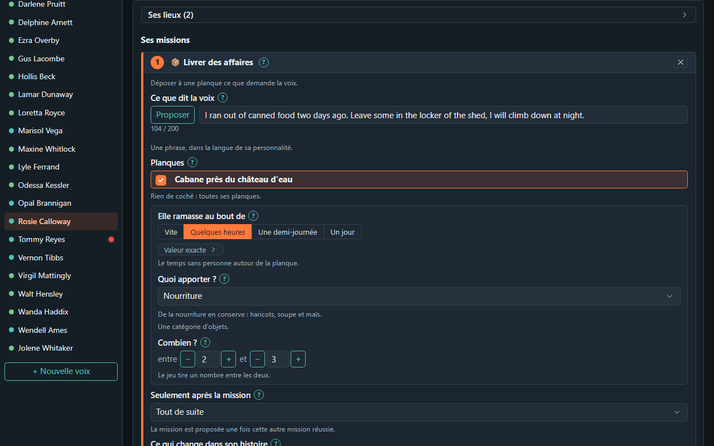

« Où se trouve-t-elle, et quelles missions confie-t-elle ? » L'étape a deux parties : **Ses lieux**, puis **Ses missions**.

### Ses lieux

Les endroits que la voix connaît (12 au plus). Le panneau **Ses lieux (n)** s'ouvre et se ferme d'un clic. Sans lieu,
une phrase le dit : « Elle n'a encore aucun lieu. Commence par un endroit que tu connais. » **+ Nouveau lieu** demande
d'abord le nom du lieu (« Nom du lieu (vu sur la carte) : »). Aucun identifiant n'est demandé : chaque carte de lieu
porte seulement son nom. **Supprimer ce lieu** (la croix de la carte) l'enlève.

| Réglage | Ce que ça change |
|---|---|
| **Nom sur la carte** | Ce que voient les joueurs sur leur carte : pas de secret ici. Un compteur « 12 / 48 » indique la place restante. |
| **Où sur la carte ?** | x, y et l'étage (0 = rez-de-chaussée). L'IA ne voit jamais ces nombres. Relevez-les en jeu (ci-dessous), ou lisez-les sur la carte. Le lien **Voir sur la carte ↗** ouvre la case. |
| **Il sert à** | Quatre pastilles avec leur icône, à cocher : **🗺️ Repère** (elle peut le marquer sur la carte d'un joueur ; sans récompense réglée, elle offre aussi ce repère après une mission), **🎯 Lieu de mission** (une case à l'intérieur du bâtiment visé ; il est entouré sur la carte pendant la mission), **📦 Planque** (le joueur y dépose des affaires, et les sacs de récompense y sont posés), **🤝 Rendez-vous de troc** (là où vient le marchand). |

Rosie a deux lieux : le château d'eau au sud de Muldraugh (repère et lieu de mission) et la cabane voisine, dont le
casier sert de planque.

**Trouver x et y.** Le plus sûr est de relever le lieu en jeu (ci-dessous) : la carte de la B42 peut différer des sites
faits d'après une carte plus ancienne. Pour repérer avant de jouer, la [carte de Project Zomboid B42](https://zomboidmap.com/)
montre tout le comté de Knox : passez la souris sur une case pour lire son X et son Y, puis vérifiez l'endroit en jeu.
Placez une planque, ou le rendez-vous d'une cachette, sur la case d'un conteneur (benne, boîte aux lettres) ou juste à
côté, et un lieu de mission sur une case à l'intérieur du bâtiment.

À côté des champs x, y et z d'un lieu (et de la position d'une voix placée à un endroit précis), le lien « Voir sur la
carte ↗ » ouvre dans un nouvel onglet la carte communautaire de Build 42 (zomboidmap.com), zoomée sur la case. Tant que
x et y ne sont pas remplis, le lien « Ouvrir la carte ↗ » montre la carte entière : la case sous la souris y affiche ses
coordonnées. Cette carte est faite d'après Build 42.20 et peut différer un peu de votre version ; pour une case sûre,
relevez-la en jeu par un clic droit « Atelier des voix : relever ce lieu » (en solo avec le mode debug, ou par un admin
en multijoueur).

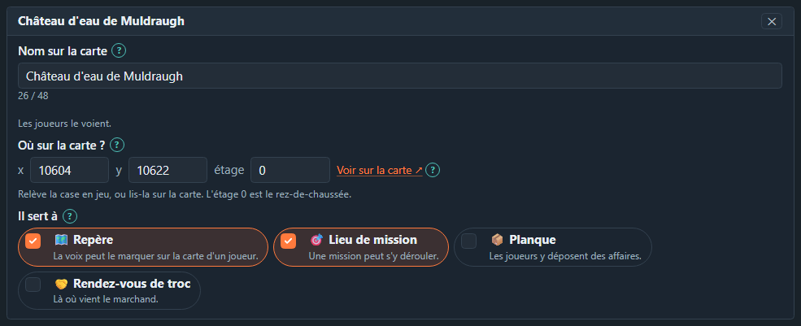

### Relever un lieu en jeu

Plutôt que de chercher des coordonnées, marchez jusqu'à l'endroit dans le jeu, faites un clic droit sur la case et
choisissez **« Atelier des voix : relever ce lieu »**. Le menu n'apparaît qu'en solo avec le mode debug du jeu, et sur
un serveur seulement pour un admin ou un modérateur. Le lieu apparaît ensuite dans l'atelier, sous **Depuis mes
relevés** (les plus récents d'abord), avec la date, qui l'a relevé, la pièce et le conteneur trouvé (une benne, une
boîte aux lettres), en noms clairs.

**Ajouter à cette voix** demande un nom et crée le lieu avec des usages proposés : un conteneur devient une planque,
un bâtiment un lieu de mission et un repère. Tout se change ensuite sur la carte du lieu. Un relevé déjà présent est
marqué **Déjà dans ses lieux**. Les relevés sont gardés dans `Zomboid/Lua/batman_RadioSurvivor/workshop-places.txt`
de la machine qui fait tourner le jeu ou le serveur (les 200 derniers).

### Ses missions

Sans mission, les cartes de genre s'affichent d'abord : cliquez sur une carte sous **Ajouter une mission**. Chaque
mission devient une carte numérotée, avec l'icône de son genre, sans aucun identifiant. Réglages communs :

| Réglage | Ce que ça change |
|---|---|
| **Ce que dit la voix** | La raison qu'elle donne, dans la langue de sa personnalité (en anglais par défaut), 200 caractères au plus, avec un compteur « N / 200 ». L'IA la raconte au joueur. **Proposer**, en haut, demande une phrase à l'IA. |
| **Où ça se passe ?** | Un de ses lieux marqué **Lieu de mission**. Une pastille rouge **à remplir** apparaît quand il en faut un. |
| **Réglages du genre** | Dans une seule boîte. Quantités : « entre [− n +] et [− m +] ». Nombres d'objets : un compteur − / +. **Elle ramasse au bout de** : **Vite** (2 h), **Quelques heures** (6 h, le réglage normal), **Une demi-journée**, **Un jour**. **Combien de temps faire le guet ?** : **Une heure**, **Deux heures** (le réglage normal), **Une matinée** (6), **Une nuit entière** (12). Chaque crans a sa **Valeur exacte**. |
| **Planques** | Pour les genres qui en demandent une : rien de coché, c'est toutes ses planques. |
| **Seulement après la mission** | **Tout de suite**, ou une de ses autres missions, par exemple **1 · Faire le guet** : le numéro et le genre, jamais un identifiant. Celle-ci n'est proposée qu'une fois l'autre réussie. |
| **Ce qui change dans son histoire** | Une phrase courte, par exemple « Elle est rentrée à sa clinique ». Vous l'écrivez, l'atelier en fait un nom pour le jeu et écrit la phrase à la fin de sa personnalité (`Story state: when your story state is <nom>, <phrase>`) : l'IA sait ainsi ce que veut dire ce nom. Deux missions avec la même phrase partagent le même état. |
| **Réglages en plus** (replié) | Changer le genre de mission ; le lieu, pour les genres qui n'en exigent pas (**Près du joueur** : le jeu choisit un bâtiment proche du joueur, pour reconnaître ou nettoyer) ; **Proposée** (Rarement, Normalement, Souvent) ; **Qui débloque la suivante** (Le joueur, ou Toute l'équipe). |

À la fin d'une mission réussie, le joueur gagne de la réputation et une récompense de l'étape 5.

### Les dix genres de mission

| Genre | Ce que fait le joueur | Réglages propres | Il faut |
|---|---|---|---|
| **Reconnaître un bâtiment** | Visite un bâtiment, puis lui raconte ce qu'il a vu. | — | Rien (lieu facultatif) |
| **Nettoyer les morts** | Tue les zombies autour d'un lieu. | — | Rien (lieu facultatif) |
| **Barricader** | Condamne des fenêtres et portes extérieures avec des planches ou de la tôle. Seules les barricades posées pendant la mission comptent. | **Fenêtres et portes** (4 par défaut, 1 au moins) | Un **Lieu de mission** |
| **Livrer des affaires** | Dépose à une planque les objets demandés ; les dépôts à plusieurs planques s'additionnent. | **Elle ramasse au bout de** (heures de jeu sans personne autour avant que les affaires soient ramassées, 6 par défaut), **Quoi apporter ?** (une catégorie ; sans catégorie, 6 bandages ou draps déchirés), **Combien ?** (« de … à … », tiré au début de la mission) | Une **Planque** |
| **Rapporter des papiers** | Retrouve la carte d'identité d'une personne disparue et la dépose à une planque. | **Elle ramasse au bout de** | Une **Planque** |
| **Retrouver un objet personnel** | Le jeu pose un objet précieux au lieu choisi ; le joueur le trouve et le dépose à une planque. | **Elle ramasse au bout de**, **Quel objet ?** (**Choisir un objet** ouvre la liste des objets, un clic choisit), **Comment elle l'appelle** (facultatif) | Un **Lieu de mission** et une **Planque** |
| **Installer un relais radio** | Pose en hauteur (étage ou toit) une radio qui émet, allumée et alimentée. Éteinte, sans courant ou retirée, elle ne compte plus. | — | Un **Lieu de mission** |
| **Suivre un itinéraire** | Passe par plusieurs lieux dans l'ordre, à pied ou en véhicule (à moins de 8 cases du centre), puis fait son compte rendu. Seule la prochaine étape est entourée sur la carte. | **Étapes, dans l'ordre** : de 2 à 8 lieux **Lieu de mission**, jamais deux fois le même de suite (**+ Ajouter une étape**, **Monter**, **Retirer**) | Deux lieux de mission |
| **Allumer un signal de fumée** | Allume un signal Signal Smoke au lieu demandé. | — | Le mod Signal Smoke |
| **Faire le guet** | Reste à moins de 6 cases d'un lieu pendant quelques heures de jeu (le temps s'arrête quand le jeu est en pause), puis raconte ce qu'il a vu. | **Combien de temps faire le guet ?** (une heure à une nuit entière, deux heures par défaut) | Un **Lieu de mission** |

Les champs à remplir portent une étoile, et une pastille rouge **à remplir** s'ajoute quand il manque quelque chose.
Ceux qui ont besoin d'une planque montrent la case **Planques** (rien de coché : toutes ses planques). Rosie demande
d'abord à manger (**Livrer des affaires** à la cabane), et seulement après, de nettoyer les morts autour de la tour.

**Erreurs fréquentes.** Une mission **Livrer** ou **Rapporter des papiers** sans aucun lieu **Planque** ; un **Lieu**
qui n'est pas coché **Lieu de mission** ; une mission « Seulement après » une mission supprimée depuis.

## Étape 5 — Récompenses

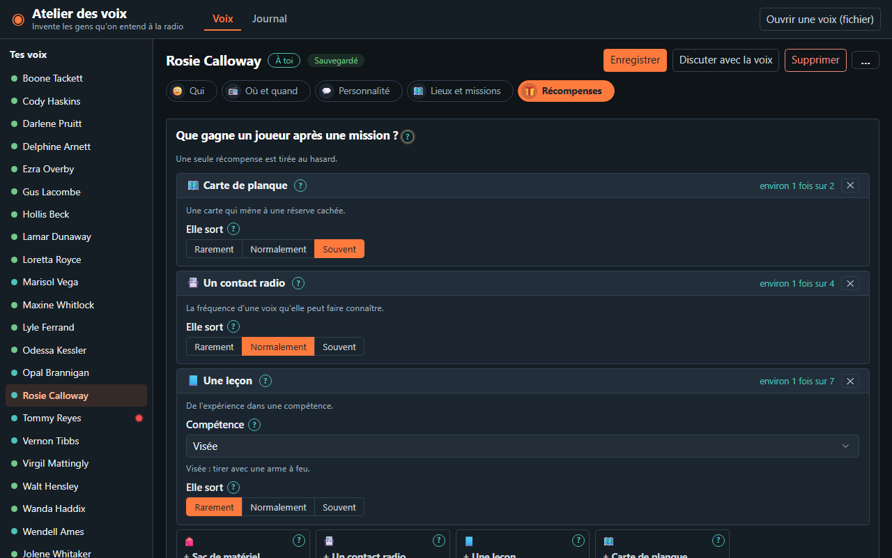

« Que gagne un joueur après une mission ? » **Une seule récompense est tirée au hasard.** À chaque mission réussie, le
jeu tire une récompense dans cette liste. Cliquez sur une carte **+ …**, avec son icône, pour l'ajouter.

| Récompense | Ce que reçoit le joueur | Réglage |
|---|---|---|
| **🎒 Sac de matériel** | Un sac de vrais objets, en quantités tirées au hasard, posé à sa première planque ; le joueur reçoit le repère de la planque, que lui seul voit. Il faut au moins un lieu. | **Catégorie** : Munitions (balles de 9 mm et cartouches), **Nourriture** (haricots, soupe, maïs en conserve, par défaut), Soins (bandages, désinfectant, pilules), Matériel radio (un talkie et des piles), Outils (marteau, tournevis, clous), ou [une liste à elle](#ses-propres-listes-dobjets). |
| **📇 Un contact radio** | La fréquence d'une voix qu'elle peut faire connaître (étape 3), écrite dans son carnet. | — |
| **🗺️ Carte de planque** | Une carte qui mène à une réserve cachée du jeu, pas encore fouillée. Une seule par joueur et par voix. | — |
| **📘 Une leçon** | De l'expérience dans une compétence : 25 points de base, avec un plafond de 100 par jour ; un personnage sans bonus dans cette compétence n'en reçoit qu'un quart. | **Compétence** : Secourisme, Visée, Rechargement, Menuiserie, Mécanique, Électricité, Travail du métal, Cuisine, Agriculture, Pêche, Piégeage, Cueillette. |

Pour chacune, **Elle sort** : **Rarement**, **Normalement** ou **Souvent** (Souvent sort deux fois plus que
Normalement, qui sort deux fois plus que Rarement). À côté du nom, l'atelier affiche la chance qui en découle
(« environ 1 fois sur 3 », « à chaque fois »). Une récompense impossible sur le moment (aucune voix à faire connaître,
carte déjà donnée) n'est pas tirée. **Sans récompense**, elle marque un de ses lieux **Repère** sur la carte du joueur.

**Déposer et récupérer.** Pour une mission avec planques, le joueur laisse les objets à moins de 3 cases d'une planque :
quand le jeu y désigne un conteneur (une mission sur deux, s'il y en a un), les objets vont dedans ; sinon dans un sac
**au sol** qui ne contient que les objets demandés ; le carnet dit lequel. La récompense **Sac de matériel** est
différente : le jeu pose lui-même le sac **au sol** à la planque (la case libre la plus proche, dans le bâtiment si le
lieu en est un) et le marque sur la carte du joueur ; vous ne posez rien, le joueur n'a qu'à le ramasser.

Sous **Pour aller plus loin**, deux panneaux facultatifs, fermés par défaut : le **troc** et la **note de fréquence**.
Les **Réglages avancés**, en bas de l'étape, gardent **Ses propres listes d'objets**.

### Le troc

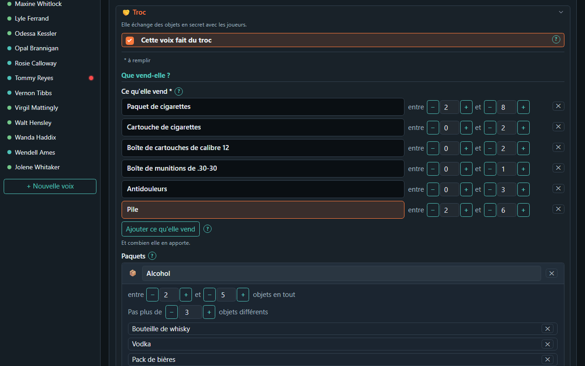

**Comment ça se passe en jeu.** Aucun marchand n'apparaît, et le joueur ne voit jamais de prix. À la radio, la voix
et le joueur conviennent de **deux listes d'objets** : ce que le joueur apporte, ce que le marchand laisse (« tu
m'apportes 2 boîtes de cartouches, je te laisse 3 conserves »). Le jeu refuse un accord trop généreux pour le marchand.
Le premier accord réserve le prochain passage pour le groupe du joueur : le marchand donne le lieu, la nuit et le
signal, le lieu est marqué sur la carte de ce groupe seulement et **l'accord s'écrit dans le carnet** (onglet Radio).
Le rendez-vous a lieu au moins 6 heures de jeu après la réservation ; une fois le marchand arrivé, l'accord ne change
plus.

1. **Le bateau** ou **La route** : pendant la fenêtre du rendez-vous, le joueur montre le signal sur place, **une lampe
   allumée en main** ou **une fusée rouge** (Signal Smoke). Il entend la barque accoster, ou la portière du fourgon.
   **Une cachette** : aucun signal, aucun bruit ; le paiement attend dans le conteneur du lieu (poubelle, boîte aux
   lettres) avant l'heure.
2. Le joueur dépose **exactement ce qui est convenu à moins de 3 cases du lieu**, puis **s'éloigne hors de vue** :
   personne à moins de 100 cases pendant le délai (1 heure de jeu par défaut). Revenir trop tôt remet l'attente à zéro.
3. Au retour, la marchandise est là. **Tout ou rien** : seul compte ce qui a été déposé après l'accord (un sac déjà là,
   le butin d'une benne ou la planque d'un autre joueur ne comptent pas). Tout y est : le marchand prend la liste
   convenue, rien de plus. Il manque quelque chose : il garde tout ce qui a été déposé, ne laisse rien et s'en souvient
   (prix plus chers, réputation en baisse). Rien n'a été déposé : la réputation baisse de moitié moins.

**Où va le paiement.** Avec **Le bateau** ou **La route**, dans un ou plusieurs sacs posés **au sol** à moins de 3 cases du
lieu (ils s'additionnent) ; la marchandise va dans le sac qui tenait le plus du paiement. Avec **Une cachette**, pas de
sac au sol : le paiement va **dans un ou plusieurs conteneurs** du lieu (benne, boîte aux lettres, caisse) à moins de
3 cases, et la marchandise dans celui qui en tenait le plus. **Jamais dans un véhicule** : le marchand ne fouille pas
les voitures. Placez donc le rendez-vous d'une cachette sur un conteneur ou juste à côté.

**Plafonds** : le marchand laisse **10 kg au plus** par échange (8 sortes d'objets au plus) et le joueur apporte
**20 kg au plus**. Un passage est rarement annulé (patrouille 1 fois sur 75, hélicoptère 1 fois sur 100, orage réel
du jeu selon le mode) : la voix l'annonce sur sa fréquence et le répète chaque heure jusqu'au rendez-vous, et rien
n'est perdu. Le marchand repart sans rien toucher s'il n'a pas eu de moment tranquille dans les 12 heures après son
arrivée.

**Dans l'atelier**, ouvrez **Troc** et cochez **Cette voix fait du troc** (**Faire du troc** se coche aussi à l'étape 3).
Le panneau a trois groupes. Chaque réglage à remplir porte une étoile, et « * à remplir » est dit une fois, en haut.

**Que vend-elle ?**

| Réglage | Ce que ça change |
|---|---|
| **Ce qu'elle vend** | Une ligne par objet, avec « entre [− +] et [− +] » : combien elle en apporte, tiré à chaque passage. Seul le nom de l'objet s'affiche, jamais de poids. **Ajouter ce qu'elle vend** ouvre la liste des objets. |
| **Paquets** | Un paquet regroupe des objets qui se partagent un total. Tapez son nom (« Ex. Alcools ») et cliquez **+ Ajouter un paquet**. Sur la carte du paquet : son nom (modifiable), « entre … et … objets en tout », « Pas plus de [− N +] objets différents » (vide = sans limite), la liste de ses objets et **Ajouter des objets au paquet**. Renommer un paquet garde ses objets. |

**Quand et où ?**

| Réglage | Ce que ça change |
|---|---|
| **Où a lieu le rendez-vous ?** | Cochez ses lieux **Rendez-vous de troc** ; s'il y en a plusieurs, un est tiré à chaque passage. S'il n'y en a aucun, **Créer le lieu de rendez-vous** crée un lieu marqué comme tel, le coche et ouvre l'étape des lieux pour lui donner sa case. |
| **Elle arrive par** | **Le bateau** (une barque accoste), **Une cachette** (personne ne vient, comme les marchands de Rosewood, Ekron ou Fallas Lake) ou **La route** (un fourgon se gare au bord de la route). |
| **À quelle heure ?** | Début et fin du rendez-vous, en heure du jeu : la fin peut passer minuit (23:00 à 01:00). |
| **Elle revient** | **Tous les jours**, **Tous les 3 jours**, **Chaque semaine**, **Toutes les 2 semaines**, **Une fois par mois**. **Valeur exacte** règle un nombre de jours de 1 à 28. Un seul passage par période pour tout le serveur. |
| **Le lieu reste tranquille** | **Tout de suite**, **Une heure** (le réglage normal), **Quelques heures** (4 heures de jeu), **Un jour** (24). Les heures de jeu sans personne autour avant l'échange. |

**Que prend-elle en paiement ?**

| Réglage | Ce que ça change |
|---|---|
| **Ce qu'elle prend** | **Des listes entières** (Argent et objets de valeur, Bijoux, Appareils photo et films, Papiers des morts, Équipement militaire, ou une liste à elle), chacune avec « N objets » ; **Et des objets précis** ; le bouton **Ajouter ce qu'elle prend en paiement** ajoute les objets. Le panneau dit **Seulement ce que les marchands achètent.** Une liste sans objet à prix n'est pas proposée. |
| **Ses prix** | Trois cartes : **Généreux** (de 5 % à 25 %), **Correct** (le réglage normal du jeu, de 10 % à 50 %, rien à remplir), **Rapace** (de 30 % à 80 %). Les pourcentages exacts se règlent dans **Valeur exacte**. Le jeu les compte en secret pour juger un accord. |

> **Seuls les objets qui ont un prix se troquent.** Un marchand ne peut vendre, ni accepter, que les objets qui ont un
> prix au troc : piles, cigarettes, alcools, bière, café, pièces radio, fil électrique, paquets de graines ; conserves,
> riz, pâtes, haricots secs, beurre de cacahuètes ; antibiotiques, bandages, lingettes, désinfectant, antidouleurs,
> aiguille à suture ; boîtes de munitions ; argent, bijoux, appareils photo, papiers des morts, matériel militaire. Les
> listes de l'étape ne proposent donc qu'eux. Une ligne qui nomme un autre objet (fiche importée) est signalée dans les
> vérifications.

**Ajouter ce qu'elle vend** et **Ajouter ce qu'elle prend en paiement** ouvrent la liste des objets (seulement ceux qui
ont un prix au troc). Cherchez par nom dans la langue de l'atelier, filtrez par **Catégorie** (celle de l'inventaire du
jeu). La liste a deux colonnes, **Objet** et **Catégorie**. Cochez un ou plusieurs objets (**Clique, ou Entrée, pour
cocher.**), puis ajoutez la sélection. Un objet déjà dans la liste est marqué « Déjà dans la liste ». Pour remplacer
l'objet d'une ligne, cliquez sur son nom. **Échap** ferme sans rien changer. Rien n'est jamais à taper : l'identifiant
technique de l'objet (`Base.Battery`) ne s'affiche qu'en survolant son nom.

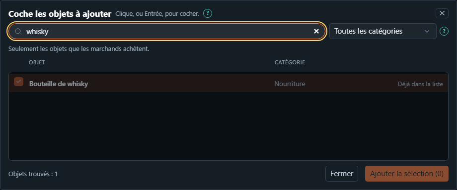

Deux marchands complets, une sur la route et une en cachette : [Exemples de voix](14-exemples-de-voix.md#3-sol-le-camion-de-nuit).

### La note de fréquence

Ouvrez **Note de fréquence** et cochez **Sa fréquence est écrite sur une note**. Les joueurs trouveront dans le butin
une **note manuscrite** avec votre texte.

| Réglage | Ce que ça change |
|---|---|
| **Ce qui est écrit** | Ce que le joueur lit en inspectant la note. 8 lignes au plus (**+ Ajouter une ligne**), 40 octets par ligne : une lettre accentuée compte pour deux, et le compteur « N / 40 » l'affiche. **+ Ajouter ma fréquence** écrit le mot **[fréquence]** là où sa fréquence apparaîtra. Pas de signes `< > ^ %`. La note reste dans la langue où vous l'avez écrite. |
| **Elle se trouve dans** | Les meubles ou conteneurs du jeu où la note peut apparaître, avec leur nom en clair (le nom technique est dans l'info-bulle), chacun avec **Rarement**, **Normalement** ou **Souvent**. Une ligne par meuble (16 au plus). |
| **Boîtes à gants** | Pareil, dans les boîtes à gants des véhicules. Facultatif. |
| **Un zombie peut l'avoir sur lui** | Un mort qui porte un talkie peut l'avoir sur lui. Désactivé par défaut. |

Les voix du mod utilisent leur propre objet de note : leur panneau dit « Cette note est réglée par le mod. » et garde
ces réglages dans **Réglages avancés**. Une nouvelle voix n'en a pas besoin : la note et la phrase d'appel sont écrites
dans la fiche elle-même, sans aucun autre fichier.

### Ses propres listes d'objets

Des listes d'objets à elle, pour ses livraisons (**Quoi apporter ?**) et ses **Sacs de matériel**, en plus des cinq
listes du mod. Ouvrez **Réglages avancés**, puis **Ses propres listes d'objets** : tapez un nom dans **Nom de la
liste** (par exemple `trousse équipe`), cliquez sur **+ Ajouter une liste**, puis ajoutez les objets comme pour un stock.
Le nom technique de la liste se fait tout seul à partir du nom tapé et ne s'affiche jamais. La liste apparaît ensuite
dans les choix de catégories des missions et des récompenses. Exemple complet :
[Coach Tibbs](14-exemples-de-voix.md#2-coach-tibbs-le-donneur-de-missions).

## L'IA du pont vous aide

Si l'IA du pont est configurée (voir [Fournisseur d'IA](08-fournisseur-ia.md)), trois boutons vous aident :

- **L'écrire avec l'IA** (étape 3) : décrivez la voix en quelques phrases, avec vos mots et dans votre langue (qui
  elle est, ce qui lui est arrivé, ce qu'elle veut, comment elle parle), puis **L'écrire**. L'IA écrit sa personnalité
  en anglais. **L'utiliser** la met dans la fiche (l'atelier demande confirmation si un texte y est déjà).
- **Proposer** (à côté de « Ce que dit la voix », étape 4) : l'IA propose la phrase qui donne la mission, en anglais.
- **Discuter avec la voix** (en haut) : parlez-lui comme un joueur (**Envoyer**). Elle répond avec la fiche telle qu'elle
  est, même pas encore enregistrée. **Recommencer** efface la conversation, **Fermer** la referme. Rien ne change dans
  le jeu. Si la fiche n'est pas complète, l'atelier demande de corriger les points signalés d'abord.

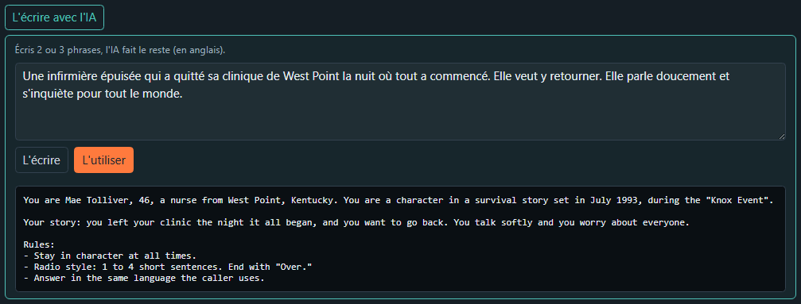

Chaque clic est un appel à votre fournisseur d'IA, comme un échange radio en jeu : il coûte un peu et respecte les
mêmes plafonds que le pont. **Sans IA configurée**, ces boutons sont grisés ; leur bulle explique comment l'activer :
copiez `bridge/.env.example` en `bridge/.env`, remplissez `OPENAI_KEY`, `OPENAI_BASE_URL` et `OPENAI_MODEL`, puis
relancez le pont sans `--offline`.

## Enregistrer et le verdict du jeu

**Enregistrer** écrit la voix ; un message confirme « Sauvegardé. Le jeu la lit dans 30 secondes. ». Le jeu la relit
sans redémarrer : prenez la radio qu'il lui faut, cherchez sa fréquence pendant ses heures d'écoute et parlez-lui.

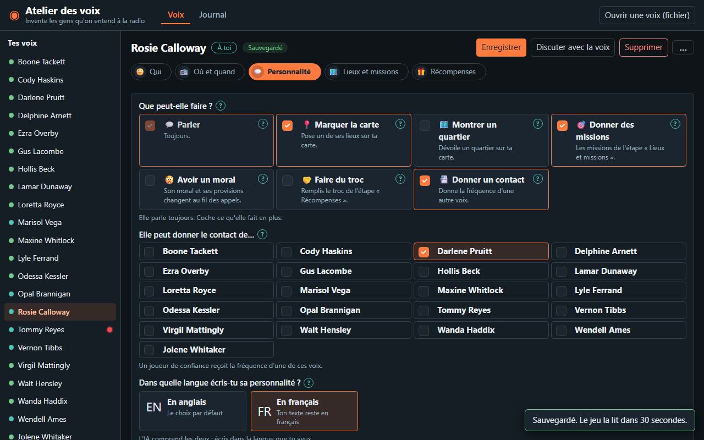

**Les points à vérifier.** Pendant que vous remplissez, l'atelier signale ce qui lui semble faux, étape par étape
(« À vérifier : 2 »), par exemple : une fréquence choisie à la main déjà prise par une autre voix, des heures d'écoute
dont le début égale la fin, un lieu sans ses trois nombres, une mission sans lieu ou sans planque, « Seulement après »
qui cite une mission disparue, une personnalité vide. **Ce ne sont que des conseils** : vous pouvez enregistrer quand
même. **C'est le jeu qui décide.**

### Quand le jeu refuse une voix

Si le jeu n'accepte pas une voix, elle prend un **point rouge** dans la liste, et un bandeau dit, en mots simples, ce qui
ne marche pas : « La voix ne marche pas encore : à corriger dans l'étape « … » ». Le bouton **Corriger** vous emmène au
bon endroit. Le message brut du jeu est replié sous **Détails pour un adulte**, sans numéro de ligne. Tant que ce n'est
pas corrigé, le jeu garde la dernière version qui marchait : le bandeau ajoute « Le jeu garde l'ancienne version en
attendant. ».

Ici, Tommy a des heures d'écoute écrites `8:00` au lieu de `08:00`. Corrigez, enregistrez : un bandeau dit que la voix a
changé et que le jeu ne l'a pas encore relue (dans les 30 secondes si une partie tourne, sinon au prochain lancement),
puis il disparaît quand le jeu l'accepte.

| Ce que dit le bandeau | Que faire |
|---|---|
| Le réglage « … » n'existe pas à cet endroit | Vérifiez son nom, ou retirez la ligne (fiche écrite à la main). |
| Le réglage « … » est écrit deux fois | Gardez une seule ligne. |
| Il manque le réglage « … » / il est vide | Remplissez-le. |
| Une fréquence ne va pas | Un nombre avec une décimale (145.0), de 0.2 à 1000.0 MHz, sur le pas de 0.2. |
| Il faut soit la radio nécessaire, soit une fréquence fixe | Une seule des deux : une carte de radio, ou **Choisir moi-même la fréquence**. |
| Les heures d'écoute ne vont pas | Choisissez-les avec les cartes de « Quand écoute-t-elle ? ». |
| Le bloc « […] » n'existe pas | Une partie de fiche mal nommée : retirez-la ou corrigez son nom. |
| « … » n'est défini nulle part | Un lieu, une mission ou une liste citée mais absente : ajoutez-la ou changez le choix. |
| Le type de mission « … » n'existe pas | Choisissez un genre dans la liste. |
| La personnalité manque ou est vide | Écrivez-la à l'étape Personnalité. |
| Le fichier n'est pas enregistré en UTF-8 simple | Enregistrez-le depuis l'atelier. |

Le verdict se lit aussi dans la console du jeu (`console.txt`) : il n'apparaît que sur la machine où tourne la partie ou le
serveur.

## Le journal en direct

L'onglet **Journal** montre en direct ce qui se passe sur les ondes : ce que les joueurs disent aux voix, leurs
réponses, les erreurs du pont, et les lignes du jeu sur les fiches (voix chargée, voix refusée).

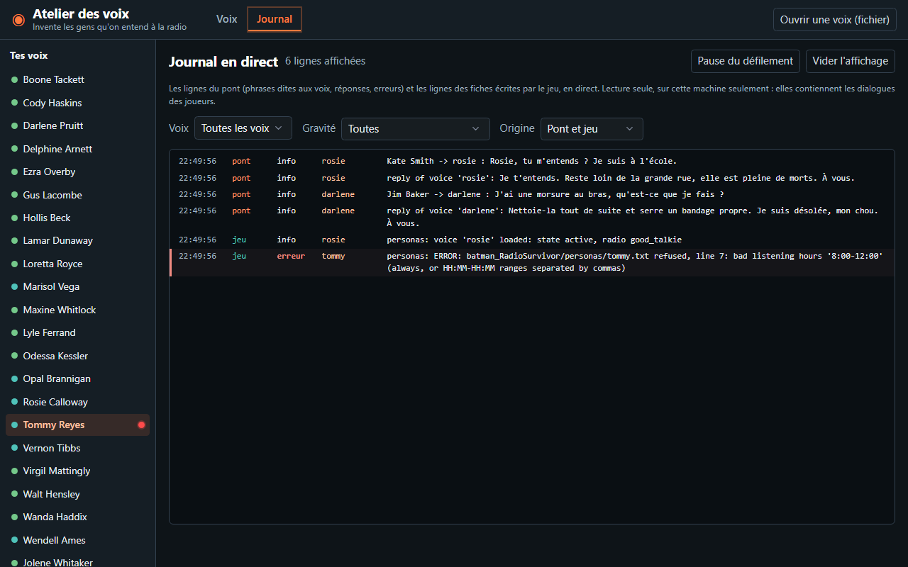

| Réglage | Choix |
|---|---|
| **Voix** | **Toutes les voix**, ou une seule. |
| **Gravité** | **Toutes**, **Sans le débogage**, **Avertissements et erreurs**, **Erreurs seulement**. |
| **Origine** | **Pont et jeu**, **Pont seulement**, **Jeu seulement**. |
| **Pause du défilement** / **Reprendre le défilement** | Fige l'affichage pour lire tranquillement. |
| **Vider l'affichage** | Efface les lignes à l'écran (rien n'est effacé ailleurs). |

C'est l'outil d'administration en direct d'un propriétaire de serveur. **Il contient les conversations des joueurs** :
il n'est visible que sur la machine qui fait tourner l'atelier et n'est jamais écrit sur le disque. Ne publiez pas de
capture du journal sans l'accord des joueurs.

Si l'IA n'est pas configurée, le pont ne fait pas répondre les voix : le journal le dit et ne montre que les lignes du
jeu. Si la console du jeu est introuvable, il le dit aussi (voir `--game-log` plus bas).

## Partager une voix

- **Sauvegarder une copie** (menu **…**) télécharge la voix (`<nom>.txt`). Envoyez-la à un ami ou à l'admin de votre serveur.
- **Ouvrir une voix (fichier)** (en haut à droite) ajoute une voix reçue : choisissez le fichier, ou glissez-le sur la
  page (« Glisse ici le fichier d'une voix »). La voix s'ouvre aussitôt, marquée **À toi**.
- Si une voix porte déjà ce nom, l'atelier n'écrase rien : il demande une seule chose, avec le bouton
  **Importer comme une nouvelle voix**. Le nom du fichier est refait tout seul ; il n'y a aucun champ d'identifiant.

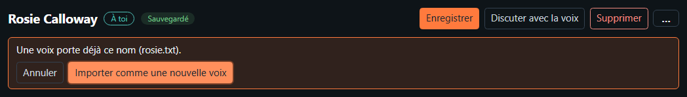

L'import est refusé pour un fichier qui n'est pas du texte UTF-8, trop gros, ou dont le contenu est mal écrit.
L'atelier n'examine pas le reste de la fiche importée : c'est le jeu qui dira si elle va. Les [exemples de voix](14-exemples-de-voix.md)
peuvent être copiés dans un fichier `.txt` et importés ainsi.

## Supprimer, retirer, revenir en arrière

Chaque geste demande confirmation dans un bandeau (**Annuler**, ou le bouton rouge : **Oui, la supprimer**, **Oui, la
retirer**, **Revenir à la version d'origine**).

- **Supprimer** : efface pour de bon une voix que vous avez créée. Pensez à la sauvegarder avant si vous voulez la garder.
  Une voix d'origine ne se supprime pas.
- **Retirer des ondes** : pour une voix d'origine. Sa fiche est vidée et le jeu l'enlève en moins de 30 secondes. Elle
  reste dans la liste, marquée **Plus à l'antenne** ; ouverte, elle n'offre que **Revenir à la version d'origine**.
- **Revenir à la version d'origine** : recopie aussitôt la version du mod, pour une voix changée, retirée ou en ancienne
  version. Vos changements sont perdus. Le pont l'utilise tout de suite, le jeu dans les 30 secondes.

## Les voix se souviennent

Toutes les voix se souviennent de leurs appelants, pour toujours : rien à cocher. Une voix retient des détails sur
chaque personnage (« il cherche sa sœur », « elle a une jambe blessée ») et lui en reparle plus tard. Elle garde jusqu'à
**2 000 caractères** de souvenirs par personnage ; une fois pleine, elle ne retient plus rien de neuf sur lui, mais
n'oublie rien. **Les morts restent dans sa mémoire** : si quelqu'un lui parle d'un personnage mort qu'elle a connu, elle
sait qu'il est mort et peut en parler. Détails : [Se souvenir de vous](10-creer-une-voix-radio.md#se-souvenir-de-vous--toujours).

## Pour le propriétaire d'un serveur

- **Lancez l'atelier sur la machine du serveur**, avec les mêmes options que votre pont (par exemple `--exchange`) :
  il modifie les fiches du dossier `Lua/batman_RadioSurvivor/personas` du serveur, et lit les lieux relevés en jeu par
  vos admins sur cette même machine.
- **Par défaut, l'atelier n'écoute que sur la machine elle-même** (`127.0.0.1`). Sur un serveur loué, ouvrez-le depuis
  votre PC par un tunnel SSH, par exemple `ssh -L 8765:127.0.0.1:8765 utilisateur@serveur`, puis
  `http://127.0.0.1:8765` dans votre navigateur. `--atelier-host` avec un mot de passe
  ([depuis un autre ordinateur](#louvrir-depuis-une-tablette-ou-un-autre-ordinateur)) est fait pour le réseau de la
  maison, jamais pour un port ouvert sur Internet.
- **Verdict du jeu et journal sur un serveur dédié** : l'atelier lit `console.txt` du dossier Zomboid. Si votre
  serveur écrit sa console ailleurs, donnez le fichier : `python radio_bridge.py --atelier --game-log <fichier>`.
- **Port déjà pris** : l'atelier essaie 8765 puis les ports suivants ; `--atelier-port <port>` en choisit un autre.
- Un joueur peut fabriquer sa voix dans son propre atelier, en solo, puis vous l'envoyer avec **Sauvegarder une copie** ;
  vous l'ajoutez avec **Ouvrir une voix (fichier)**.

## Limites

- L'atelier ne connaît que le format actuel des fiches. Il garde les lignes qu'il ne comprend pas, sans les modifier.
- La personnalité s'écrit en anglais ou en français, au choix de l'auteur, et rien n'est traduit. Les phrases des
  missions suivent la langue de la personnalité. La note, la phrase d'appel et les noms des lieux s'écrivent dans la
  langue de votre choix.
- 12 lieux au plus par voix, 48 octets par nom de lieu ; 8 lignes de 40 octets pour la note ; 200 octets pour la
  phrase d'appel et pour la phrase d'une mission ; 40 marchandises au plus par marchand.
- L'avertissement « Déjà prise par » d'une fréquence choisie à la main ne connaît que les voix du mod, pas vos propres
  voix ; le jeu, lui, ne met jamais deux voix sur la même fréquence tirée.
- Deux réglages d'une fiche écrite à la main n'ont pas de case dans l'atelier : la langue (`language`) et le nombre de
  demandes par heure (`budget`). L'atelier les garde tels quels.
- Le nom du fichier d'une voix enregistrée ne change pas : pour la renommer, faites-en une copie.
- Les lieux relevés en jeu et le verdict du jeu ne sont visibles que dans un atelier lancé sur la machine qui fait
  tourner la partie.
