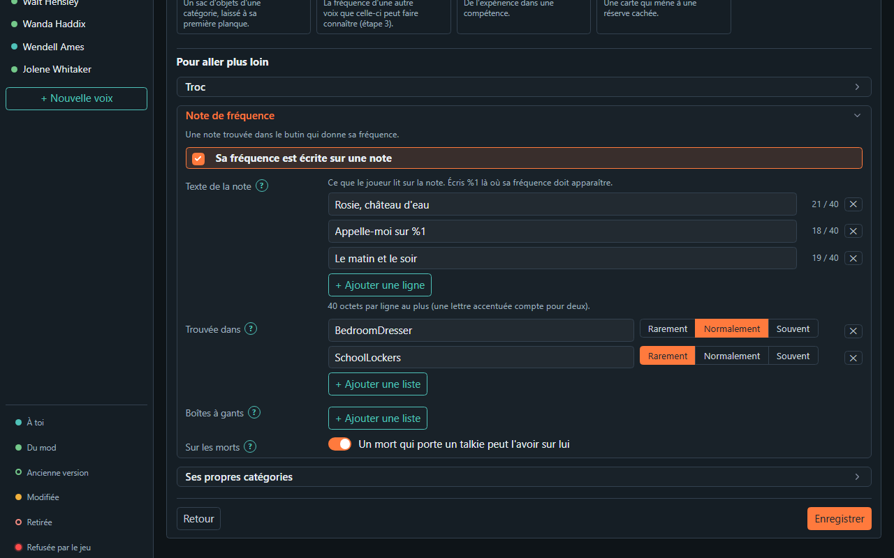
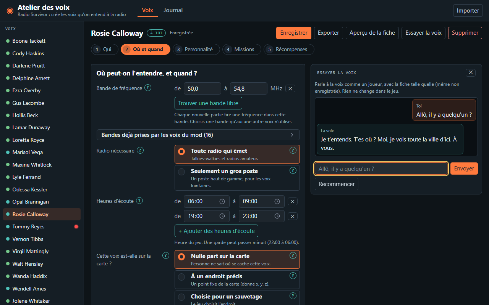
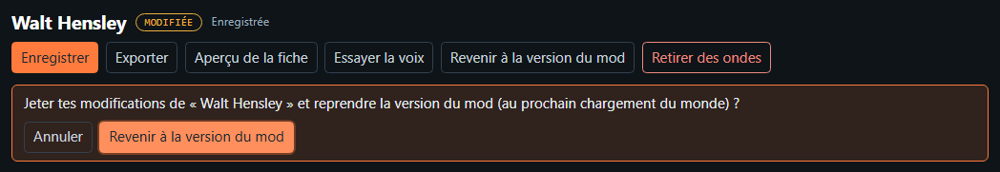

*English: [Voice workshop](../en/13-voice-workshop.md)*

# Atelier des voix

L'**atelier des voix** est une page qui s'ouvre dans votre navigateur. Elle sert à fabriquer les personnes qui
répondent à la radio : qui elles sont, quand elles écoutent, leur caractère, les missions qu'elles confient, ce
qu'elles donnent en échange et ce qu'elles vendent. On remplit cinq étapes, on clique sur **Enregistrer**, et le jeu
entend la nouvelle voix en moins de 30 secondes, sans redémarrer.

Pas besoin d'écrire un fichier à la main. L'atelier écrit le même fichier que celui décrit dans
[Créer une voix radio](10-creer-une-voix-radio.md), la référence ligne par ligne. Quatre voix complètes, construites
pas à pas, sont dans [Exemples de voix](14-exemples-de-voix.md).

Sur les images de cette page, un joueur a créé **Rosie**, une ado de 15 ans cachée en haut du château d'eau de
Muldraugh. Elle appelle le matin et le soir, demande à manger, puis qu'on nettoie les morts autour de sa tour.

## Sommaire

- [Ouvrir l'atelier](#ouvrir-latelier) · [depuis une tablette](#louvrir-depuis-une-tablette-ou-un-autre-ordinateur)
- [L'écran de l'atelier](#lécran-de-latelier) · [la liste des voix](#la-liste-des-voix) ·
  [créer une voix](#créer-une-voix) · [les boutons d'une voix](#les-boutons-dune-voix)
- Les cinq étapes : [1. Qui](#étape-1--qui) · [2. Où et quand](#étape-2--où-et-quand) ·
  [3. Personnalité](#étape-3--personnalité) · [4. Missions](#étape-4--missions) ·
  [5. Récompenses](#étape-5--récompenses)
- Pour aller plus loin : [troc](#le-troc) · [note de fréquence](#la-note-de-fréquence) ·
  [ses propres catégories](#ses-propres-catégories)
- [L'IA du pont vous aide](#lia-du-pont-vous-aide) · [Enregistrer et le verdict du jeu](#enregistrer-et-le-verdict-du-jeu) ·
  [Le journal en direct](#le-journal-en-direct)
- [Partager une voix](#partager-une-voix) · [Supprimer, retirer, revenir en arrière](#supprimer-retirer-revenir-en-arrière) ·
  [Les voix se souviennent](#les-voix-se-souviennent) · [Pour le propriétaire d'un serveur](#pour-le-propriétaire-dun-serveur) ·
  [Limites](#limites)

## Ouvrir l'atelier

L'atelier fait partie du **pont** (le petit programme Python qui fait parler les voix, voir
[Le pont en solo](05-pont-en-solo.md)). Il faut Python 3.10 ou plus récent, et le dossier `bridge` du pont, téléchargé
en entier depuis GitHub (l'atelier vit dans son sous-dossier `atelier`).

- **Windows** : double-cliquez sur `atelier.bat` dans le dossier `bridge`.
- **Linux** : lancez `./atelier.sh` dans ce même dossier.
- **macOS** : double-cliquez sur `atelier.command`.
- **Ou à la main**, depuis le dossier `bridge` : `python radio_bridge.py --atelier`.

Le navigateur s'ouvre tout seul sur l'atelier. Sinon, la fenêtre du pont affiche l'adresse à ouvrir (par exemple
`http://127.0.0.1:8765`). La page est en français si votre navigateur est en français, en anglais sinon.

Bon à savoir :

- **Le pont continue de marcher pour le jeu.** Une seule fenêtre fait les deux : les voix répondent en jeu pendant que
  vous travaillez dans l'atelier. Fermer cette fenêtre ferme aussi l'atelier.
- **Sans IA configurée, l'atelier s'ouvre quand même.** Tout marche, sauf les boutons d'aide à l'écriture et l'essai
  de la voix, qui restent grisés (voir [L'IA du pont vous aide](#lia-du-pont-vous-aide)).
- **L'atelier travaille sur les vraies fiches du jeu** : le dossier `Zomboid\Lua\batman_RadioSurvivor\personas` de
  votre ordinateur. Ce dossier n'existe qu'après le premier chargement d'un monde avec le mod : lancez une partie une
  fois avant d'ouvrir l'atelier.

### L'ouvrir depuis une tablette ou un autre ordinateur

Par défaut, l'atelier ne répond qu'à l'ordinateur sur lequel il tourne. Pour l'ouvrir depuis une tablette ou un autre
ordinateur du réseau de la maison :

1. Choisissez un mot de passe de **10 caractères ou plus** et ajoutez-le au fichier `.env` du dossier `bridge` (celui
   qui contient les réglages de l'IA ; copiez `.env.example` en `.env` si vous n'en avez pas) :
   `ATELIER_PASSWORD=votre mot de passe`
2. Lancez l'atelier sur le réseau : `python radio_bridge.py --atelier --atelier-host 0.0.0.0` (avec un lanceur :
   `atelier.bat --atelier-host 0.0.0.0`, `./atelier.sh --atelier-host 0.0.0.0`).
3. La fenêtre du pont affiche l'adresse à ouvrir, par exemple
   `Voice workshop on http://0.0.0.0:8765/ (password required); from another device: http://192.168.1.20:8765/`.
   Sur la tablette, ouvrez `http://<adresse du PC>:8765/`, entrez le mot de passe et cliquez sur **Se connecter**.

- **Tout le monde se connecte**, le PC lui-même compris. Le navigateur reste connecté 7 jours, ou jusqu'au
  redémarrage du pont. Le bouton **Se déconnecter**, en haut à droite, ferme la session.
- **Les mauvais mots de passe sont freinés** : après 5 échecs depuis le même appareil, la page affiche « Trop d'essais
  manqués : réessaie dans … s » ; l'attente dure 1 minute, puis double à chaque nouvel échec (jusqu'à 15 minutes).
  Chaque connexion, échec et déconnexion apparaît dans le journal en direct avec l'adresse de l'appareil.
- Sans `ATELIER_PASSWORD`, ou avec un mot de passe plus court, l'atelier ne démarre pas sur le réseau : la fenêtre du
  pont dit pourquoi, et le pont continue de répondre au jeu.
- Windows peut demander si Python a le droit d'utiliser le réseau : autorisez-le sur les réseaux **privés** seulement.
- **Réseau de la maison seulement.** L'atelier parle en HTTP simple, ce qui suffit à la maison. Pour l'atteindre de
  l'extérieur, passez par un VPN comme Tailscale ou par un mandataire HTTPS. **N'ouvrez jamais le port sur votre box.**

## L'écran de l'atelier

- **En haut** : deux onglets, **Voix** (l'éditeur) et **Journal** ([le journal en direct](#le-journal-en-direct)) ;
  à droite, **Importer** ([partager une voix](#partager-une-voix)) et, sur le réseau, **Se déconnecter**.
- **À gauche** : la liste des voix et le bouton **+ Nouvelle voix**.
- **Au centre** : la voix ouverte. Sans voix ouverte, un écran d'accueil rappelle les trois gestes : choisir une voix,
  remplir les cinq étapes, enregistrer.

Chaque réglage a un petit **?** : passez la souris dessus (ou cliquez) pour savoir à quoi il sert, ce que vit le joueur
en jeu, les choix possibles et un exemple. **Échap** referme la bulle.

### La liste des voix

Chaque voix porte un point de couleur ; la légende est sous la liste.

| Pastille | Sens |
|---|---|
| **À toi** | Une voix que vous avez créée ou importée. |
| **Du mod** | Une voix livrée avec le mod, telle quelle. |
| **Ancienne version** (point vert creux) | Une copie d'une voix du mod que le jeu a écrite d'après une ancienne version du mod : le jeu la remplacera par la nouvelle version du mod au prochain chargement du monde. Rien à faire. |
| **Modifiée** | Une voix du mod que vous avez changée. Une mise à jour du mod n'écrase jamais vos changements. |
| **Retirée** | Une voix du mod que vous avez retirée des ondes. |
| **Pas encore enregistrée** | (en haut de l'éditeur) Une voix créée mais jamais enregistrée : elle n'existe pas encore pour le jeu. |
| **Refusée par le jeu** (point rouge) | Le jeu n'a pas accepté la fiche : voir [Quand le jeu refuse une voix](#quand-le-jeu-refuse-une-voix). |

### Créer une voix

**+ Nouvelle voix** ouvre un petit formulaire :

| Case | Ce qu'on y met |
|---|---|
| **Nom** | Le nom que les joueurs entendront, comme « Rosie Calloway ». |
| **Identifiant court** | Rempli tout seul depuis le prénom (`rosie`). Lettres minuscules, chiffres et `_`, en commençant par une lettre, 32 au plus. Il devient le nom du fichier et **ne change plus** une fois la voix enregistrée. |
| **Partir de** | **Une voix vide** (une fiche de départ, avec une bande libre et une personnalité à réécrire) ou **Une copie de …** n'importe quelle voix (la copie est enregistrée aussitôt). |

Copier une voix du mod est un bon moyen de commencer : tout est déjà rempli, il ne reste qu'à changer. **Créer**
ouvre la nouvelle voix à l'étape 1. Si l'identifiant est mal écrit ou déjà pris, le formulaire le dit.

Rien n'est enregistré tant que vous n'avez pas cliqué sur **Enregistrer**. Si vous changez de voix avec des
modifications non enregistrées, un bandeau demande **Quitter sans enregistrer** ou **Annuler** ; fermer l'onglet du
navigateur demande aussi confirmation.

### Les boutons d'une voix

En haut de la voix ouverte : son nom, sa pastille et « Enregistrée » ou « Modifications non enregistrées ».

| Bouton | Effet |
|---|---|
| **Enregistrer** | Écrit la fiche ; le jeu la relit en moins de 30 secondes. Aussi en bas de l'étape 5. |
| **Exporter** | Télécharge la fiche (`<identifiant>.txt`). Absent tant que la voix n'est pas enregistrée. |
| **Aperçu de la fiche** | Montre à droite le fichier tel qu'il sera écrit, mis à jour à chaque frappe. **Cacher la fiche** le ferme. |
| **Essayer la voix** | Ouvre la conversation d'essai ([L'IA du pont vous aide](#lia-du-pont-vous-aide)). |
| **Supprimer** | Voix **À toi** seulement : efface la fiche pour de bon. |
| **Retirer des ondes** | Voix **Du mod** ou **Modifiée** : vide la fiche, le jeu enlève la voix. |
| **Revenir à la version du mod** | Voix **Modifiée** ou **Retirée** : jette vos changements. |

Sous ces boutons, les **cinq étapes** sont des pastilles numérotées : cliquez pour sauter à une étape, ou utilisez
**Retour** et **Suivant** en bas. Un chiffre sur une pastille compte les [points à regarder](#enregistrer-et-le-verdict-du-jeu)
de cette étape.

## Étape 1 — Qui

« Qui parle à la radio ? »

| Réglage | Ce que ça change |
|---|---|
| **Nom** | Comment la voix se présente ; les joueurs l'entendent à la radio. |
| **Identifiant court** | Le nom du fichier. Modifiable seulement avant le premier enregistrement ; pour renommer ensuite, faites une copie. |
| **Courte description** | Pour vous seul : le jeu ne la lit pas. Elle s'écrit en commentaire en tête de la fiche. |
| **À l'antenne ?** | **À l'antenne** : elle écoute et répond (le choix normal). **Silencieuse pour l'instant** : elle garde sa fréquence mais ne répond pas, les joueurs n'entendent que du silence. **Partie** : elle a quitté la radio, sa fréquence redevient libre ; elle peut revenir si vous changez l'état. **Morte** : elle est morte dans l'histoire, sa fréquence redevient libre. |

**Exemple en jeu.** Mettre Rosie sur **Silencieuse pour l'instant** pendant une semaine de jeu fait croire aux joueurs
qu'il lui est arrivé quelque chose ; la remettre **À l'antenne** la fait revenir.

## Étape 2 — Où et quand

« Où peut-on l'entendre, et quand ? »

| Réglage | Ce que ça change |
|---|---|
| **Bande de fréquence** | « de … à … MHz ». Chaque nouvelle partie tire une fréquence dans cette bande et la garde toute la partie : les joueurs doivent la chercher en tournant le bouton. Les fréquences vont de 1.0 à 999.8 MHz, par pas de 0,2. Plusieurs bandes sont possibles. |
| **Trouver une bande libre** | Ajoute une bande qu'aucune voix du mod n'utilise. Si votre bande croise celle d'une autre voix, une ligne orange le dit. |
| **Bandes déjà prises par les voix du mod** | Liste repliée des bandes des voix livrées. |
| **Fréquences fixes** | N'apparaît que pour une fiche qui en a déjà (écrite à la main) : les mêmes fréquences à chaque partie, comme `145.0`. |
| **Radio nécessaire** | **Toute radio qui émet** : talkies-walkies et radios amateur, si la bande est dans leur portée. **Seulement un gros poste** : un poste haut de gamme (talkie de plus haut niveau, poste militaire, radio amateur haut de gamme) ; un joueur avec un petit talkie ne peut pas lui parler. |
| **Heures d'écoute** | Heure du jeu, « de … à … ». **+ Ajouter des heures d'écoute** ajoute une garde. Une garde peut passer minuit (22:00 à 06:00). Sans aucune garde : elle écoute tout le temps. Hors de ses heures, elle se tait et n'appelle jamais. |
| **Cette voix est-elle sur la carte ?** | **Nulle part sur la carte** : personne ne sait où elle se cache (le bon choix pour une nouvelle voix). **À un endroit précis** : un point fixe, donné par **Endroit sur la carte** (x, y, z). **Choisie pour un sauvetage** : réservé au sauvetage des Whitaker. |
| **Appels spontanés** | Une chance sur N, chaque heure d'écoute, qu'elle appelle d'elle-même. 5 : environ un appel toutes les cinq heures. 0 ou vide : jamais. Chaque appel compte comme une demande à l'IA. |
| **Ce que dit la voix en appelant** | Apparaît dès que les appels sont réglés. La phrase entendue par tous les joueurs à l'écoute, dans la langue de votre choix ; `%1` devient sa fréquence. 200 octets au plus, sans `<`, `>` ni `^`. Quand l'IA du pont tourne, c'est elle qui écrit l'appel ; votre phrase sert quand le pont n'écrit rien. |

Les voix du mod affichent **Clé du texte de l'appel** à la place de la phrase : c'est un nom de texte traduit du mod.
Une nouvelle voix écrit sa phrase.

**Quelles radios entendent quelle bande** (portée des radios du jeu) :

| Radio | Bande |
|---|---|
| Talkie-walkie Toys-R-Mine, talkie-walkie artisanal | 75 à 150 MHz |
| Talkie-walkie ValuTech | 50 à 200 MHz |
| Talkie-walkie Premium Technologies | 25 à 300 MHz |
| Talkie-walkie tactique, radio amateur Premium Technologies, radio amateur artisanale | 10 à 500 MHz |
| Talkie-walkie et radio amateur de l'armée américaine | 0,2 à 1 000 MHz |

Une bande entre 75 et 150 MHz est entendue par tous les talkies ; une bande au-delà de 300 MHz demande une radio
militaire ou amateur. La plupart des bandes entre 75 et 150 sont déjà prises par les voix du mod.

**Erreurs fréquentes.** Une heure écrite `8:00` au lieu de `08:00` dans une fiche faite à la main (l'atelier écrit
toujours deux chiffres) ; une garde dont le début égale la fin ; une bande qui croise celle d'une autre voix (permis,
mais les deux voix se partagent les fréquences tirées).

## Étape 3 — Personnalité

« Qui est cette voix, et que peut-elle faire à la radio ? »

### Ce que la voix peut faire

Pendant la conversation, l'IA décide seule d'utiliser une action quand la situation s'y prête. Le jeu vérifie ensuite
chaque action ; s'il la refuse, la voix parle quand même.

| Case | Ce que vit le joueur | À savoir |
|---|---|---|
| **Parler** | Elle répond à la radio. | Toujours cochée. |
| **Marquer un lieu sur la carte** | « Je te le marque sur ta carte » : un symbole apparaît à l'un de ses lieux. | Il faut un lieu **Repère sur la carte**. Seul le joueur qui parle le voit. |
| **Montrer un quartier** | Le quartier autour d'un de ses lieux se découvre sur la carte du joueur. | Il faut un lieu **Repère sur la carte**. |
| **Confier des missions** | Elle donne les missions de l'étape 4. | Le joueur doit avoir le carnet. Une mission en cours à la fois par joueur et par voix. |
| **Moral et provisions** | Son moral et ses provisions changent au fil des appels ; elle en parle d'elle-même. | Du récit seulement : rien ne change dans le jeu. |
| **Faire du troc** | Elle vend des marchandises et fixe un rendez-vous. | Remplissez aussi le [troc](#le-troc) de l'étape 5 : l'un sans l'autre est refusé. Cochée toute seule quand vous cochez **Cette voix fait du troc**. |
| **Écouter les comptes rendus** | Les joueurs rendent compte d'une mission à la radio. | |
| **Donner une fréquence** | Elle donne la fréquence d'une autre voix à quelqu'un de confiance ; elle s'écrit dans son carnet. | Fait apparaître **Voix à faire connaître**. |
| **Envoyer un signal**, **Installer une scène** | | Prévues pour plus tard : le jeu les refuse toujours. Ne les cochez pas. |
| **Laisser un sac de matériel** | | Réservée aux missions de récupération du carnet : ne la cochez pas. |

**Voix à faire connaître** : cochez les voix dont elle peut donner la fréquence. Le jeu choisit lui-même,
parmi elles, une voix à l'antenne. Sert aussi à la récompense **Une fréquence**. Rosie connaît Darlene, l'infirmière.

### Sa personnalité (en anglais)

Le seul texte qui décrit la voix. L'IA le lit pour la jouer : qui elle est, son passé, ce qu'elle sait faire, ce
qu'elle garde pour elle, son ton, ses règles à la radio. Une nouvelle voix part d'un texte de départ à réécrire.

Conseils :

- Écrivez en anglais, à la deuxième personne (« You are Rosie… »). La voix répond quand même dans la langue du joueur
  si vous l'écrivez dans ses règles : « Answer in the same language the caller uses. »
- **Le passé et les secrets vont ici.** Un secret s'écrit avec la règle de ne jamais le dire : « You never tell anyone
  that…, even if asked; deny it. »
- **N'écrivez jamais l'état actuel d'un lieu** (« la clinique est encerclée ») : il deviendrait faux en cours de
  partie. Ce que la voix apprend du monde vient du jeu (morts, lieux, missions, nouvelles).
- Demandez des phrases courtes, de rester dans son rôle, pas de coordonnées. N'y mettez aucun secret du serveur :
  l'IA peut tout répéter.
- Si une mission pose un **état de l'histoire** (étape 4), dites ici ce que cet état change pour elle.

**L'écrire avec l'IA** peut écrire ce texte pour vous ([L'IA du pont vous aide](#lia-du-pont-vous-aide)).

## Étape 4 — Missions

« Quelles missions confie cette voix ? » L'étape a deux parties : ses lieux, puis ses missions.

### Ses lieux

Les endroits que la voix connaît (12 au plus). Le panneau **Ses lieux (n)** s'ouvre et se ferme d'un clic.
**+ Ajouter un lieu** demande d'abord le nom du lieu : l'identifiant du lieu en est tiré une fois pour toutes (les
missions s'y réfèrent). **Supprimer ce lieu** (la croix de la carte) l'enlève.

| Réglage | Ce que ça change |
|---|---|
| **Nom sur la carte** | Ce que voient les joueurs sur leur carte : pas de secret ici. 48 octets au plus. |
| **Case** | x, y et l'étage z (0 = rez-de-chaussée). L'IA ne voit jamais ces nombres. Relevez-les en jeu (ci-dessous). |
| **Sert à** | Un ou plusieurs usages : **Repère sur la carte** (elle peut le marquer sur la carte d'un joueur ; sans récompense réglée, elle offre aussi ce repère après une mission), **Lieu de mission** (une case à l'intérieur du bâtiment visé ; il est entouré sur la carte pendant la mission), **Planque** (le joueur y dépose des affaires, et les sacs de récompense y sont posés), **Rendez-vous de troc** (là où vient le marchand). |

Rosie a deux lieux : le château d'eau au sud de Muldraugh (repère et lieu de mission) et la cabane voisine, dont le
casier sert de planque.

**Trouver x et y.** Le plus sûr est de relever le lieu en jeu (ci-dessous) : la carte de la B42 peut différer des sites
faits d'après une carte plus ancienne. Pour repérer avant de jouer, la [carte de Project Zomboid B42](https://zomboidmap.com/)
montre tout le comté de Knox : passez la souris sur une case pour lire son X et son Y, puis vérifiez l'endroit en jeu.
Placez une planque ou le rendez-vous d'un dépôt caché sur la case d'un conteneur (benne, boîte aux lettres) ou juste à
côté, et un lieu de mission sur une case à l'intérieur du bâtiment.

### Relever un lieu en jeu

Plutôt que de chercher des coordonnées, marchez jusqu'à l'endroit dans le jeu, faites un clic droit sur la case et
choisissez **« Atelier des voix : relever ce lieu »**. Le menu existe toujours en solo, et seulement pour un admin sur
un serveur. Le lieu apparaît ensuite dans l'atelier, sous **Relevés en jeu** (les plus récents d'abord), avec la date,
qui l'a relevé, la pièce et le conteneur trouvé (une benne, une boîte aux lettres).

**Ajouter à cette voix** demande un nom et crée le lieu avec des usages proposés : un conteneur devient une planque,
un bâtiment un lieu de mission et un repère. Tout se change ensuite dans la carte du lieu. Un relevé déjà présent est
marqué **Déjà dans ses lieux**. Les relevés sont gardés dans `Zomboid/Lua/batman_RadioSurvivor/workshop-places.txt`
de la machine qui fait tourner le jeu ou le serveur (les 200 derniers).

### Les missions

Pour ajouter une mission, cliquez sur une carte de genre sous **Ajouter une mission**. Chaque mission devient une carte
numérotée, avec ces réglages communs :

| Réglage | Ce que ça change |
|---|---|
| **Genre de mission** | Change le genre ; les réglages propres à l'ancien genre sont retirés. Le jeu vérifie lui-même la réussite : la voix ne décide de rien. |
| **Ce que dit la voix** | La raison qu'elle donne, en anglais, 200 caractères au plus. L'IA la raconte au joueur. **Proposer** demande une phrase à l'IA. |
| **Seulement après** | **Tout de suite**, ou une autre de ses missions : celle-ci n'est proposée qu'une fois l'autre réussie. Le joueur découvre les missions l'une après l'autre. |
| **Plus d'options** › **Lieu** | Pour les genres qui n'en exigent pas : **Choisi autour du joueur** (vide, le jeu choisit un bâtiment près du joueur pour reconnaître ou nettoyer) ou un de ses lieux. |
| **Plus d'options** › **Proposée** | **Rarement**, **Normalement** ou **Souvent** quand elle a plusieurs missions à confier. Souvent revient deux fois plus que Normalement. |
| **Plus d'options** › **Qui débloque la suivante** | Pour « Seulement après » : **Le joueur** (lui-même doit avoir réussi la première mission ; par défaut) ou **Toute l'équipe** (sa faction, ou lui seul s'il n'en a pas). |
| **Plus d'options** › **État de l'histoire une fois réussie** | Un mot (`a-z`, `0-9`, `_`) que la voix retient : l'IA le rappelle à chaque appel, et les autres mods peuvent le lire. Exemple : `returned`. |

À la fin d'une mission réussie, le joueur gagne de la réputation et une récompense de l'étape 5.

### Les dix genres de mission

| Genre | Ce que fait le joueur | Réglages propres | Il faut |
|---|---|---|---|
| **Reconnaître un bâtiment** | Visite un bâtiment, puis lui raconte ce qu'il a vu. | — | Rien (lieu facultatif) |
| **Nettoyer les morts** | Tue les zombies autour d'un lieu. | — | Rien (lieu facultatif) |
| **Barricader** | Condamne des fenêtres et portes extérieures avec des planches ou de la tôle. Seules les barricades posées pendant la mission comptent. | **Fenêtres et portes** (4 par défaut, 1 au moins) | Un **Lieu** |
| **Livrer des affaires** | Dépose à une planque les objets demandés ; les dépôts à plusieurs planques s'additionnent. | **Délai de ramassage** (heures de jeu sans personne autour avant que les affaires soient ramassées, 6 par défaut), **Quoi apporter** (une catégorie ; sans catégorie, 6 bandages ou draps déchirés), **Combien** (« de … à … », tiré au début de la mission) | Une **Planque** |
| **Rapporter des papiers** | Retrouve la carte d'identité d'une personne disparue et la dépose à une planque. | **Délai de ramassage** | Une **Planque** |
| **Retrouver un objet personnel** | Le jeu pose un objet précieux au lieu choisi ; le joueur le trouve et le dépose à une planque. | **Délai de ramassage**, **Quel objet** (tapez son nom, ou **Parcourir les objets**), **Son nom** (comment elle l'appelle, facultatif) | Un **Lieu** et une **Planque** |
| **Installer un relais radio** | Pose en hauteur (étage ou toit) une radio qui émet, allumée et alimentée. Éteinte, sans courant ou retirée, elle ne compte plus. | — | Un **Lieu** |
| **Suivre un itinéraire** | Passe par plusieurs lieux dans l'ordre, à pied ou en véhicule (à moins de 8 cases du centre), puis fait son compte rendu. Seule la prochaine étape est entourée sur la carte. | **Étapes, dans l'ordre** : de 2 à 8 lieux **Lieu de mission**, jamais deux fois le même de suite (**+ Ajouter une étape**, **Monter**, **Retirer**) | Deux lieux de mission |
| **Allumer un signal de fumée** | Allume un signal Signal Smoke au lieu demandé. | — | Le mod Signal Smoke |
| **Faire le guet** | Reste à moins de 6 cases d'un lieu pendant quelques heures de jeu (le temps s'arrête quand le jeu est en pause), puis raconte ce qu'il a vu. | **Heures de guet** (1 à 24, 2 par défaut) | Un **Lieu** |

Les genres qui ont besoin d'un lieu l'affichent avec « (obligatoire) » ; ceux qui ont besoin d'une planque montrent
la case **Planques** (rien de coché : toutes ses planques). Rosie demande d'abord à manger (**Livrer des affaires** à la
cabane), et seulement après, de nettoyer les morts autour de la tour.

**Erreurs fréquentes.** Une mission **Livrer** ou **Rapporter des papiers** sans aucun lieu **Planque** ; un **Lieu**
qui n'est pas coché **Lieu de mission** ; une mission « Seulement après » une mission supprimée depuis.

## Étape 5 — Récompenses

« Que gagne un joueur après une mission ? » À chaque mission réussie, le jeu tire **une** récompense dans cette liste.
Cliquez sur une carte **+ …** pour l'ajouter.

| Récompense | Ce que reçoit le joueur | Réglage |
|---|---|---|
| **Sac de matériel** | Un sac de vrais objets, en quantités tirées au hasard, posé à sa première planque ; le joueur reçoit le repère de la planque, que lui seul voit. Il faut au moins un lieu. | **Catégorie** : Munitions (balles de 9 mm et cartouches), Nourriture (haricots, soupe, maïs en conserve), Soins (bandages, désinfectant, pilules), Matériel radio (un talkie et des piles), Outils (marteau, tournevis, clous), ou [une catégorie à elle](#ses-propres-catégories). |
| **Une fréquence** | La fréquence d'une voix qu'elle peut faire connaître (étape 3), écrite dans son carnet. | — |
| **Carte de planque** | Une carte qui mène à une réserve cachée du jeu, pas encore fouillée. Une seule par joueur et par voix. | — |
| **Une leçon** | De l'expérience dans une compétence : 25 points de base, avec un plafond de 100 par jour ; un personnage sans bonus dans cette compétence n'en reçoit qu'un quart. | **Compétence** : Secourisme, Visée, Rechargement, Menuiserie, Mécanique, Électricité, Travail du métal, Cuisine, Agriculture, Pêche, Piégeage, Cueillette. |

Pour chacune, **Elle sort** : **Rarement**, **Normalement** ou **Souvent** (Souvent sort deux fois plus que
Normalement, qui sort deux fois plus que Rarement). À côté du nom, l'atelier affiche la chance qui en découle
(« environ 1 fois sur 3 », « à chaque fois »). Une récompense impossible sur le moment (aucune voix à faire connaître,
carte déjà donnée) n'est pas tirée. **Sans récompense**, elle marque un de ses lieux **Repère sur la carte** sur la
carte du joueur.

**Déposer et récupérer.** Pour une mission avec planques, le joueur laisse les objets à moins de 3 cases d'une planque :
quand le jeu y désigne un conteneur (une mission sur deux, s'il y en a un), les objets vont dedans ; sinon dans un sac
**au sol** qui ne contient que les objets demandés ; le carnet dit lequel. La récompense **Sac de matériel** est
différente : le jeu pose lui-même le sac **au sol** à la planque (la case libre la plus proche, dans le bâtiment si le
lieu en est un) et le marque sur la carte du joueur ; vous ne posez rien, le joueur n'a qu'à le ramasser.

Sous **Pour aller plus loin**, trois panneaux facultatifs, fermés par défaut : le troc, la note de fréquence et ses
propres catégories.

### Le troc

**Comment ça se passe en jeu.** Aucun marchand n'apparaît. Le joueur négocie à la radio ; sa première offre ferme
réserve le prochain passage pour son groupe. Le marchand donne alors le lieu, la nuit et le signal, et le lieu est
marqué sur la carte de ce groupe seulement. Le rendez-vous a lieu au moins 6 heures de jeu après la réservation.

1. **Bateau** ou **Route** : pendant la fenêtre du rendez-vous, le joueur montre le signal sur place, **une lampe
   allumée en main** ou **une fusée rouge** (Signal Smoke). Il entend la barque accoster, ou la portière du fourgon.
   **Dépôt caché** : aucun signal, aucun bruit ; le paiement attend dans le conteneur du lieu (poubelle, boîte aux
   lettres) avant l'heure.
2. Le joueur pose un **sac avec le paiement à moins de 3 cases du lieu**, puis **s'éloigne hors de vue** : personne à
   moins de 100 cases pendant le délai (1 heure de jeu par défaut). Revenir trop tôt remet l'attente à zéro.
3. Au retour, le sac contient la marchandise. Un sac qui ne couvre pas le prix est une **tricherie** : rien n'est pris
   ni donné, et le marchand s'en souvient (prix plus chers, réputation en baisse).

**Où va le paiement.** Avec **Bateau** ou **Route**, n'importe quel sac posé **au sol** à moins de 3 cases du lieu (le
paiement dedans) ; la marchandise est mise dans ce même sac. Avec **Dépôt caché**, pas de sac au sol : le paiement va
**dans un conteneur** du lieu (benne, boîte aux lettres, caisse) à moins de 3 cases, et la marchandise est mise dans
ce même conteneur. Placez donc le rendez-vous d'un dépôt caché sur un conteneur ou juste à côté.

**Plafonds** : le marchand apporte **10 kg au plus** par échange (8 sortes d'objets au plus) et ne prend **20 kg au
plus** dans le sac. Il accepte en paiement des objets de valeur : argent, bijoux, montres, appareils photo et
pellicules, papiers des morts (cartes d'identité, portefeuilles, plaques militaires), matériel militaire en bon état.
Un passage peut être annulé (patrouille, barrage, ratissage, hélicoptère, orage) ; le marchand repart s'il n'a pas eu
de moment tranquille dans les 12 heures après son arrivée.

**Dans l'atelier**, ouvrez **Troc** et cochez **Cette voix fait du troc** (**Faire du troc** se coche aussi à l'étape 3) :

| Réglage | Ce que ça change |
|---|---|
| **Rendez-vous** (obligatoire) | Cochez ses lieux **Rendez-vous de troc** ; s'il y en a plusieurs, un est tiré par passage. Sans lieu de ce genre, **Aller à ses lieux** vous emmène à l'étape 4. |
| **Arrive par** (obligatoire) | **Bateau** (une barque accoste), **Route** (un fourgon se gare au bord de la route) ou **Dépôt caché** (personne ne vient, comme les marchands de Rosewood, Ekron ou Fallas Lake). |
| **Heures du rendez-vous** (obligatoire) | La fenêtre, en heure du jeu, où le joueur montre le signal ; la fin peut passer minuit (23:00 à 01:00). |
| **Passage** (obligatoire) | « tous les N jours » de jeu, de 1 à 28. Un seul passage par période pour tout le serveur. |
| **Marchandises** (obligatoire) | Une ligne par objet : son nom (tapez « pile », « pansement » et choisissez dans la liste, ou **Parcourir les objets**) et combien il en apporte, « de … à … » (tiré à chaque passage). Le poids s'affiche pour information : **vous n'écrivez jamais de poids**, le jeu le connaît (bouteille pleine comprise). **+ Ajouter un objet** ajoute une ligne. |
| **Lots** | Un lot regroupe des marchandises qui se partagent un total : son nom, « de … à … au total » et, si vous voulez, « au plus N sortes ». Sur chaque ligne de marchandise, choisissez **Dans le lot « … »** au lieu d'**Un nombre**. Un lot sans objet est refusé par le jeu. |
| **Marge** | La part que le marchand garde, « de … % à … % » ; vide : 10 % à 50 %. Elle baisse pour un client fidèle. |
| **Lieu tranquille depuis** | Les heures de jeu sans personne autour avant l'échange ; vide : environ 1 heure. |

> **Seuls les objets qui ont un prix se vendent.** Un marchand ne peut vendre que les objets qui ont un prix au troc :
> piles, cigarettes, alcools, bière, café, pièces radio, fil électrique, paquets de graines ; conserves, riz, pâtes,
> haricots secs, beurre de cacahuètes ; antibiotiques, bandages, lingettes, désinfectant, antidouleurs, aiguille à
> suture ; boîtes de munitions ; matériel militaire. La liste des marchandises (recherche et **Parcourir les objets**)
> ne propose donc qu'eux. Une ligne qui nomme un autre objet (fiche importée, type tapé en entier) est signalée dans les
> vérifications : le jeu accepte la fiche, mais toute offre qui cite cet objet serait refusée.

**Parcourir les objets** ouvre la liste des objets du jeu (pour les marchandises : ceux qu'un marchand peut vendre) : cherchez par nom (ou `Module.Type`), filtrez par
**Catégorie** (celle de l'inventaire du jeu), cliquez pour choisir. Chaque ligne donne le nom, la catégorie, le type
gardé par la fiche et le poids. Dans une liste de marchandises, chaque clic (ou **Entrée**) ajoute une ligne et la
fenêtre reste ouverte : ajoutez plusieurs objets d'un coup, puis **Terminé**. **Échap** ferme la fenêtre.

Deux marchands complets, un sur la route et un par dépôt caché : [Exemples de voix](14-exemples-de-voix.md#3-sol-le-camion-de-nuit).

### La note de fréquence

Ouvrez **Note de fréquence** et cochez **Sa fréquence est écrite sur une note**. Les joueurs trouveront dans le butin
une **note manuscrite** avec votre texte.

| Réglage | Ce que ça change |
|---|---|
| **Texte de la note** | Ce que le joueur lit en inspectant la note. 8 lignes au plus (**+ Ajouter une ligne**), 40 octets par ligne (une lettre accentuée compte pour deux, le compteur l'affiche). Une ligne doit contenir `%1`, là où s'écrit sa fréquence. Pas de `<`, `>` ni `^`. La note reste dans la langue où vous l'avez écrite. |
| **Trouvée dans** | Les meubles ou conteneurs du jeu où elle peut apparaître (commode d'une chambre `BedroomDresser`, casier d'école `SchoolLockers`…), chacun avec **Rarement**, **Normalement** ou **Souvent**. Une ligne par liste (16 au plus). |
| **Boîtes à gants** | Pareil, dans les boîtes à gants des véhicules (`GloveBox`, `PostalGloveBox`…). Facultatif. |
| **Sur les morts** | **Un mort qui porte un talkie peut l'avoir sur lui**. Désactivé par défaut. |

Les voix du mod utilisent leur propre objet de note : leur panneau dit « Cette note utilise son propre objet du mod »
et garde ces réglages dans **Réglages avancés**. Une nouvelle voix n'en a pas besoin : la note et la phrase d'appel
sont écrites dans la fiche elle-même, sans aucun autre fichier.

### Ses propres catégories

Des listes d'objets à elle, pour ses livraisons (**Quoi apporter**) et ses **Sacs de matériel**, en plus des cinq
catégories du mod. Tapez un nom (par exemple `trousse équipe`), cliquez sur **+ Ajouter une catégorie**, puis ajoutez
les objets comme pour un stock (**+ Ajouter un objet**, quantité « de … à … »). La catégorie apparaît ensuite dans les
listes de catégories des missions et des récompenses. Exemple complet :
[Coach Tibbs](14-exemples-de-voix.md#2-coach-tibbs-le-donneur-de-missions).

## L'IA du pont vous aide

Si l'IA du pont est configurée (voir [Fournisseur d'IA](08-fournisseur-ia.md)), trois boutons vous aident :

- **L'écrire avec l'IA** (étape 3) : décrivez la voix en quelques phrases, avec vos mots et dans votre langue (qui
  elle est, ce qui lui est arrivé, ce qu'elle veut, comment elle parle), puis **L'écrire**. L'IA écrit sa personnalité
  en anglais. **L'utiliser** la met dans la fiche (l'atelier demande confirmation si un texte y est déjà).
- **Proposer** (à côté de « Ce que dit la voix », étape 4) : l'IA propose la phrase qui donne la mission, en anglais.
- **Essayer la voix** (en haut) : parlez-lui comme un joueur (**Envoyer**). Elle répond avec la fiche telle qu'elle
  est, même pas encore enregistrée. **Recommencer** efface la conversation, **Fermer** la referme. Rien ne change dans
  le jeu. Si la fiche n'est pas complète, l'atelier demande de corriger les points signalés d'abord.

Chaque clic est un appel à votre fournisseur d'IA, comme un échange radio en jeu : il coûte un peu et respecte les
mêmes plafonds que le pont. **Sans IA configurée**, ces boutons sont grisés ; leur bulle explique comment l'activer :
copiez `bridge/.env.example` en `bridge/.env`, remplissez `OPENAI_KEY`, `OPENAI_BASE_URL` et `OPENAI_MODEL`, puis
relancez le pont sans `--offline`.

## Enregistrer et le verdict du jeu

**Enregistrer** écrit la fiche ; un message confirme « Enregistrée. Le jeu la relit en moins de 30 secondes. ». Le jeu
la relit sans redémarrer : réglez une radio sur sa bande pendant ses heures d'écoute et parlez-lui.

**Les points à regarder.** Pendant que vous remplissez, l'atelier signale ce qui lui semble faux, étape par étape
(« 2 point(s) à regarder »), par exemple : une bande qui croise celle d'une autre voix, des heures d'écoute dont le
début égale la fin, un lieu sans ses trois nombres, une mission sans lieu ou sans planque, « Seulement après » qui cite
une mission disparue, une personnalité vide. **Ce ne sont que des conseils** : vous pouvez enregistrer quand même.
**C'est le jeu qui décide.**

### Quand le jeu refuse une voix

Si le jeu n'accepte pas une fiche, la voix prend un **point rouge** dans la liste, et un bandeau dit quelle ligne pose
problème, en mots simples, avec le message exact du jeu. Le bouton **Aller à l'étape « … »** vous emmène au bon
endroit.

Ici, Tommy a des heures d'écoute écrites `8:00` au lieu de `08:00`. Tant que ce n'est pas corrigé, le jeu garde la
dernière version qui marchait, ou la voix se tait. Corrigez, enregistrez : un bandeau dit que la fiche a changé et
que le jeu ne l'a pas encore relue (dans les 30 secondes si une partie tourne, sinon au prochain lancement), puis il
disparaît quand le jeu l'accepte.

| Ce que dit le bandeau | Que faire |
|---|---|
| Le réglage « … » n'existe pas à cet endroit | Vérifiez son nom, ou retirez la ligne (fiche écrite à la main). |
| Le réglage « … » est écrit deux fois | Gardez une seule ligne. |
| Il manque le réglage « … » / il est vide | Remplissez-le. |
| Une fréquence ne va pas | Un nombre avec une décimale (145.0), sur le pas de 0,2, sans doublon ni bandes qui se touchent. |
| Le bloc « […] » n'existe pas | Une partie de fiche mal nommée : retirez-la ou corrigez son nom. |
| « … » n'est défini nulle part | Un lieu, une mission ou une catégorie cité mais absent : ajoutez-le ou changez le choix. |
| Le type de mission « … » n'existe pas | Choisissez un genre dans la liste. |
| La personnalité manque ou est vide | Écrivez-la à l'étape 3. |
| Le fichier n'est pas enregistré en UTF-8 simple | Enregistrez-le depuis l'atelier. |

Le verdict se lit dans la console du jeu (`console.txt`) : il n'apparaît que sur la machine où tourne la partie ou le
serveur.

## Le journal en direct

L'onglet **Journal** montre en direct ce qui se passe sur les ondes : ce que les joueurs disent aux voix, leurs
réponses, les erreurs du pont, et les lignes du jeu sur les fiches (voix chargée, voix refusée).

| Réglage | Choix |
|---|---|
| **Voix** | **Toutes les voix**, ou une seule. |
| **Gravité** | **Toutes**, **Sans le débogage**, **Avertissements et erreurs**, **Erreurs seulement**. |
| **Origine** | **Pont et jeu**, **Pont seulement**, **Jeu seulement**. |
| **Pause du défilement** / **Reprendre le défilement** | Fige l'affichage pour lire tranquillement. |
| **Vider l'affichage** | Efface les lignes à l'écran (rien n'est effacé ailleurs). |

C'est l'outil d'administration en direct d'un propriétaire de serveur. **Il contient les conversations des joueurs** :
il n'est visible que sur la machine qui fait tourner l'atelier et n'est jamais écrit sur le disque. Ne publiez pas de
capture du journal sans l'accord des joueurs.

Si l'IA n'est pas configurée, le pont ne fait pas répondre les voix : le journal le dit et ne montre que les lignes du
jeu. Si la console du jeu est introuvable, il le dit aussi (voir `--game-log` plus bas).

## Partager une voix

- **Exporter** télécharge la fiche de la voix (`<identifiant>.txt`). Envoyez-la à un ami ou à l'admin de votre serveur.
- **Importer** (en haut à droite) ajoute une fiche reçue : choisissez le fichier, ou glissez-le sur la page (« Dépose
  une fiche de voix (.txt) pour l'importer »). La voix s'ouvre aussitôt, marquée **À toi**.
- Si une voix porte déjà cet identifiant, l'atelier n'écrase rien : il propose un nouvel identifiant (par exemple
  `rosie_2`), que vous pouvez changer avant **Importer**.

L'import est refusé pour un fichier qui n'est pas du texte UTF-8, trop gros, ou dont l'identifiant est mal écrit.
L'atelier n'examine pas le reste de la fiche importée : c'est le jeu qui dira si elle va. Les [exemples de voix](14-exemples-de-voix.md) peuvent être copiés dans un
fichier `.txt` et importés ainsi.

## Supprimer, retirer, revenir en arrière

Chaque geste demande confirmation dans un bandeau (**Annuler** ou le bouton rouge).

- **Supprimer** : efface pour de bon une voix que vous avez créée. Pensez à l'exporter avant si vous voulez la garder.
  Une voix du mod ne se supprime pas.
- **Retirer des ondes** : pour une voix du mod. Sa fiche est vidée et le jeu l'enlève en moins de 30 secondes. Elle
  reste dans la liste, marquée **Retirée** ; ouverte, elle n'offre que **Revenir à la version du mod**.
- **Revenir à la version du mod** : jette vos changements sur une voix du mod (ou annule son retrait). La version du
  mod revient au prochain chargement du monde.

## Les voix se souviennent

Toutes les voix se souviennent de leurs appelants, pour toujours : rien à cocher. Une voix retient des détails sur
chaque personnage (« il cherche sa sœur », « elle a une jambe blessée ») et lui en reparle plus tard. Elle garde jusqu'à
**2 000 caractères** de souvenirs par personnage ; une fois pleine, elle ne retient plus rien de neuf sur lui, mais
n'oublie rien. **Les morts restent dans sa mémoire** : si quelqu'un lui parle d'un personnage mort qu'elle a connu, elle
sait qu'il est mort et peut en parler. Détails : [Se souvenir de vous](10-creer-une-voix-radio.md#se-souvenir-de-vous--toujours).

## Pour le propriétaire d'un serveur

- **Lancez l'atelier sur la machine du serveur**, avec les mêmes options que votre pont (par exemple `--exchange`) :
  il modifie les fiches du dossier `Lua/batman_RadioSurvivor/personas` du serveur, et lit les lieux relevés en jeu par
  vos admins sur cette même machine.
- **Par défaut, l'atelier n'écoute que sur la machine elle-même** (`127.0.0.1`). Sur un serveur loué, ouvrez-le depuis
  votre PC par un tunnel SSH, par exemple `ssh -L 8765:127.0.0.1:8765 utilisateur@serveur`, puis
  `http://127.0.0.1:8765` dans votre navigateur. `--atelier-host` avec un mot de passe
  ([depuis un autre ordinateur](#louvrir-depuis-une-tablette-ou-un-autre-ordinateur)) est fait pour le réseau de la
  maison, jamais pour un port ouvert sur Internet.
- **Verdict du jeu et journal sur un serveur dédié** : l'atelier lit `console.txt` du dossier Zomboid. Si votre
  serveur écrit sa console ailleurs, donnez le fichier : `python radio_bridge.py --atelier --game-log <fichier>`.
- **Port déjà pris** : l'atelier essaie 8765 puis les ports suivants ; `--atelier-port <port>` en choisit un autre.
- Un joueur peut fabriquer sa voix dans son propre atelier, en solo, puis vous l'envoyer avec **Exporter** ; vous
  l'ajoutez avec **Importer**.

## Limites

- L'atelier ne connaît que le format actuel des fiches. Il garde les lignes qu'il ne comprend pas, sans les modifier.
- La personnalité et les phrases des missions s'écrivent en anglais (l'IA joue la voix à partir de ce texte et répond
  dans la langue du joueur). La note, la phrase d'appel et les noms des lieux s'écrivent dans la langue de votre choix.
- 12 lieux au plus par voix, 48 octets par nom de lieu ; 8 lignes de 40 octets pour la note ; 200 octets pour la
  phrase d'appel et pour la phrase d'une mission ; 40 marchandises au plus par marchand.
- **Trouver une bande libre** ne tient compte que des bandes des voix du mod, pas de celles de vos propres voix.
- Deux réglages d'une fiche écrite à la main n'ont pas de case dans l'atelier : la langue (`language`) et le nombre de
  demandes par heure (`budget`). L'atelier les garde tels quels.
- L'identifiant d'une voix enregistrée ne change pas : pour la renommer, faites-en une copie.
- Revenir à la version du mod ne prend effet qu'au prochain chargement du monde.
- Les lieux relevés en jeu et le verdict du jeu ne sont visibles que dans un atelier lancé sur la machine qui fait
  tourner la partie.
